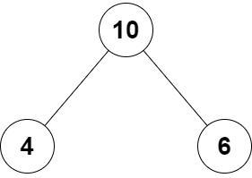

# 2236. 判断根结点是否等于子结点之和

Easy · [力扣原题](https://leetcode.cn/problems/root-equals-sum-of-children/)

| 作者 | 题解 | 动画讲解 |
|---|---|---|
| 灵茶山艾府 | [📄 题解](灵茶山艾府.md) | [▶︎ 2236 判断根结点是否等于子结点之和 · 灵茶山艾府.mp4](2236%20判断根结点是否等于子结点之和%20·%20灵茶山艾府.mp4) |
| yiduobo | [📄 题解](yiduobo.md) | [▶︎ 2236 判断根结点是否等于子结点之和 · yiduobo.mp4](2236%20判断根结点是否等于子结点之和%20·%20yiduobo.mp4) |

## 题目描述

给你一个 **二叉树** 的根结点 `root`，该二叉树由恰好 `3` 个结点组成：根结点、左子结点和右子结点。

如果根结点值等于两个子结点值之和，返回 `true` ，否则返回 `false` 。

**示例 1：**



```

输入：root = [10,4,6]
输出：true
解释：根结点、左子结点和右子结点的值分别是 10 、4 和 6 。
由于 10 等于 4 + 6 ，因此返回 true 。
```

**示例 2：**


```

输入：root = [5,3,1]
输出：false
解释：根结点、左子结点和右子结点的值分别是 5 、3 和 1 。
由于 5 不等于 3 + 1 ，因此返回 false 。
```

**提示：**

- 树只包含根结点、左子结点和右子结点

- `-100 <= Node.val <= 100`

---
[↑ 返回 2200-2299](../README.md) · [总索引](../../../索引.md) · [仓库首页](../../../README.md)
