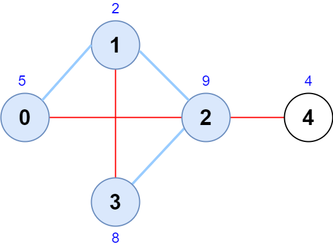
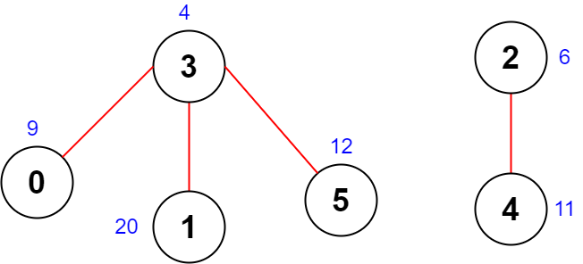

# 一步步提示如何做出此题（Python/Java/C++/Go）

> **[2242. 节点序列的最大得分](https://leetcode.cn/problems/maximum-score-of-a-node-sequence/solutions/1426715/by-endlesscheng-dt8h/) · Hard · 难度分 2304**

> **所属题单**
> - [常用数据结构 · 零、常用枚举技巧](../../../刷题路径/灵神原版题单/常用数据结构/零、常用枚举技巧.md) · §0.2 枚举中间 · §0.2.2 进阶
> - [图论算法 · 九、其他](../../../刷题路径/灵神原版题单/图论算法/九、其他.md)

> **题目描述**
> 给你一个 `n` 个节点的 **无向图** ，节点编号为 `0` 到 `n - 1` 。
>
> 给你一个下标从 **0** 开始的整数数组 `scores` ，其中 `scores[i]` 是第 `i` 个节点的分数。同时给你一个二维整数数组 `edges` ，其中 `edges[i] = [a_i, b_i]` ，表示节点 `a_i` 和 `b_i` 之间有一条 **无向** 边。
>
> 一个合法的节点序列如果满足以下条件，我们称它是 **合法的** ：
>
> - 序列中每 **相邻** 节点之间有边相连。
>
> - 序列中没有节点出现超过一次。
>
> 节点序列的分数定义为序列中节点分数之 **和** 。
>
> 请你返回一个长度为 `4` 的合法节点序列的最大分数。如果不存在这样的序列，请你返回 `-1` 。
>
> **示例 1：**
>
> 
>
> ```
>
> 输入：scores = [5,2,9,8,4], edges = [[0,1],[1,2],[2,3],[0,2],[1,3],[2,4]]
> 输出：24
> 解释：上图为输入的图，节点序列为 [0,1,2,3] 。
> 节点序列的分数为 5 + 2 + 9 + 8 = 24 。
> 观察可知，没有其他节点序列得分和超过 24 。
> 注意节点序列 [3,1,2,0] 和 [1,0,2,3] 也是合法的，且分数为 24 。
> 序列 [0,3,2,4] 不是合法的，因为没有边连接节点 0 和 3 。
> ```
>
> **示例 2：**
>
> 
>
> ```
>
> 输入：scores = [9,20,6,4,11,12], edges = [[0,3],[5,3],[2,4],[1,3]]
> 输出：-1
> 解释：上图为输入的图。
> 没有长度为 4 的合法序列，所以我们返回 -1 。
> ```
>
> **提示：**
>
> - `n == scores.length`
>
> - `4 <= n <= 5 * 10⁴`
>
> - `1 <= scores[i] <= 10⁸`
>
> - `0 <= edges.length <= 5 * 10⁴`
>
> - `edges[i].length == 2`
>
> - `0 <= a_i, b_i <= n - 1`
>
> - `a_i != b_i`
>
> - 不会有重边。

> **题解**
> #### 提示 1-1
>
> 试试枚举可不可以。（做题时优先考虑最简单的算法）
>
> #### 提示 1-2
>
> 枚举谁呢？可以枚举点，也可以枚举边。
>
> #### 提示 2-1
>
> **简化问题**可以帮助我们找到思路。
>
> 如果序列长度为 $3$，要如何枚举？
>
> #### 提示 2-2
>
> 只要 $3$ 个节点的话，我们可以枚举端点，可以枚举中间的节点，还可以枚举边。
>
> 这几种方案都试着想一想，哪一种是最方便的呢？
>
> #### 提示 2-3
>
> 枚举**中间**的点是最方便的，算出与其相邻的分数最大的两个点即可。
>
> 相比枚举端点，**枚举中间的效率也要更高**。
>
> 顺着这个思路去思考原问题。
>
> #### 提示 3-1
>
> 设序列为 $a-x-y-b$（$-$ 表示边），枚举 $\textit{edges}$ 中的每条边，作为序列**正中间**的那条边，即 $x-y$。
>
> #### 提示 3-2
>
> 我们需要把与 $x$ 相邻的点中，分数最大且不同于 $y$ 和 $b$ 的点作为 $a$；把与 $y$ 相邻的点中，分数最大且不同于 $x$ 和 $a$ 的点作为 $b$。
>
> #### 提示 3-3
>
> 与 $x$ 相邻的点中，由于只需要与 $y$ 和 $b$ 不一样，我们仅需要保留分数最大的三个点，$a$ 必定在这三个点中。
>
> #### 提示 3-4
>
> 剩下要做的，就是在枚举 $\textit{edges}$ 前，预处理出这三个点。
>
> 代码实现时，可以用排序（见 Go 和 Java）、堆（见 Python `nlargest`）、快速选择（见 C++ `nth_element`）或者手动维护求前三大。最优的时间复杂度为 $O(n+m)$。
>
> ```python
> class Solution:
>     def maximumScore(self, scores: List[int], edges: List[List[int]]) -> int:
>         g = [[] for _ in range(len(scores))]
>         for x, y in edges:
>             g[x].append((scores[y], y))
>             g[y].append((scores[x], x))
>         for i, vs in enumerate(g):
>             if len(vs) > 3: 
>                 g[i] = nlargest(3, vs)
>
>         # 下面这一段可以简写成一行，为了可读性这里就不写了
>         ans = -1
>         for x, y in edges:
>             for score_a, a in g[x]:
>                 for score_b, b in g[y]:
>                     if y != a != b != x:
>                         ans = max(ans, score_a + scores[x] + scores[y] + score_b)
>         return ans
> ```
>
>
> #### 相似题目
>
> - [Codeforces 666B. World Tour](https://codeforces.com/problemset/problem/666/B)
>
> #### 最后
>
> 欢迎关注我的B站频道：[灵茶山艾府](https://space.bilibili.com/206214)，定期更新算法讲解视频哦~
