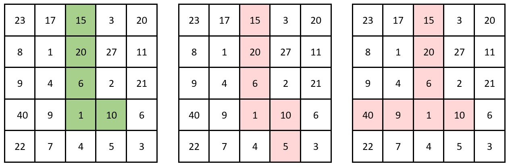

# 前缀和 + 从上往下/从下往上 + 左拐/右拐（Python/Java/C++/Go）

> **[2245. 转角路径的乘积中最多能有几个尾随零](https://leetcode.cn/problems/maximum-trailing-zeros-in-a-cornered-path/solutions/1427617/by-endlesscheng-7z5a/) · Medium · 难度分 2037**

> **所属题单**
> - [常用数据结构 · 一、前缀和](../../../刷题路径/灵神原版题单/常用数据结构/一、前缀和.md) · §1.5 进阶

> **题目描述**
> 给你一个二维整数数组 `grid` ，大小为 `m x n`，其中每个单元格都含一个正整数。
>
> **转角路径** 定义为：包含至多一个弯的一组相邻单元。具体而言，路径应该完全 **向水平方向** 或者 **向竖直方向** 移动过弯（如果存在弯），而不能访问之前访问过的单元格。在过弯之后，路径应当完全朝 **另一个** 方向行进：如果之前是向水平方向，那么就应该变为向竖直方向；反之亦然。当然，同样不能访问之前已经访问过的单元格。
>
> 一条路径的 **乘积** 定义为：路径上所有值的乘积。
>
> 请你从 `grid` 中找出一条乘积中尾随零数目最多的转角路径，并返回该路径中尾随零的数目。
>
> 注意：
>
> - **水平** 移动是指向左或右移动。
>
> - **竖直** 移动是指向上或下移动。
>
> **示例 1：**
>
> 
>
> ```
>
> 输入：grid = [[23,17,15,3,20],[8,1,20,27,11],[9,4,6,2,21],[40,9,1,10,6],[22,7,4,5,3]]
> 输出：3
> 解释：左侧的图展示了一条有效的转角路径。
> 其乘积为 15 * 20 * 6 * 1 * 10 = 18000 ，共计 3 个尾随零。
> 可以证明在这条转角路径的乘积中尾随零数目最多。
>
> 中间的图不是一条有效的转角路径，因为它有不止一个弯。
> 右侧的图也不是一条有效的转角路径，因为它需要重复访问已经访问过的单元格。
> ```
>
> **示例 2：**
>
> 
>
> ```
>
> 输入：grid = [[4,3,2],[7,6,1],[8,8,8]]
> 输出：0
> 解释：网格如上图所示。
> 不存在乘积含尾随零的转角路径。
> ```
>
> **提示：**
>
> - `m == grid.length`
>
> - `n == grid[i].length`
>
> - `1 <= m, n <= 10⁵`
>
> - `1 <= m * n <= 10⁵`
>
> - `1 <= grid[i][j] <= 1000`

> **题解**
> 尾零的个数就是路径上的数的因子 $2$ 的个数和，与因子 $5$ 的个数之和的较小值。
>  
> 那么数越多越好，路径的起点和终点都应该在边界上。
>
> 预处理每一行的因子的前缀和，然后枚举所有的路径：
>
> - 从上往下走，枚举左拐/右拐；
> - 从下往上走，枚举左拐/右拐。
>
> 所有路径上的 $\min(s_2,s_5)$ 的最大值即为答案，这里 $s_2$ 为路径上的因子 $2$ 的个数之和，$s_5$ 为路径上的因子 $5$ 的个数之和。
>
> ```python
> c2, c5 = [0] * 1001, [0] * 1001
> for i in range(2, 1001):  # 预处理：递推算出每个数的因子 2 的个数和因子 5 的个数
>     if i % 2 == 0: c2[i] = c2[i // 2] + 1
>     if i % 5 == 0: c5[i] = c5[i // 5] + 1
>
> class Solution:
>     def maxTrailingZeros(self, grid: List[List[int]]) -> int:
>         m, n = len(grid), len(grid[0])
>         s = [[None] * (n + 1) for _ in range(m)]
>         for i, row in enumerate(grid):
>             s[i][0] = (0, 0)
>             for j, v in enumerate(row):  # 计算 grid 每行因子 2 和 5 的前缀和
>                 s[i][j + 1] = (s[i][j][0] + c2[v], s[i][j][1] + c5[v])
>
>         ans = 0
>         for j, col in enumerate(zip(*grid)):
>             s2 = s5 = 0
>             for i, v in enumerate(col):  # 从上往下，枚举左拐还是右拐
>                 s2 += c2[v]
>                 s5 += c5[v]
>                 ans = max(ans, min(s2 + s[i][j][0], s5 + s[i][j][1]),
>                                min(s2 + s[i][n][0] - s[i][j + 1][0], s5 + s[i][n][1] - s[i][j + 1][1]))
>             s2 = s5 = 0
>             for i in range(m - 1, -1, -1):  # 从下往上，枚举左拐还是右拐
>                 s2 += c2[col[i]]
>                 s5 += c5[col[i]]
>                 ans = max(ans, min(s2 + s[i][j][0], s5 + s[i][j][1]),
>                                min(s2 + s[i][n][0] - s[i][j + 1][0], s5 + s[i][n][1] - s[i][j + 1][1]))
>         return ans
> ```
