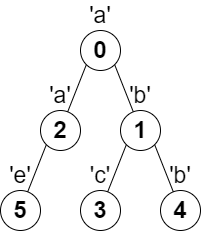

# 2246. 相邻字符不同的最长路径

Hard · 难度分 2126 · [力扣原题](https://leetcode.cn/problems/longest-path-with-different-adjacent-characters/)

所在刷题路径：灵神题单·动态规划、灵神题单·链表树与回溯

| 作者 | 题解 | 动画讲解 |
|---|---|---|
| 灵茶山艾府 | [📄 题解](灵茶山艾府.md) | [▶︎ 动画（GIF）](2246%20相邻字符不同的最长路径%20·%20灵茶山艾府.gif) · [mp4 文件](2246%20相邻字符不同的最长路径%20·%20灵茶山艾府.mp4) |
| yiduobo | [📄 题解](yiduobo.md) | [▶︎ 动画（GIF）](2246%20相邻字符不同的最长路径%20·%20yiduobo.gif) · [mp4 文件](2246%20相邻字符不同的最长路径%20·%20yiduobo.mp4) |

## 动画讲解

> 动图会循环播放；想暂停、拖进度条请下载上面表格里的 mp4 文件。

### 灵茶山艾府


### yiduobo


## 题目描述

给你一棵 **树**（即一个连通、无向、无环图），根节点是节点 `0` ，这棵树由编号从 `0` 到 `n - 1` 的 `n` 个节点组成。用下标从 **0** 开始、长度为 `n` 的数组 `parent` 来表示这棵树，其中 `parent[i]` 是节点 `i` 的父节点，由于节点 `0` 是根节点，所以 `parent[0] == -1` 。

另给你一个字符串 `s` ，长度也是 `n` ，其中 `s[i]` 表示分配给节点 `i` 的字符。

请你找出路径上任意一对相邻节点都没有分配到相同字符的 **最长路径** ，并返回该路径的长度。

**示例 1：**



```

输入：parent = [-1,0,0,1,1,2], s = "abacbe"
输出：3
解释：任意一对相邻节点字符都不同的最长路径是：0 -> 1 -> 3 。该路径的长度是 3 ，所以返回 3 。
可以证明不存在满足上述条件且比 3 更长的路径。
```

**示例 2：**


```

输入：parent = [-1,0,0,0], s = "aabc"
输出：3
解释：任意一对相邻节点字符都不同的最长路径是：2 -> 0 -> 3 。该路径的长度为 3 ，所以返回 3 。
```

**提示：**

- `n == parent.length == s.length`

- `1 <= n <= 10⁵`

- 对所有 `i >= 1` ，`0 <= parent[i] <= n - 1` 均成立

- `parent[0] == -1`

- `parent` 表示一棵有效的树

- `s` 仅由小写英文字母组成

---
[↑ 返回 2200-2299](../README.md) · [总索引](../../../索引.md) · [仓库首页](../../../README.md)
