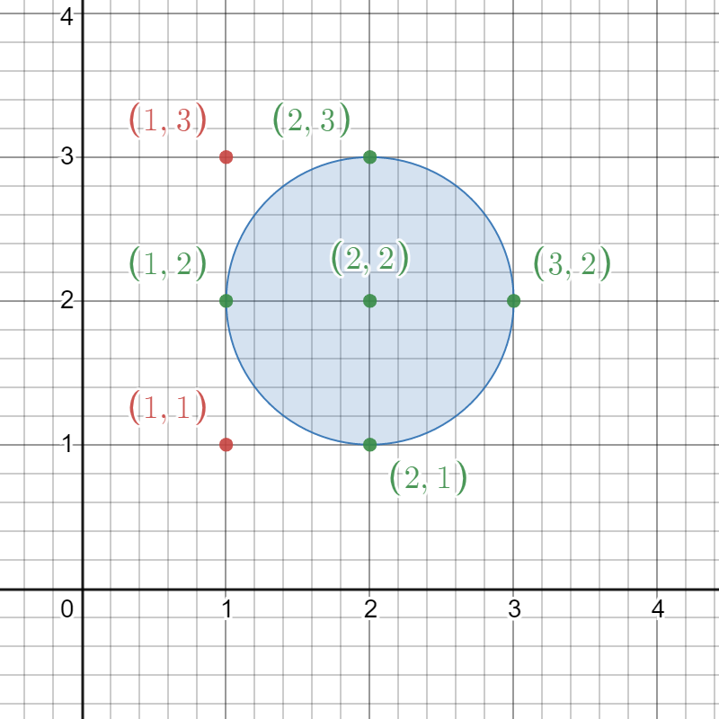
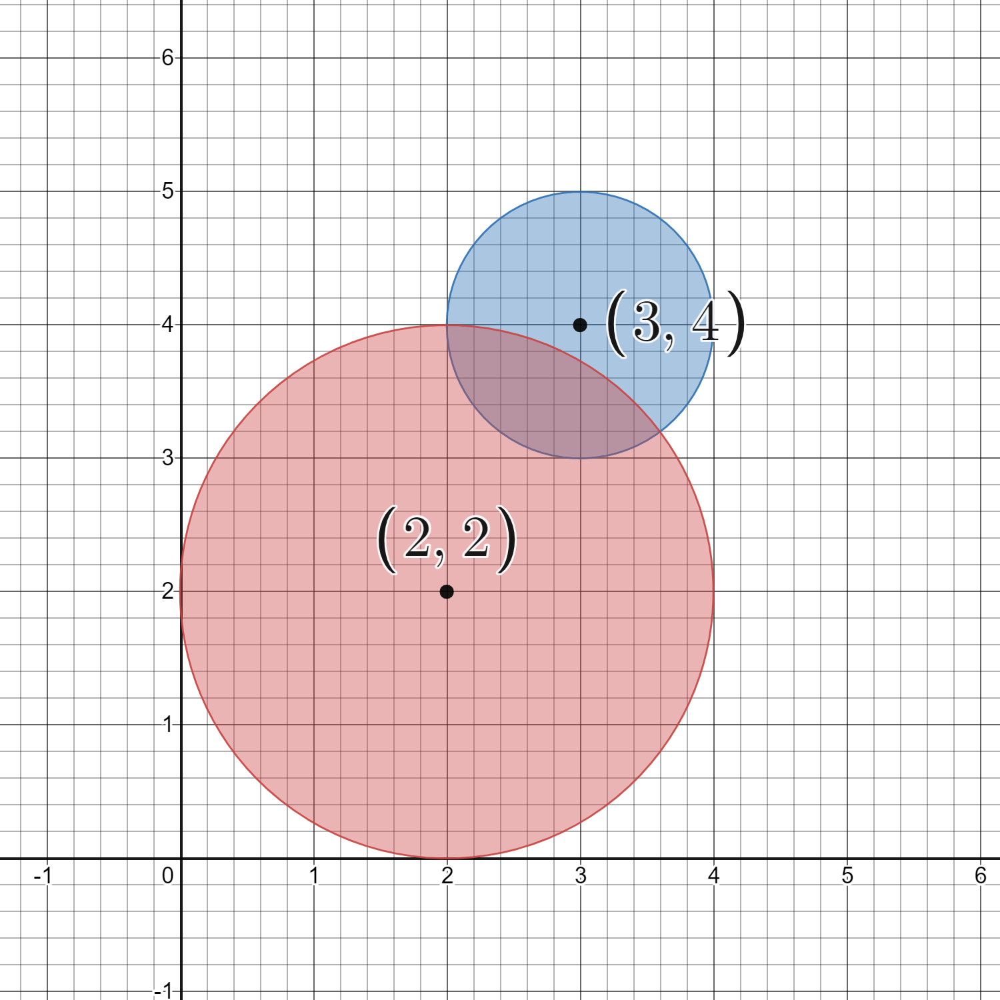

# 2249. 统计圆内格点数目

Medium · [力扣原题](https://leetcode.cn/problems/count-lattice-points-inside-a-circle/)

| 作者 | 题解 | 动画讲解 |
|---|---|---|
| 灵茶山艾府 | [📄 题解](灵茶山艾府.md) | [▶︎ 2249 统计圆内格点数目 · 灵茶山艾府.mp4](2249%20统计圆内格点数目%20·%20灵茶山艾府.mp4) |
| yiduobo | [📄 题解](yiduobo.md) | [▶︎ 2249 统计圆内格点数目 · yiduobo.mp4](2249%20统计圆内格点数目%20·%20yiduobo.mp4) |

## 题目描述

给你一个二维整数数组 `circles` ，其中 `circles[i] = [x_i, y_i, r_i]` 表示网格上圆心为 `(x_i, y_i)` 且半径为 `r_i` 的第 `i` 个圆，返回出现在 **至少一个** 圆内的 **格点数目** 。

**注意：**

- **格点** 是指整数坐标对应的点。

- **圆周上的点** 也被视为出现在圆内的点。

**示例 1：**



```

输入：circles = [[2,2,1]]
输出：5
解释：
给定的圆如上图所示。
出现在圆内的格点为 (1, 2)、(2, 1)、(2, 2)、(2, 3) 和 (3, 2)，在图中用绿色标识。
像 (1, 1) 和 (1, 3) 这样用红色标识的点，并未出现在圆内。
因此，出现在至少一个圆内的格点数目是 5 。
```

**示例 2：**



```

输入：circles = [[2,2,2],[3,4,1]]
输出：16
解释：
给定的圆如上图所示。
共有 16 个格点出现在至少一个圆内。
其中部分点的坐标是 (0, 2)、(2, 0)、(2, 4)、(3, 2) 和 (4, 4) 。
```

**提示：**

- `1 <= circles.length <= 200`

- `circles[i].length == 3`

- `1 <= x_i, y_i <= 100`

- `1 <= r_i <= min(x_i, y_i)`

---
[↑ 返回 2200-2299](../README.md) · [总索引](../../../索引.md) · [仓库首页](../../../README.md)
