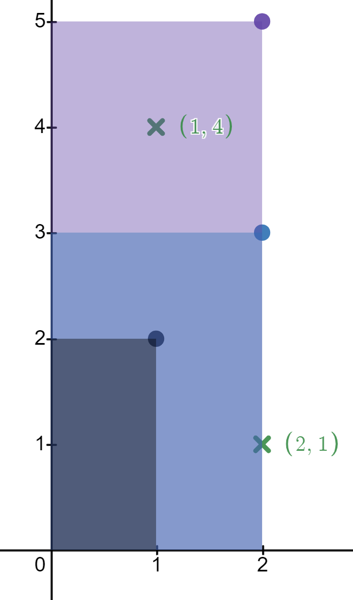
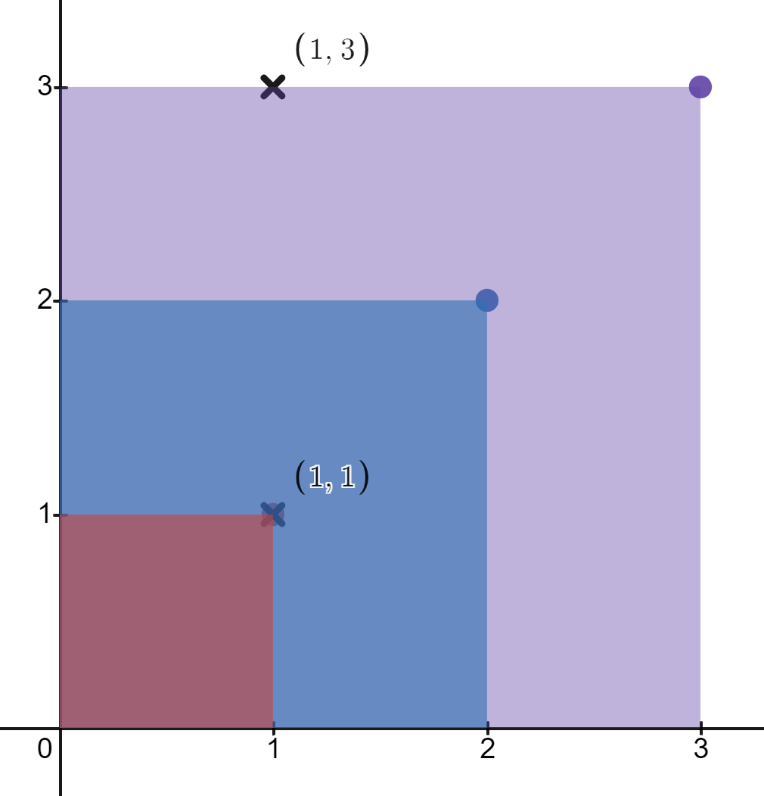

# 排序 + 排序 + 排序（Python/Java/C++/Go）

> **[2250. 统计包含每个点的矩形数目](https://leetcode.cn/problems/count-number-of-rectangles-containing-each-point/solutions/1445027/pai-xu-pai-xu-pai-xu-pythonjavacgo-by-en-ou4k/) · Medium**

> **所属题单**
> - [常用数据结构 · 八、树状数组和线段树](../../../刷题路径/灵神原版题单/常用数据结构/八、树状数组和线段树.md) · §8.1 树状数组

> **题目描述**
> 给你一个二维整数数组 `rectangles` ，其中 `rectangles[i] = [l_i, h_i]` 表示第 `i` 个矩形长为 `l_i` 高为 `h_i` 。给你一个二维整数数组 `points` ，其中 `points[j] = [x_j, y_j]` 是坐标为 `(x_j, y_j)` 的一个点。
>
> 第 `i` 个矩形的 **左下角** 在 `(0, 0)` 处，**右上角** 在 `(l_i, h_i)` 。
>
> 请你返回一个整数数组 `count` ，长度为 `points.length`，其中 `count[j]`是 **包含** 第 `j` 个点的矩形数目。
>
> 如果 `0 <= x_j <= l_i` 且 `0 <= y_j <= h_i` ，那么我们说第 `i` 个矩形包含第 `j` 个点。如果一个点刚好在矩形的 **边上** ，这个点也被视为被矩形包含。
>
> **示例 1：**
>
> 
>
> ```
> 输入：rectangles = [[1,2],[2,3],[2,5]], points = [[2,1],[1,4]]
> 输出：[2,1]
> 解释：
> 第一个矩形不包含任何点。
> 第二个矩形只包含一个点 (2, 1) 。
> 第三个矩形包含点 (2, 1) 和 (1, 4) 。
> 包含点 (2, 1) 的矩形数目为 2 。
> 包含点 (1, 4) 的矩形数目为 1 。
> 所以，我们返回 [2, 1] 。
> ```
>
> **示例 2：**
>
> 
>
> ```
> 输入：rectangles = [[1,1],[2,2],[3,3]], points = [[1,3],[1,1]]
> 输出：[1,3]
> 解释：
> 第一个矩形只包含点 (1, 1) 。
> 第二个矩形只包含点 (1, 1) 。
> 第三个矩形包含点 (1, 3) 和 (1, 1) 。
> 包含点 (1, 3) 的矩形数目为 1 。
> 包含点 (1, 1) 的矩形数目为 3 。
> 所以，我们返回 [1, 3] 。
> ```
>
> **提示：**
>
> - `1 <= rectangles.length, points.length <= 5 * 10⁴`
>
> - `rectangles[i].length == points[j].length == 2`
>
> - `1 <= l_i, x_j <= 10⁹`
>
> - `1 <= h_i, y_j <= 100`
>
> - 所有 `rectangles` **互不相同** 。
>
> - 所有 `points` **互不相同** 。

> **题解**
> ### 方法一：按纵坐标排序
>
> 基本思路就是对每个点 $(x_i,y_i)$，统计横坐标不小于 $x_i$ 且纵坐标不小于 $y_i$ 的矩形个数。
>
> 为了加快统计速度，我们可以将 $\textit{rectangles}$ 和 $\textit{points}$ 都按照纵坐标从大到小排序。
>
> 然后遍历每个点 $(x_i,y_i)$，将所有纵坐标不小于 $y_i$ 的矩形的横坐标加入一个有序列表 $\textit{xs}$。
>
> **由于纵坐标的范围只有 $[1,100]$，我们可以暴力地在每次插入完横坐标后对 $\textit{xs}$ 排序，排序的次数不会超过 $100$ 次。**
>
> 然后在 $\textit{xs}$ 中二分即可算出横坐标不小于 $x_i$ 的矩形个数，由于我们是按纵坐标从大到小遍历的，因此这些矩形的纵坐标均不小于 $y_i$，因此这些矩形均包含点 $(x_i,y_i)$。
>
> - 时间复杂度：$O(Hn\log n + m\log m + m\log n)$，其中 $H=\max(h_i)$，$n$ 为 $\textit{rectangles}$ 的长度，$m$ 为 $\textit{points}$ 的长度。
> - 空间复杂度：$O(n+m)$。
>
> ```python
> class Solution:
>     def countRectangles(self, rectangles: List[List[int]], points: List[List[int]]) -> List[int]:
>         rectangles.sort(key=lambda r: -r[1])
>         n = len(points)
>         ans = [0] * n
>         i, xs = 0, []
>         for (x, y), id in sorted(zip(points, range(n)), key=lambda x: -x[0][1]):
>             start = i
>             while i < len(rectangles) and rectangles[i][1] >= y:
>                 xs.append(rectangles[i][0])
>                 i += 1
>             if start < i:
>                 xs.sort()  # 只有在 xs 插入了新元素时才排序
>             ans[id] = i - bisect_left(xs, x)
>         return ans
> ```
>
>
> 注：如果这题纵坐标的范围也是 $10^9$，我们还可以用名次树来做出此题（如 Python 的 `SortedList`）。
>
> - 时间复杂度：$O(n\log n + m\log m+m\log n)$。这种做法就与 $H$ 无关了。
> - 空间复杂度：$O(n+m)$。
>
> ```python
> from sortedcontainers import SortedList
>
> class Solution:
>     def countRectangles(self, rectangles: List[List[int]], points: List[List[int]]) -> List[int]:
>         rectangles.sort(key=lambda r: -r[1])
>         n = len(points)
>         ans = [0] * n
>         i, xs = 0, SortedList()
>         for (x, y), id in sorted(zip(points, range(n)), key=lambda x: -x[0][1]):
>             while i < len(rectangles) and rectangles[i][1] >= y:
>                 xs.add(rectangles[i][0])
>                 i += 1
>             ans[id] = i - xs.bisect_left(x)
>         return ans
> ```
>
> ### 方法二：按横坐标排序
>
> 我们也可以按横坐标从大到小排序，对于点 $(x_i,y_i)$，统计横坐标不小于 $x_i$ 的矩形个数，由于高度不超过 $100$，可以用一个数组来存储每个高度有多少个矩形。
>
> 那么只要累加高度不小于 $y_i$ 的矩形个数即可。
>
> 实现时可以暴力累加，也可以用树状数组，由于这里高度很小，代码直接用的暴力累加的写法。
>
> - 时间复杂度：$O(Hm + n\log n + m\log m)$。
> - 空间复杂度：$O(H+m)$。
>
> ```python
> class Solution:
>     def countRectangles(self, rectangles: List[List[int]], points: List[List[int]]) -> List[int]:
>         rectangles.sort(key=lambda r: -r[0])
>         n = len(points)
>         ans = [0] * n
>         cnt = [0] * (max(y for _, y in rectangles) + 1)
>         i = 0
>         for (x, y), id in sorted(zip(points, range(n)), key=lambda x: -x[0][0]):
>             while i < len(rectangles) and rectangles[i][0] >= x:
>                 cnt[rectangles[i][1]] += 1
>                 i += 1
>             ans[id] = sum(cnt[y:])
>         return ans
> ```
>
>
> ### 方法三：按行统计 + 二分查找
>
> 纵坐标至多有 $100$ 种，看成是 $100$ 行数据。我们可以统计这 $100$ 行的矩阵的横坐标坐标，这样对于每个点 $(x_i,y_i)$，从第 $y_i$ 行遍历到第 $100$ 行，对于每一行，二分求出有多少个矩阵的横坐标不小于 $x_i$。累加即为答案。
>
> - 时间复杂度：$O((n+Hm)\log n)$。
> - 空间复杂度：$O(n+H)$。不计返回值的空间。
>
> ```python
> class Solution:
>     def countRectangles(self, rectangles: List[List[int]], points: List[List[int]]) -> List[int]:
>         max_y = max(y for _, y in rectangles)
>         xs = [[] for _ in range(max_y + 1)]
>         for x, y in rectangles:
>             xs[y].append(x)
>         for x in xs:
>             x.sort()
>         return [sum(len(x) - bisect_left(x, px) for x in xs[py:]) for px, py in points]
> ```
