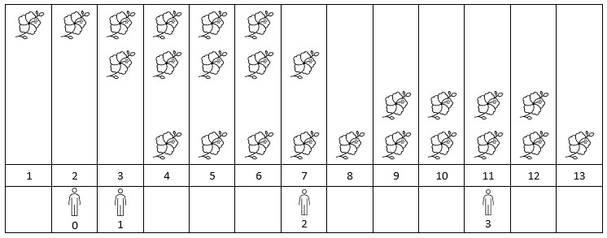
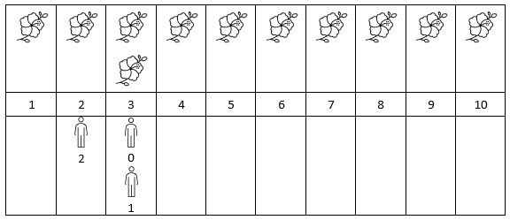

# 2251. 花期内花的数目

Hard · 难度分 2022 · [力扣原题](https://leetcode.cn/problems/number-of-flowers-in-full-bloom/)

所在刷题路径：灵神题单·常用数据结构

| 作者 | 题解 | 动画讲解 |
|---|---|---|
| 灵茶山艾府 | [📄 题解](灵茶山艾府.md) | [▶︎ 动画（GIF）](2251%20花期内花的数目%20·%20灵茶山艾府.gif) · [mp4 文件](2251%20花期内花的数目%20·%20灵茶山艾府.mp4) |
| yiduobo | [📄 题解](yiduobo.md) | [▶︎ 动画（GIF）](2251%20花期内花的数目%20·%20yiduobo.gif) · [mp4 文件](2251%20花期内花的数目%20·%20yiduobo.mp4) |

## 动画讲解

> 动图会循环播放；想暂停、拖进度条请下载上面表格里的 mp4 文件。

### 灵茶山艾府


### yiduobo


## 题目描述

给你一个下标从 **0** 开始的二维整数数组 `flowers` ，其中 `flowers[i] = [start_i, end_i]` 表示第 `i` 朵花的 **花期** 从 `start_i` 到 `end_i` （都 **包含**）。同时给你一个下标从 **0** 开始大小为 `n` 的整数数组 `people` ，`people[i]` 是第 `i` 个人来看花的时间。

请你返回一个大小为 `n` 的整数数组 `answer` ，其中 `answer[i]`是第 `i` 个人到达时在花期内花的 **数目** 。

**示例 1：**



```

输入：flowers = [[1,6],[3,7],[9,12],[4,13]], people = [2,3,7,11]
输出：[1,2,2,2]
解释：上图展示了每朵花的花期时间，和每个人的到达时间。
对每个人，我们返回他们到达时在花期内花的数目。
```

**示例 2：**



```

输入：flowers = [[1,10],[3,3]], people = [3,3,2]
输出：[2,2,1]
解释：上图展示了每朵花的花期时间，和每个人的到达时间。
对每个人，我们返回他们到达时在花期内花的数目。
```

**提示：**

- `1 <= flowers.length <= 5 * 10⁴`

- `flowers[i].length == 2`

- `1 <= start_i <= end_i <= 10⁹`

- `1 <= people.length <= 5 * 10⁴`

- `1 <= people[i] <= 10⁹`

---
[↑ 返回 2200-2299](../README.md) · [总索引](../../../索引.md) · [仓库首页](../../../README.md)
