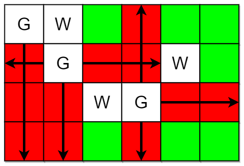
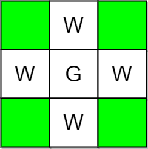

# 遍历警卫及其视线（Python/Java/C++/C/Go/JS/Rust）

> **[2257. 统计网格图中没有被保卫的格子数](https://leetcode.cn/problems/count-unguarded-cells-in-the-grid/solutions/1460907/mo-ni-by-endlesscheng-voye/) · Medium**

> **题目描述**
> 给你两个整数 `m` 和 `n` 表示一个下标从 **0** 开始的 `m x n` 网格图。同时给你两个二维整数数组 `guards` 和 `walls` ，其中 `guards[i] = [row_i, col_i]` 且 `walls[j] = [row_j, col_j]` ，分别表示第 `i` 个警卫和第 `j` 座墙所在的位置。
>
> 一个警卫能看到 4 个坐标轴方向（即东、南、西、北）的 **所有** 格子，除非他们被一座墙或者另外一个警卫 **挡住** 了视线。如果一个格子能被 **至少** 一个警卫看到，那么我们说这个格子被 **保卫** 了。
>
> 请你返回空格子中，有多少个格子是 **没被保卫** 的。
>
> **示例 1：**
>
> 
>
> ```
> 输入：m = 4, n = 6, guards = [[0,0],[1,1],[2,3]], walls = [[0,1],[2,2],[1,4]]
> 输出：7
> 解释：上图中，被保卫和没有被保卫的格子分别用红色和绿色表示。
> 总共有 7 个没有被保卫的格子，所以我们返回 7 。
> ```
>
> **示例 2：**
>
> 
>
> ```
> 输入：m = 3, n = 3, guards = [[1,1]], walls = [[0,1],[1,0],[2,1],[1,2]]
> 输出：4
> 解释：上图中，没有被保卫的格子用绿色表示。
> 总共有 4 个没有被保卫的格子，所以我们返回 4 。
> ```
>
> **提示：**
>
> - `1 <= m, n <= 10⁵`
>
> - `2 <= m * n <= 10⁵`
>
> - `1 <= guards.length, walls.length <= 5 * 10⁴`
>
> - `2 <= guards.length + walls.length <= m * n`
>
> - `guards[i].length == walls[j].length == 2`
>
> - `0 <= row_i, row_j < m`
>
> - `0 <= col_i, col_j < n`
>
> - `guards` 和 `walls` 中所有位置 **互不相同** 。

> **题解**
> 暴力的想法是，依次检查每个空格子是否被保卫，即检查这个空格子上下左右方向上是否有警卫，且中间没有墙。但这样做的时间复杂度是 $\mathcal{O}(mn(m+n))$。
>
> 反过来，遍历警卫及其四个方向的视线，视线所及之处的空格子，标记为被保卫。用一个二维数组 $\textit{guarded}$ 记录被保卫的格子。
>
> 最后遍历 $\textit{guarded}$，统计没被保卫的格子个数。
>
> **技巧**：如果 $(x,y)$ 处是警卫或者墙，那么标记 $\textit{guarded}[x][y]=-1$。当我们遍历到 $\textit{guarded}[x][y]=-1$ 时，就不再继续遍历。
>
> ```python
> # 左右上下
> DIRS = (0, -1), (0, 1), (-1, 0), (1, 0)
>
> class Solution:
>     def countUnguarded(self, m: int, n: int, guards: List[List[int]], walls: List[List[int]]) -> int:
>         guarded = [[0] * n for _ in range(m)]
>
>         # 标记警卫格子、墙格子
>         for x, y in guards:
>             guarded[x][y] = -1
>         for x, y in walls:
>             guarded[x][y] = -1
>
>         # 遍历警卫
>         for x0, y0 in guards:
>             # 遍历视线方向（左右上下）
>             for dx, dy in DIRS:
>                 # 视线所及之处，被保卫
>                 x, y = x0 + dx, y0 + dy
>                 while 0 <= x < m and 0 <= y < n and guarded[x][y] != -1:
>                     guarded[x][y] = 1  # 被保卫
>                     x += dx
>                     y += dy
>
>         # 统计没被保卫（值为 0）的格子数
>         return sum(row.count(0) for row in guarded)
> ```
>
>
> #### 复杂度分析
>
> - 时间复杂度：$\mathcal{O}(mn)$。每个格子至多被标记 $4$ 次。
> - 空间复杂度：$\mathcal{O}(mn)$。
>
> ## 相似题目
>
> - [1222. 可以攻击国王的皇后](https://leetcode.cn/problems/queens-that-can-attack-the-king/)
>
> ## 分类题单
>
> [如何科学刷题？](https://leetcode.cn/circle/discuss/RvFUtj/)
>
> 1. [滑动窗口与双指针（定长/不定长/单序列/双序列/三指针/分组循环）](https://leetcode.cn/circle/discuss/0viNMK/)
> 2. [二分算法（二分答案/最小化最大值/最大化最小值/第K小）](https://leetcode.cn/circle/discuss/SqopEo/)
> 3. [单调栈（基础/矩形面积/贡献法/最小字典序）](https://leetcode.cn/circle/discuss/9oZFK9/)
> 4. [网格图（DFS/BFS/综合应用）](https://leetcode.cn/circle/discuss/YiXPXW/)
> 5. [位运算（基础/性质/拆位/试填/恒等式/思维）](https://leetcode.cn/circle/discuss/dHn9Vk/)
> 6. [图论算法（DFS/BFS/拓扑排序/基环树/最短路/最小生成树/网络流）](https://leetcode.cn/circle/discuss/01LUak/)
> 7. [动态规划（入门/背包/划分/状态机/区间/状压/数位/数据结构优化/树形/博弈/概率期望）](https://leetcode.cn/circle/discuss/tXLS3i/)
> 8. [常用数据结构（前缀和/差分/栈/队列/堆/字典树/并查集/树状数组/线段树）](https://leetcode.cn/circle/discuss/mOr1u6/)
> 9. [数学算法（数论/组合/概率期望/博弈/计算几何/随机算法）](https://leetcode.cn/circle/discuss/IYT3ss/)
> 10. [贪心与思维（基本贪心策略/反悔/区间/字典序/数学/思维/脑筋急转弯/构造）](https://leetcode.cn/circle/discuss/g6KTKL/)
> 11. [链表、二叉树与回溯（前后指针/快慢指针/DFS/BFS/直径/LCA/一般树）](https://leetcode.cn/circle/discuss/K0n2gO/)
> 12. [字符串（KMP/Z函数/Manacher/字符串哈希/AC自动机/后缀数组/子序列自动机）](https://leetcode.cn/circle/discuss/SJFwQI/)
>
> [我的题解精选（已分类）](https://github.com/EndlessCheng/codeforces-go/blob/master/leetcode/SOLUTIONS.md)
>
> 欢迎关注 [B站@灵茶山艾府](https://space.bilibili.com/206214)
