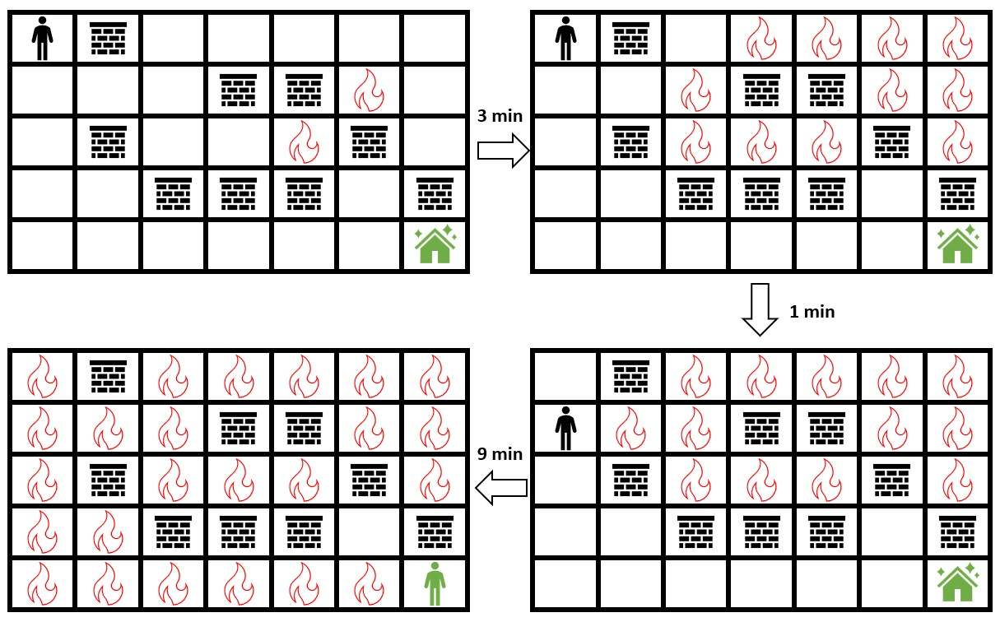
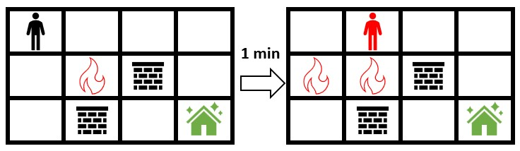
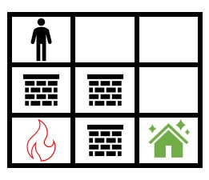
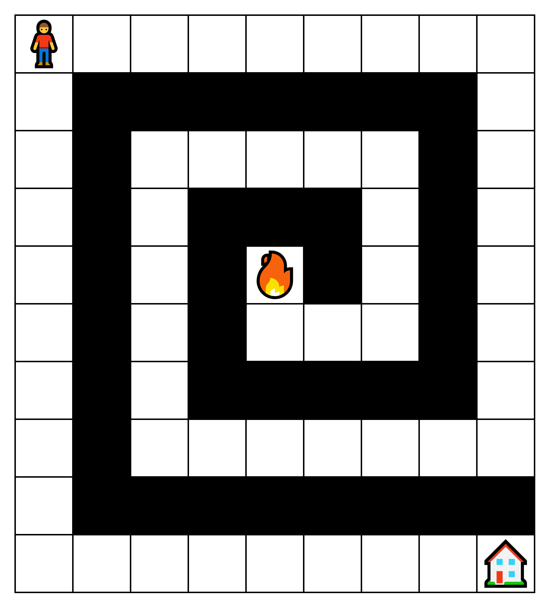
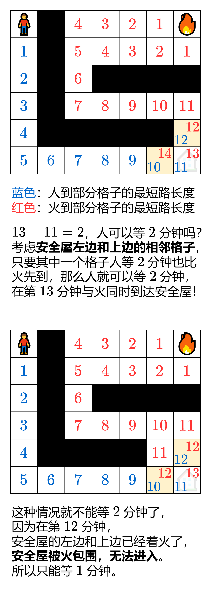

# 【图解】两种方法：二分答案 / 直接计算（Python/Java/C++/Go/JS/Rust）

> **[2258. 逃离火灾](https://leetcode.cn/problems/escape-the-spreading-fire/solutions/1460794/er-fen-bfspythonjavacgo-by-endlesscheng-ypp1/) · Hard · 难度分 2347**

> **所属题单**
> - [二分算法 · 二、二分答案](../../../刷题路径/灵神原版题单/二分算法/二、二分答案.md) · §2.2 求最大
> - [网格图 · 五、综合应用](../../../刷题路径/灵神原版题单/网格图/五、综合应用.md)

> **题目描述**
> 给你一个下标从 **0** 开始大小为 `m x n` 的二维整数数组 `grid` ，它表示一个网格图。每个格子为下面 3 个值之一：
>
> - `0` 表示草地。
>
> - `1` 表示着火的格子。
>
> - `2` 表示一座墙，你跟火都不能通过这个格子。
>
> 一开始你在最左上角的格子 `(0, 0)` ，你想要到达最右下角的安全屋格子 `(m - 1, n - 1)` 。每一分钟，你可以移动到 **相邻** 的草地格子。每次你移动 **之后** ，着火的格子会扩散到所有不是墙的 **相邻** 格子。
>
> 请你返回你在初始位置可以停留的 **最多** 分钟数，且停留完这段时间后你还能安全到达安全屋。如果无法实现，请你返回 `-1` 。如果不管你在初始位置停留多久，你 **总是** 能到达安全屋，请你返回 `10⁹` 。
>
> 注意，如果你到达安全屋后，火马上到了安全屋，这视为你能够安全到达安全屋。
>
> 如果两个格子有共同边，那么它们为 **相邻** 格子。
>
> **示例 1：**
>
> 
>
> ```
> 输入：grid = [[0,2,0,0,0,0,0],[0,0,0,2,2,1,0],[0,2,0,0,1,2,0],[0,0,2,2,2,0,2],[0,0,0,0,0,0,0]]
> 输出：3
> 解释：上图展示了你在初始位置停留 3 分钟后的情形。
> 你仍然可以安全到达安全屋。
> 停留超过 3 分钟会让你无法安全到达安全屋。
> ```
>
> **示例 2：**
>
> 
>
> ```
> 输入：grid = [[0,0,0,0],[0,1,2,0],[0,2,0,0]]
> 输出：-1
> 解释：上图展示了你马上开始朝安全屋移动的情形。
> 火会蔓延到你可以移动的所有格子，所以无法安全到达安全屋。
> 所以返回 -1 。
> ```
>
> **示例 3：**
>
> 
>
> ```
> 输入：grid = [[0,0,0],[2,2,0],[1,2,0]]
> 输出：1000000000
> 解释：上图展示了初始网格图。
> 注意，由于火被墙围了起来，所以无论如何你都能安全到达安全屋。
> 所以返回 10⁹ 。
> ```
>
> **提示：**
>
> - `m == grid.length`
>
> - `n == grid[i].length`
>
> - `2 <= m, n <= 300`
>
> - `4 <= m * n <= 2 * 10⁴`
>
> - `grid[i][j]` 是 `0` ，`1` 或者 `2` 。
>
> - `grid[0][0] == grid[m - 1][n - 1] == 0`

> **题解**
> 首先明确题意：人在到达安全屋**之前**，如果人移动到某个格子，火也移动到这个格子，那么人就被火烧到了。但是，允许人和火同时到达安全屋，这种情况不算人被火烧到。
>
> ## 方法一：二分答案
>
> #### 提示 1
>
> 如果人可以在**初始位置**停留 $t$ 分钟，那么肯定也可以停留少于 $t$ 分钟；如果人不能在初始位置停留 $t$ 分钟，那么肯定也不能停留超过 $t$ 分钟。
>
> 例如示例 1，人可以在初始位置停留 $3$ 分钟，那同样也可以在初始位置停留 $0,1,2$ 分钟；人不能在初始位置停留 $4$ 分钟，那同样也不能在初始位置停留 $5,6,7,\cdots$ 分钟。
>
> 这样我们就可以二分猜答案（最长停留时间）了。不了解二分答案的同学，可以先看这篇[【图解】一图掌握二分答案！四种写法！附题单！](../../0200-0299/0275%20H%20指数%20II/灵茶山艾府.md)
>
> #### 提示 2
>
> 二分答案前，先估计一下二分的上界。
>
> {:width=400}
>
> 如图，火可能要绕很多圈才能到达左上角，人可以在被火烧到的前一分钟出发。
>
> 所以粗略估计，就用 $mn$ 当作二分的上界。
>
> > 注：也可以 BFS 算出火到人的最短距离，但这样要多写一个 BFS 的逻辑。考虑到方法二已经做到线性了，这里方法一就写简单点了。
>
> 假设当前二分的答案为 $t$。
>
> 为了避免被火烧到，人需要用最短时间到达安全屋，BFS 非常适合做这件事情。
>
> 在人移动前，先原地等待 $t$ 分钟。每分钟，着火的格子会扩散到所有不是墙的相邻格子，这种「扩散」模型也非常适合用 BFS 实现。
>
> 然后，每分钟人先移动，火再移动。如何判断人和火到达同一个格子？如果下一分钟人的格子出队时，发现已经被火烧到了，就直接跳过。
>
> 如果人可以到达安全屋，则说明答案至少为 $t$，否则答案小于 $t$。
>
> 二分结束后，如果发现答案 $\ge mn$，说明火被堵住了（或者压根就没有火），返回 $10^9$。
>
> 代码实现时，为了方便模拟每分钟人的移动和火的扩散，不用队列实现，而是用**双数组**实现 BFS。
>
> ```python
> class Solution:
>     def maximumMinutes(self, grid: List[List[int]]) -> int:
>         m, n = len(grid), len(grid[0])
>
>         # 返回能否在初始位置停留 t 分钟，并安全到达安全屋
>         def check(t: int) -> bool:
>             f = [(i, j) for i, row in enumerate(grid) for j, x in enumerate(row) if x == 1]
>             on_fire = set(f)  # 标记着火的位置
>             def spread_fire():
>                 # 火的 BFS
>                 nonlocal f
>                 tmp = f
>                 f = []
>                 for i, j in tmp:
>                     for x, y in (i - 1, j), (i + 1, j), (i, j - 1), (i, j + 1):  # 上下左右
>                         if 0 <= x < m and 0 <= y < n and grid[x][y] == 0 and (x, y) not in on_fire:
>                             on_fire.add((x, y))  # 标记着火的位置
>                             f.append((x, y))
>             while t and f:  # 如果火无法扩散就提前退出
>                 spread_fire()  # 火扩散
>                 t -= 1
>             if (0, 0) in on_fire:
>                 return False  # 起点着火，寄
>
>             # 人的 BFS
>             q = [(0, 0)]
>             vis = set(q)
>             while q:
>                 tmp = q
>                 q = []
>                 for i, j in tmp:
>                     if (i, j) in on_fire: continue  # 人走到这个位置后，火也扩散到了这个位置
>                     for x, y in (i - 1, j), (i + 1, j), (i, j - 1), (i, j + 1):  # 上下左右
>                         if 0 <= x < m and 0 <= y < n and grid[x][y] == 0 and (x, y) not in on_fire and (x, y) not in vis:
>                             if x == m - 1 and y == n - 1:
>                                 return True  # 我们安全了…暂时。
>                             vis.add((x, y))  # 避免反复访问同一个位置
>                             q.append((x, y))
>                 spread_fire()  # 火扩散
>             return False  # 人被火烧到，或者没有可以到达安全屋的路
>
>         # 这里我用开区间二分（其它写法也可以）
>         left = -1
>         right = m * n + 1
>         while left + 1 < right:
>             mid = (left + right) // 2
>             if check(mid):
>                 left = mid
>             else:
>                 right = mid
>         return left if left < m * n else 10 ** 9
> ```
>
>
> #### 复杂度分析
>
> - 时间复杂度：$\mathcal{O}(mn\log mn)$，其中 $m$ 和 $n$ 分别为 $\textit{grid}$ 的行数和列数。二分循环 $\mathcal{O}(\log mn)$ 次，每次 `check` 的时间为 $\mathcal{O}(mn)$。
> - 空间复杂度：$\mathcal{O}(mn)$。
>
> ## 方法二：直接计算
>
> 这个方法来自如下观察：
>
> 考虑网格图中的一个格子，记作 $C$。设人在 $t_1$ 分钟到达 $C$，火在 $t_2$ 分钟到达 $C$。如果人比火先到达 $C$，即 $t_1 < t_2$，那么**不会出现中途火把人烧到的情况**。这可以用反证法证明：如果中途火把人烧到，那么火可以沿着人走的最短路到达 $C$，火到达 $C$ 的时间和人是一样的 $t_1$，但这与实际矛盾。
>
> **推论**：在 $t_1<t_2$ 时，人在初始位置停留 $t_2-t_1-1$ 分钟，也可以比火先到达 $C$，且中途不会被火烧到。
>
> **证明**：这相当于人在 $t_2-1$ 分钟到达 $C$，显然人比火先到。假设中途人被火烧到，那么火可以沿着人走的最短路到达 $C$，这说明火到达 $C$ 的时间应该是 $t_2-1$ 而不是 $t_2$，与实际矛盾。所以原命题成立，人中途不会被火烧到。
>
> 如果 $C$ 是安全屋，答案就是 $t_2-t_1-1$ 吗？
>
> #### 更加细致的分析
>
> 很不幸，题目允许人和火可以同时到达安全屋。
>
> 这就引出了最后的问题：设人在 $t_1$ 分钟到达安全屋，火在 $t_2$ 分钟到达安全屋，那么人可以在初始位置停留 $t_2-t_1$ 分钟吗？
>
> {:width=400}
>
> #### 算法
>
> 首先通过 BFS 求出人到每个格子的最短时间 $\textit{manTime}$，以及火到每个格子的最短时间 $\textit{fireTime}$。
>
> 分类讨论：
>
> - 如果 $\textit{manTime}[m-1][n-1]<0$，说明人无法到达安全屋，返回 $-1$。
> - 否则，如果 $\textit{fireTime}[m-1][n-1]<0$，说明火无法到达安全屋。由于此时人和安全屋是连通的，但火和安全屋不是连通的，说明人和火是隔开的，人可以无限等待下去，返回 $10^9$。
> - 否则，记 $\textit{d}=\textit{fireTime}[m-1][n-1]-\textit{manTime}[m-1][n-1]$：
> - 如果 $\textit{d} < 0$，说明火比人先到安全屋，返回 $-1$。
> - 如果 $\textit{d} \ge 0$，判断人能否在停留 $d$ 分钟后，先比火到达安全屋左边**或**上边相邻格子。如果可以，返回 $d$，对应上图第一种情况；否则返回 $d-1$，对应上图第二种情况。
>
> ```python
> class Solution:
>     def maximumMinutes(self, grid: List[List[int]]) -> int:
>         m, n = len(grid), len(grid[0])
>
>         # 返回三个数，分别表示到达安全屋/安全屋左边/安全屋上边的最短时间
>         def bfs(q: List[Tuple[int, int]]) -> (int, int, int):
>             time = [[-1] * n for _ in range(m)]  # -1 表示未访问
>             for i, j in q:
>                 time[i][j] = 0
>             t = 1
>             while q:  # 每次循环向外扩展一圈
>                 tmp = q
>                 q = []
>                 for i, j in tmp:
>                     for x, y in (i - 1, j), (i + 1, j), (i, j - 1), (i, j + 1):  # 上下左右
>                         if 0 <= x < m and 0 <= y < n and grid[x][y] == 0 and time[x][y] < 0:
>                             time[x][y] = t
>                             q.append((x, y))
>                 t += 1
>             return time[-1][-1], time[-1][-2], time[-2][-1]
>
>         man_to_house_time, m1, m2 = bfs([(0, 0)])
>         if man_to_house_time < 0:  # 人无法到安全屋
>             return -1
>
>         fire_pos = [(i, j) for i, row in enumerate(grid) for j, x in enumerate(row) if x == 1]
>         fire_to_house_time, f1, f2 = bfs(fire_pos)
>         if fire_to_house_time < 0:  # 火无法到安全屋
>             return 10 ** 9
>
>         d = fire_to_house_time - man_to_house_time
>         if d < 0:  # 火比人先到安全屋
>             return -1
>
>         if m1 != -1 and m1 + d < f1 or \
>            m2 != -1 and m2 + d < f2:  # 安全屋左边或上边的其中一个格子人比火先到
>             return d  # 图中第一种情况
>         return d - 1  # 图中第二种情况
> ```
>
>
> #### 复杂度分析
>
> - 时间复杂度：$\mathcal{O}(mn)$，其中 $m$ 和 $n$ 分别为 $\textit{grid}$ 的行数和列数。
> - 空间复杂度：$\mathcal{O}(mn)$。
>
> ## 分类题单
>
> [如何科学刷题？](https://leetcode.cn/circle/discuss/RvFUtj/)
>
> 1. [滑动窗口与双指针（定长/不定长/单序列/双序列/三指针/分组循环）](https://leetcode.cn/circle/discuss/0viNMK/)
> 2. [二分算法（二分答案/最小化最大值/最大化最小值/第K小）](https://leetcode.cn/circle/discuss/SqopEo/)
> 3. [单调栈（基础/矩形面积/贡献法/最小字典序）](https://leetcode.cn/circle/discuss/9oZFK9/)
> 4. [网格图（DFS/BFS/综合应用）](https://leetcode.cn/circle/discuss/YiXPXW/)
> 5. [位运算（基础/性质/拆位/试填/恒等式/思维）](https://leetcode.cn/circle/discuss/dHn9Vk/)
> 6. [图论算法（DFS/BFS/拓扑排序/最短路/最小生成树/二分图/基环树/欧拉路径）](https://leetcode.cn/circle/discuss/01LUak/)
> 7. [动态规划（入门/背包/状态机/划分/区间/状压/数位/数据结构优化/树形/博弈/概率期望）](https://leetcode.cn/circle/discuss/tXLS3i/)
> 8. [常用数据结构（前缀和/差分/栈/队列/堆/字典树/并查集/树状数组/线段树）](https://leetcode.cn/circle/discuss/mOr1u6/)
> 9. [数学算法（数论/组合/概率期望/博弈/计算几何/随机算法）](https://leetcode.cn/circle/discuss/IYT3ss/)
> 10. [贪心与思维（基本贪心策略/反悔/区间/字典序/数学/思维/脑筋急转弯/构造）](https://leetcode.cn/circle/discuss/g6KTKL/)
> 11. [链表、二叉树与回溯（前后指针/快慢指针/DFS/BFS/直径/LCA/一般树）](https://leetcode.cn/circle/discuss/K0n2gO/)
> 12. [字符串（KMP/Z函数/Manacher/字符串哈希/AC自动机/后缀数组/子序列自动机）](https://leetcode.cn/circle/discuss/SJFwQI/)
>
> [我的题解精选（已分类）](https://github.com/EndlessCheng/codeforces-go/blob/master/leetcode/SOLUTIONS.md)
>
> 欢迎关注 [B站@灵茶山艾府](https://space.bilibili.com/206214)
