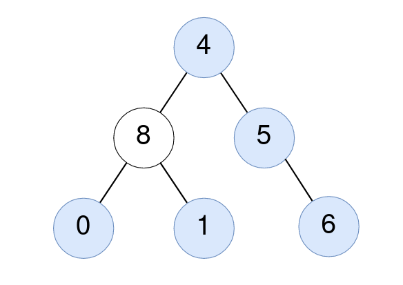

# 统计子树元素和 & 子树大小（Python/Java/C++/C/Go/JS/Rust）

> **[2265. 统计值等于子树平均值的节点数](https://leetcode.cn/problems/count-nodes-equal-to-average-of-subtree/solutions/1477315/tong-ji-zi-shu-de-jie-dian-he-ji-jie-dia-va8t/) · Medium · 难度分 1473**

> **所属题单**
> - [链表、二叉树与回溯 · 二、二叉树](../../../刷题路径/灵神原版题单/链表、二叉树与回溯/二、二叉树.md) · §2.3 自底向上 DFS（后序遍历）

> **题目描述**
> 给你一棵二叉树的根节点 `root` ，找出并返回满足要求的节点数，要求节点的值等于其 **子树** 中值的 **平均值** 。
>
> **注意：**
>
> - `n` 个元素的平均值可以由 `n` 个元素 **求和** 然后再除以 `n` ，并 **向下舍入** 到最近的整数。
>
> - `root` 的 **子树** 由 `root` 和它的所有后代组成。
>
> **示例 1：**
>
> 
>
> ```
> 输入：root = [4,8,5,0,1,null,6]
> 输出：5
> 解释：
> 对值为 4 的节点：子树的平均值 (4 + 8 + 5 + 0 + 1 + 6) / 6 = 24 / 6 = 4 。
> 对值为 5 的节点：子树的平均值 (5 + 6) / 2 = 11 / 2 = 5 。
> 对值为 0 的节点：子树的平均值 0 / 1 = 0 。
> 对值为 1 的节点：子树的平均值 1 / 1 = 1 。
> 对值为 6 的节点：子树的平均值 6 / 1 = 6 。
> ```
>
> **示例 2：**
>
> 
>
> ```
> 输入：root = [1]
> 输出：1
> 解释：对值为 1 的节点：子树的平均值 1 / 1 = 1。
> ```
>
> **提示：**
>
> - 树中节点数目在范围 `[1, 1000]` 内
>
> - `0 <= Node.val <= 1000`

> **题解**
> 本题二叉树递归入门题。不了解递归的同学请看[【基础算法精讲 09】](https://www.bilibili.com/video/BV1UD4y1Y769/)。
>
> 为了求出子树平均值，我们需要知道子树的节点值之和 $\textit{sum}$，以及子树节点个数 $\textit{size}$，那么子树平均值就是 $\left\lfloor\dfrac{\textit{sum}}{\textit{size}}\right\rfloor$。
>
> 如果当前节点 $\textit{node}$ 满足 $\textit{node}.\textit{val} = \left\lfloor\dfrac{\textit{sum}}{\textit{size}}\right\rfloor$，把答案增加一。
>
> ```python
> class Solution:
>     def averageOfSubtree(self, root: TreeNode) -> int:
>         ans = 0
>
>         # 返回 node 子树的节点值之和、节点个数
>         def dfs(node: TreeNode | None) -> tuple[int, int]:
>             if node is None:
>                 return 0, 0
>             left_sum, left_size = dfs(node.left)  # 拆解问题：递归计算左子树的信息
>             right_sum, right_size = dfs(node.right)  # 拆解问题：递归计算右子树的信息
>             sum_ = left_sum + right_sum + node.val  # node 子树的节点值之和
>             size = left_size + right_size + 1  # node 子树的节点个数
>             if node.val == sum_ // size:  # 题目要求下取整
>                 nonlocal ans
>                 ans += 1
>             return sum_, size
>
>         dfs(root)
>         return ans
> ```
>
>
> #### 复杂度分析
>
> - 时间复杂度：$\mathcal{O}(n)$，其中 $n$ 是二叉树的节点个数。
> - 空间复杂度：$\mathcal{O}(h)$。其中 $h$ 是二叉树的高度。
>
> ## 专题训练
>
> 见下面二叉树题单的「**§2.3 自底向上 DFS**」。
>
> ## 分类题单
>
> [如何科学刷题？](https://leetcode.cn/discuss/post/3141566/ru-he-ke-xue-shua-ti-by-endlesscheng-q3yd/)
>
> 1. [滑动窗口与双指针（定长/不定长/单序列/双序列/三指针/分组循环）](https://leetcode.cn/discuss/post/3578981/ti-dan-hua-dong-chuang-kou-ding-chang-bu-rzz7/)
> 2. [二分算法（二分答案/最小化最大值/最大化最小值/第K小）](https://leetcode.cn/discuss/post/3579164/ti-dan-er-fen-suan-fa-er-fen-da-an-zui-x-3rqn/)
> 3. [单调栈（基础/矩形面积/贡献法/最小字典序）](https://leetcode.cn/discuss/post/3579480/ti-dan-dan-diao-zhan-ju-xing-xi-lie-zi-d-u4hk/)
> 4. [网格图（DFS/BFS/综合应用）](https://leetcode.cn/discuss/post/3580195/fen-xiang-gun-ti-dan-wang-ge-tu-dfsbfszo-l3pa/)
> 5. [位运算（基础/性质/拆位/试填/恒等式/思维）](https://leetcode.cn/discuss/post/3580371/fen-xiang-gun-ti-dan-wei-yun-suan-ji-chu-nth4/)
> 6. [图论算法（DFS/BFS/拓扑排序/基环树/最短路/最小生成树/网络流）](https://leetcode.cn/discuss/post/3581143/fen-xiang-gun-ti-dan-tu-lun-suan-fa-dfsb-qyux/)
> 7. [动态规划（入门/背包/划分/状态机/区间/状压/数位/数据结构优化/树形/博弈/概率期望）](https://leetcode.cn/discuss/post/3581838/fen-xiang-gun-ti-dan-dong-tai-gui-hua-ru-007o/)
> 8. [常用数据结构（前缀和/差分/栈/队列/堆/字典树/并查集/树状数组/线段树）](https://leetcode.cn/discuss/post/3583665/fen-xiang-gun-ti-dan-chang-yong-shu-ju-j-bvmv/)
> 9. [数学算法（数论/组合/概率期望/博弈/计算几何/随机算法）](https://leetcode.cn/discuss/post/3584388/fen-xiang-gun-ti-dan-shu-xue-suan-fa-shu-gcai/)
> 10. [贪心与思维（基本贪心策略/反悔/区间/字典序/数学/思维/脑筋急转弯/构造）](https://leetcode.cn/discuss/post/3091107/fen-xiang-gun-ti-dan-tan-xin-ji-ben-tan-k58yb/)
> 11. [链表、树与回溯（前后指针/快慢指针/DFS/BFS/直径/LCA）](https://leetcode.cn/discuss/post/3142882/fen-xiang-gun-ti-dan-lian-biao-er-cha-sh-6srp/)
> 12. [字符串（KMP/Z函数/Manacher/字符串哈希/AC自动机/后缀数组/子序列自动机）](https://leetcode.cn/discuss/post/3144832/fen-xiang-gun-ti-dan-zi-fu-chuan-kmpzhan-ugt4/)
>
> [我的题解精选（已分类）](https://github.com/EndlessCheng/codeforces-go/blob/master/leetcode/SOLUTIONS.md)
>
> 欢迎关注 [B站@灵茶山艾府](https://space.bilibili.com/206214)
