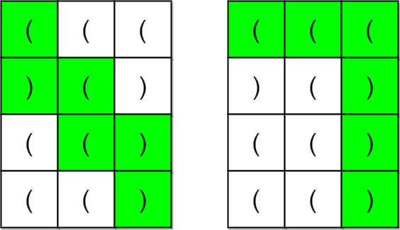
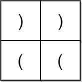

# 添加状态后 DFS + 剪枝优化（Python/Java/C++/Go）

> **[2267. 检查是否有合法括号字符串路径](https://leetcode.cn/problems/check-if-there-is-a-valid-parentheses-string-path/solutions/1477302/tian-jia-zhuang-tai-hou-dfscpythonjavago-f287/) · Hard · 难度分 2085**

> **所属题单**
> - [常用数据结构 · 三、栈](../../../刷题路径/灵神原版题单/常用数据结构/三、栈.md) · §3.4 合法括号字符串（RBS）
> - [网格图 · 五、综合应用](../../../刷题路径/灵神原版题单/网格图/五、综合应用.md)
> - [动态规划 · 二、网格图 DP](../../../刷题路径/灵神原版题单/动态规划/二、网格图%20DP.md) · §2.2 进阶
> - [动态规划 · 十一、优化 DP](../../../刷题路径/灵神原版题单/动态规划/十一、优化%20DP.md) · §11.9 其他优化 DP

> **题目描述**
> 一个括号字符串是一个 **非空** 且只包含 `'('` 和 `')'` 的字符串。如果下面 **任意** 条件为 **真** ，那么这个括号字符串就是 **合法的** 。
>
> - 字符串是 `()` 。
>
> - 字符串可以表示为 `AB`（`A` 连接 `B`），`A` 和 `B` 都是合法括号序列。
>
> - 字符串可以表示为 `(A)` ，其中 `A` 是合法括号序列。
>
> 给你一个 `m x n` 的括号网格图矩阵 `grid` 。网格图中一个 **合法括号路径** 是满足以下所有条件的一条路径：
>
> - 路径开始于左上角格子 `(0, 0)` 。
>
> - 路径结束于右下角格子 `(m - 1, n - 1)` 。
>
> - 路径每次只会向 **下** 或者向 **右** 移动。
>
> - 路径经过的格子组成的括号字符串是 **合法** 的。
>
> 如果网格图中存在一条 **合法括号路径** ，请返回 `true` ，否则返回 `false` 。
>
> **示例 1：**
>
> 
>
> ```
>
> 输入：grid = [["(","(","("],[")","(",")"],["(","(",")"],["(","(",")"]]
> 输出：true
> 解释：上图展示了两条路径，它们都是合法括号字符串路径。
> 第一条路径得到的合法字符串是 "()(())" 。
> 第二条路径得到的合法字符串是 "((()))" 。
> 注意可能有其他的合法括号字符串路径。
> ```
>
> **示例 2：**
>
> 
>
> ```
>
> 输入：grid = [[")",")"],["(","("]]
> 输出：false
> 解释：两条可行路径分别得到 "))(" 和 ")((" 。由于它们都不是合法括号字符串，我们返回 false 。
> ```
>
> **提示：**
>
> - `m == grid.length`
>
> - `n == grid[i].length`
>
> - `1 <= m, n <= 100`
>
> - `grid[i][j]` 要么是 `'('` ，要么是 `')'` 。

> **题解**
> 在从左上角到右下角的移动过程中，用一个变量 $c$ 表示尚未匹配的左括号的个数：遇到左括号就 $+1$，遇到右括号就 $-1$（匹配）。
>
> - 由于任意时刻访问过的右括号个数不能比左括号个数还多，所以任意时刻必须满足 $c\ge 0$。
> - 由于最后左右括号个数相等，所以最后必须满足 $c=0$。
>
> 写一个网格图 DFS。除了有参数 $x,y$ 以外，我们还需要知道当前的 $c$ 值。
>
> - 起点是 $(0,0,0)$，表示从左上角 $(0,0)$ 出发，初始 $c=0$。
> - 终点是 $(m-1,n-1,1)$，表示在右下角 $(m-1,n-1)$ 结束，且到达 $(m-1,n-1)$ 的时候必须满足 $c=1$（右下角必须是右括号）。
> - 根据当前格子的字符计算 $c$ 值，然后往下或往右移动，继续 DFS。
>
> 一旦找到合法路径，就可以返回 $\texttt{true}$ 了，不再 DFS。所以如果 $\textit{dfs}(x,y,c)$ 最后返回的是 $\texttt{false}$，那后续访问同一个状态（再次调用 $\textit{dfs}(x,y,c)$），仍然会得到 $\texttt{false}$。因此没必要重复访问同一个状态，可以用一个 $\textit{vis}$ 数组标记，遇到访问过的状态就直接返回 $\texttt{false}$。
>
> > **注**：从起点到终点，往下走的次数是固定的，即 $m-1$ 次，往右走的次数也是固定的，即 $n-1$ 次，因此路径长度（字符串长度）是一个定值，即 $1 + (m-1) + (n-1) = m+n-1$。极限情况下合法字符串左半均为左括号，右半均为右括号，因此 $c$ 最大为 $\dfrac{m+n-1}{2}$。
>
> **优化**：由于合法字符串的左右括号的个数必须相同，所以路径长度必须是偶数，即 $m+n-1$ 必须是偶数，$m+n$ 必须是奇数。这可以在 DFS 之前判断。
>
> ```python
> class Solution:
>     def hasValidPath(self, grid: List[List[str]]) -> bool:
>         m, n = len(grid), len(grid[0])
>         if (m + n) % 2 == 0 or grid[0][0] == ')' or grid[-1][-1] == '(':
>             return False
>
>         @cache  # 效果类似 vis 数组
>         def dfs(x: int, y: int, c: int) -> bool:
>             if c > m - x + n - y - 1:  # 剪枝：即使后面都是 ')' 也不能把 c 减为 0
>                 return False
>             if x == m - 1 and y == n - 1:  # 终点
>                 return c == 1  # 上面提前判断了，终点一定是 ')'
>
>             c += 1 if grid[x][y] == '(' else -1
>             if c < 0:  # 右括号比左括号还多
>                 return False
>             return x < m - 1 and dfs(x + 1, y, c) or \
>                    y < n - 1 and dfs(x, y + 1, c)
>
>         return dfs(0, 0, 0)  # 起点
> ```
>
>
> #### 复杂度分析
>
> - 时间复杂度：$\mathcal{O}(mn(m+n))$，其中 $m$ 和 $n$ 分别为 $\textit{grid}$ 的行数和列数。每个状态至多访问一次。
> - 空间复杂度：$\mathcal{O}(mn(m+n))$。
>
> ## 注
>
> 值得注意的是，DFS 的写法相比某些递推的写法要快 $10$ 倍以上，这是因为有很多状态是无法访问到的：比如 $(x,y,c) = (2,3,100)$ 这个状态就是不可达的，此时还没走几步，$c$ 不可能这么大。或者对于一些随机的网格图，$c$ 的值也会比较小。这种情况下 DFS 的优势就发挥出来了，DFS 可以十分自然地遍历到所有合法的状态，加上自带的剪枝效果，可以大大降低访问到的状态数。
>
> ## 专题训练
>
> 见下面数据结构题单的「**§3.4 合法括号字符串**」。
>
> ## 分类题单
>
> [如何科学刷题？](https://leetcode.cn/discuss/post/3141566/ru-he-ke-xue-shua-ti-by-endlesscheng-q3yd/)
>
> 1. [滑动窗口与双指针（定长/不定长/单序列/双序列/三指针/分组循环）](https://leetcode.cn/discuss/post/3578981/ti-dan-hua-dong-chuang-kou-ding-chang-bu-rzz7/)
> 2. [二分算法（二分答案/最小化最大值/最大化最小值/第K小）](https://leetcode.cn/discuss/post/3579164/ti-dan-er-fen-suan-fa-er-fen-da-an-zui-x-3rqn/)
> 3. [单调栈（基础/矩形面积/贡献法/最小字典序）](https://leetcode.cn/discuss/post/3579480/ti-dan-dan-diao-zhan-ju-xing-xi-lie-zi-d-u4hk/)
> 4. [网格图（DFS/BFS/综合应用）](https://leetcode.cn/discuss/post/3580195/fen-xiang-gun-ti-dan-wang-ge-tu-dfsbfszo-l3pa/)
> 5. [位运算（基础/性质/拆位/试填/恒等式/思维）](https://leetcode.cn/discuss/post/3580371/fen-xiang-gun-ti-dan-wei-yun-suan-ji-chu-nth4/)
> 6. [图论算法（DFS/BFS/拓扑排序/基环树/最短路/最小生成树/网络流）](https://leetcode.cn/discuss/post/3581143/fen-xiang-gun-ti-dan-tu-lun-suan-fa-dfsb-qyux/)
> 7. [动态规划（入门/背包/划分/状态机/区间/状压/数位/数据结构优化/树形/博弈/概率期望）](https://leetcode.cn/discuss/post/3581838/fen-xiang-gun-ti-dan-dong-tai-gui-hua-ru-007o/)
> 8. [常用数据结构（前缀和/差分/栈/队列/堆/字典树/并查集/树状数组/线段树）](https://leetcode.cn/discuss/post/3583665/fen-xiang-gun-ti-dan-chang-yong-shu-ju-j-bvmv/)
> 9. [数学算法（数论/组合/概率期望/博弈/计算几何/随机算法）](https://leetcode.cn/discuss/post/3584388/fen-xiang-gun-ti-dan-shu-xue-suan-fa-shu-gcai/)
> 10. [贪心与思维（基本贪心策略/反悔/区间/字典序/数学/思维/脑筋急转弯/构造）](https://leetcode.cn/discuss/post/3091107/fen-xiang-gun-ti-dan-tan-xin-ji-ben-tan-k58yb/)
> 11. [链表、树与回溯（前后指针/快慢指针/DFS/BFS/直径/LCA）](https://leetcode.cn/discuss/post/3142882/fen-xiang-gun-ti-dan-lian-biao-er-cha-sh-6srp/)
> 12. [字符串（KMP/Z函数/Manacher/字符串哈希/AC自动机/后缀数组/子序列自动机）](https://leetcode.cn/discuss/post/3144832/fen-xiang-gun-ti-dan-zi-fu-chuan-kmpzhan-ugt4/)
>
> [我的题解精选（已分类）](https://github.com/EndlessCheng/codeforces-go/blob/master/leetcode/SOLUTIONS.md)
>
> 欢迎关注 [B站@灵茶山艾府](https://space.bilibili.com/206214)
