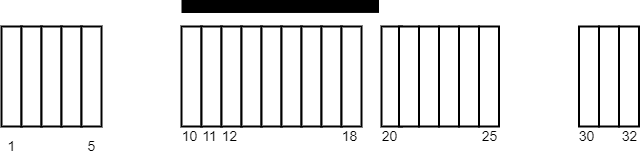

# 排序 + 滑动窗口（Python/Java/C++/Go）

> **[2271. 毯子覆盖的最多白色砖块数](https://leetcode.cn/problems/maximum-white-tiles-covered-by-a-carpet/solutions/1496434/by-endlesscheng-kdy9/) · Medium · 难度分 2022**

> **所属题单**
> - [滑动窗口与双指针 · 二、不定长滑动窗口](../../../刷题路径/灵神原版题单/滑动窗口与双指针/二、不定长滑动窗口.md) · §2.1 越短越合法/求最长/最大 · §2.1.2 进阶（选做）

> **题目描述**
> 给你一个二维整数数组 `tiles` ，其中 `tiles[i] = [l_i, r_i]` ，表示所有在 `l_i <= j <= r_i` 之间的每个瓷砖位置 `j` 都被涂成了白色。
>
> 同时给你一个整数 `carpetLen` ，表示可以放在 **任何位置** 的一块毯子的长度。
>
> 请你返回使用这块毯子，**最多** 可以盖住多少块白色瓷砖。
>
> **示例 1：**
>
> 
>
> ```
>
> 输入：tiles = [[1,5],[10,11],[12,18],[20,25],[30,32]], carpetLen = 10
> 输出：9
> 解释：将毯子从瓷砖 10 开始放置。
> 总共覆盖 9 块瓷砖，所以返回 9 。
> 注意可能有其他方案也可以覆盖 9 块瓷砖。
> 可以看出，瓷砖无法覆盖超过 9 块瓷砖。
> ```
>
> **示例 2：**
>
> 
>
> ```
>
> 输入：tiles = [[10,11],[1,1]], carpetLen = 2
> 输出：2
> 解释：将毯子从瓷砖 10 开始放置。
> 总共覆盖 2 块瓷砖，所以我们返回 2 。
> ```
>
> **提示：**
>
> - `1 <= tiles.length <= 5 * 10⁴`
>
> - `tiles[i].length == 2`
>
> - `1 <= l_i <= r_i <= 10⁹`
>
> - `1 <= carpetLen <= 10⁹`
>
> - `tiles` 互相 **不会重叠** 。

> **题解**
> 将 $\textit{tiles}$ 按左端点 $l_i$ 排序后，我们可以枚举毯子的摆放位置，然后计算毯子能覆盖多少块瓷砖。
>
> 实际上，**毯子右端点**放在一段瓷砖中间，是不如直接放在这段瓷砖右端点的（因为从中间向右移动，能覆盖的瓷砖数不会减少），所以可以枚举每段瓷砖的右端点来摆放毯子的右端点。
>
> 这样就可以双指针了，左指针 $\textit{left}$ 需要满足其指向的那段瓷砖的右端点被毯子覆盖。
>
> 设毯子右端点在瓷砖段 $i$ 上，则毯子左端点位于 $\textit{tiles}[i][1] - \textit{carpetLen}+1$，对于 $\textit{left}$ 需要满足
>
> $$
> \textit{tiles}[\textit{left}][1] \ge \textit{tiles}[i][1] - \textit{carpetLen}+1
> $$
>
> 如果毯子左端点在瓷砖段 $\textit{tiles}[\textit{left}]$ 内部，则覆盖的瓷砖数还需要额外减去这段瓷砖没被覆盖的部分，即减去
>
> $$
> (\textit{tiles}[i][1] - \textit{carpetLen}+1)-\textit{tiles}[\textit{left}][0]
> $$
>
> 如果上式是负数则不减。
>
> ```python
> class Solution:
>     def maximumWhiteTiles(self, tiles: List[List[int]], carpetLen: int) -> int:
>         tiles.sort(key=lambda x: x[0])
>         ans = cover = left = 0
>         for tl, tr in tiles:
>             cover += tr - tl + 1  # 统计完整区间长度和
>
>             carpet_left = tr - carpetLen + 1  # 毯子左端点
>             while tiles[left][1] < carpet_left:  # tiles[left] 完全不在窗口中
>                 cover -= tiles[left][1] - tiles[left][0] + 1
>                 left += 1
>
>             # tiles[left] 中的小于 carpet_left 的这部分不在窗口中
>             uncover = max(carpet_left - tiles[left][0], 0)
>             ans = max(ans, cover - uncover)  # 注意这里没有修改 cover，cover 始终是完整区间长度和
>         return ans
> ```
>
>
> #### 复杂度分析
>
> - 时间复杂度：$\mathcal{O}(n\log n)$，其中 $n$ 是 $\textit{tiles}$ 的长度。瓶颈在排序上。
> - 空间复杂度：$\mathcal{O}(1)$。忽略排序时的栈开销。
>
> ## 进阶问题
>
> 本题的带权版本：[3413. 收集连续 K 个袋子可以获得的最多硬币数量](https://leetcode.cn/problems/maximum-coins-from-k-consecutive-bags/)
>
> ## 分类题单
>
> [如何科学刷题？](https://leetcode.cn/circle/discuss/RvFUtj/)
>
> 1. [滑动窗口与双指针（定长/不定长/单序列/双序列/三指针/分组循环）](https://leetcode.cn/circle/discuss/0viNMK/)
> 2. [二分算法（二分答案/最小化最大值/最大化最小值/第K小）](https://leetcode.cn/circle/discuss/SqopEo/)
> 3. [单调栈（基础/矩形面积/贡献法/最小字典序）](https://leetcode.cn/circle/discuss/9oZFK9/)
> 4. [网格图（DFS/BFS/综合应用）](https://leetcode.cn/circle/discuss/YiXPXW/)
> 5. [位运算（基础/性质/拆位/试填/恒等式/思维）](https://leetcode.cn/circle/discuss/dHn9Vk/)
> 6. [图论算法（DFS/BFS/拓扑排序/基环树/最短路/最小生成树/网络流）](https://leetcode.cn/circle/discuss/01LUak/)
> 7. [动态规划（入门/背包/划分/状态机/区间/状压/数位/数据结构优化/树形/博弈/概率期望）](https://leetcode.cn/circle/discuss/tXLS3i/)
> 8. [常用数据结构（前缀和/差分/栈/队列/堆/字典树/并查集/树状数组/线段树）](https://leetcode.cn/circle/discuss/mOr1u6/)
> 9. [数学算法（数论/组合/概率期望/博弈/计算几何/随机算法）](https://leetcode.cn/circle/discuss/IYT3ss/)
> 10. [贪心与思维（基本贪心策略/反悔/区间/字典序/数学/思维/脑筋急转弯/构造）](https://leetcode.cn/circle/discuss/g6KTKL/)
> 11. [链表、二叉树与回溯（前后指针/快慢指针/DFS/BFS/直径/LCA/一般树）](https://leetcode.cn/circle/discuss/K0n2gO/)
> 12. [字符串（KMP/Z函数/Manacher/字符串哈希/AC自动机/后缀数组/子序列自动机）](https://leetcode.cn/circle/discuss/SJFwQI/)
>
> [我的题解精选（已分类）](https://github.com/EndlessCheng/codeforces-go/blob/master/leetcode/SOLUTIONS.md)
>
> 欢迎关注 [B站@灵茶山艾府](https://space.bilibili.com/206214)
