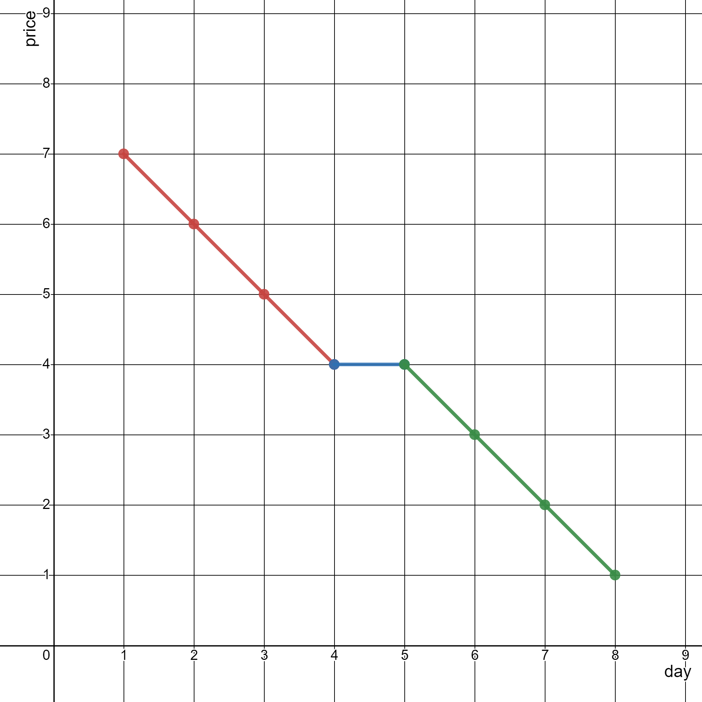
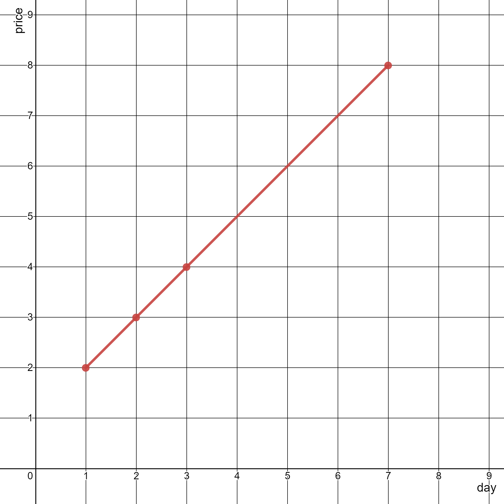

# 判断三点共线

> **[2280. 表示一个折线图的最少线段数](https://leetcode.cn/problems/minimum-lines-to-represent-a-line-chart/solutions/1510444/pan-duan-san-dian-gong-xian-chao-jian-ji-0n0o/) · Medium · 难度分 1681**

> **所属题单**
> - [数学算法 · 五、计算几何](../../../刷题路径/灵神原版题单/数学算法/五、计算几何.md) · §5.1 点、线

> **题目描述**
> 给你一个二维整数数组 `stockPrices` ，其中 `stockPrices[i] = [day_i, price_i]` 表示股票在 `day_i` 的价格为 `price_i` 。**折线图** 是一个二维平面上的若干个点组成的图，横坐标表示日期，纵坐标表示价格，折线图由相邻的点连接而成。比方说下图是一个例子：
>
> 
>
> 请你返回要表示一个折线图所需要的 **最少线段数** 。
>
> **示例 1：**
>
> 
>
> ```
> 输入：stockPrices = [[1,7],[2,6],[3,5],[4,4],[5,4],[6,3],[7,2],[8,1]]
> 输出：3
> 解释：
> 上图为输入对应的图，横坐标表示日期，纵坐标表示价格。
> 以下 3 个线段可以表示折线图：
> - 线段 1 （红色）从 (1,7) 到 (4,4) ，经过 (1,7) ，(2,6) ，(3,5) 和 (4,4) 。
> - 线段 2 （蓝色）从 (4,4) 到 (5,4) 。
> - 线段 3 （绿色）从 (5,4) 到 (8,1) ，经过 (5,4) ，(6,3) ，(7,2) 和 (8,1) 。
> 可以证明，无法用少于 3 条线段表示这个折线图。
> ```
>
> **示例 2：**
>
> 
>
> ```
> 输入：stockPrices = [[3,4],[1,2],[7,8],[2,3]]
> 输出：1
> 解释：
> 如上图所示，折线图可以用一条线段表示。
> ```
>
> **提示：**
>
> - `1 <= stockPrices.length <= 10⁵`
>
> - `stockPrices[i].length == 2`
>
> - `1 <= day_i, price_i <= 10⁹`
>
> - 所有 `day_i` **互不相同** 。

> **题解**
> 本题 [视频讲解](https://www.bilibili.com/video/BV1RY4y157nW) 已出炉，讨论了一些浮点数的小知识，欢迎三连~
>
> ---
>
> 按照 $\textit{day}_i$ 排序后，如果相邻两条线段的斜率不同，那么必然需要一条新的线段。
>
> 代码实现时，可以假定第一天之前的斜率为 $\dfrac{1}{0}$，从而简化判断逻辑。
>
> 如果你用的是除法，要特别小心浮点数带来的影响：如果计算机无法精确表示一个浮点数（你可以理解成一个无限循环的小数），那么计算机会将其舍入到最近的一个能表示的浮点数上，两个本来不同的斜率，由于数值过于接近（比浮点精度还小），计算机会将其舍入到同一个浮点数上，这样本该不同的数值计算机会判定为相同。
>
> 改为乘法可以避免此问题。
>
> ```python
> class Solution:
>     def minimumLines(self, stockPrices: List[List[int]]) -> int:
>         stockPrices.sort(key=lambda x: x[0])  # 按照 day 排序
>         ans, pre_dy, pre_dx = 0, 1, 0
>         for (x1, y1), (x2, y2) in pairwise(stockPrices):
>             dy, dx = y2 - y1, x2 - x1
>             if dy * pre_dx != pre_dy * dx:  # 与上一条线段的斜率不同
>                 ans += 1
>                 pre_dy, pre_dx = dy, dx
>         return ans
> ```
>
>
> 由于斜率之差可以小到 $10^{-18}$ 量级，C++ 选手可以用 `long double` 来保证算出来的结果在误差允许范围内。
