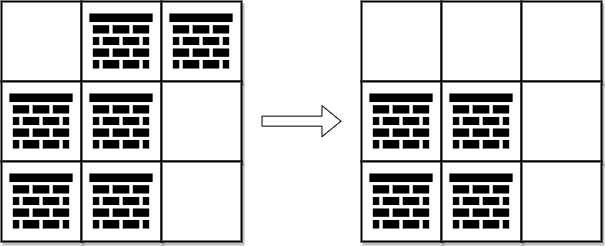
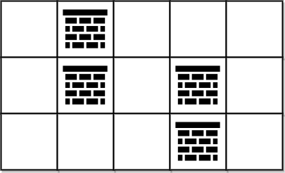

# 0-1 BFS 线性做法（Python/Java/C++/Go）

> **[2290. 到达角落需要移除障碍物的最小数目](https://leetcode.cn/problems/minimum-obstacle-removal-to-reach-corner/solutions/1524710/0-1-bfs-by-endlesscheng-4pjt/) · Hard · 难度分 2138**

> **所属题单**
> - [网格图 · 三、网格图 0-1 BFS](../../../刷题路径/灵神原版题单/网格图/三、网格图%200-1%20BFS.md)

> **题目描述**
> 给你一个下标从 **0** 开始的二维整数数组 `grid` ，数组大小为 `m x n` 。每个单元格都是两个值之一：
>
> - `0` 表示一个 **空** 单元格，
>
> - `1` 表示一个可以移除的 **障碍物** 。
>
> 你可以向上、下、左、右移动，从一个空单元格移动到另一个空单元格。
>
> 现在你需要从左上角 `(0, 0)` 移动到右下角 `(m - 1, n - 1)` ，返回需要移除的障碍物的 **最小** 数目。
>
> **示例 1：**
>
> 
>
> ```
>
> 输入：grid = [[0,1,1],[1,1,0],[1,1,0]]
> 输出：2
> 解释：可以移除位于 (0, 1) 和 (0, 2) 的障碍物来创建从 (0, 0) 到 (2, 2) 的路径。
> 可以证明我们至少需要移除两个障碍物，所以返回 2 。
> 注意，可能存在其他方式来移除 2 个障碍物，创建出可行的路径。
> ```
>
> **示例 2：**
>
> 
>
> ```
>
> 输入：grid = [[0,1,0,0,0],[0,1,0,1,0],[0,0,0,1,0]]
> 输出：0
> 解释：不移除任何障碍物就能从 (0, 0) 到 (2, 4) ，所以返回 0 。
> ```
>
> **提示：**
>
> - `m == grid.length`
>
> - `n == grid[i].length`
>
> - `1 <= m, n <= 10⁵`
>
> - `2 <= m * n <= 10⁵`
>
> - `grid[i][j]` 为 `0` **或** `1`
>
> - `grid[0][0] == grid[m - 1][n - 1] == 0`

> **题解**
> 从 $(i,j)$ 移动到与其相邻的格子 $(i',j')$，视作一条从 $(i,j)$ 到 $(i',j')$ 的有向边，边权为 $\textit{grid}[i'][j']$。
>
> 问题变成计算从起点到终点的最短路。
>
> 这可以用 Dijkstra 算法解决，原理请看 [Dijkstra 算法介绍](../../0700-0799/0743%20网络延迟时间/灵茶山艾府.md)。
>
> 由于本题的边权只有 $0$ 和 $1$，也可以用 **0-1 BFS** 解决。
>
> 0-1 BFS 本质是对 Dijkstra 算法的优化。因为边权只有 $0$ 和 $1$，我们可以把最小堆换成**双端队列**，遇到 $0$ 边权就加入**队首**，遇到 $1$ 边权就加入**队尾**，这样可以保证队首总是最小的，就不需要最小堆了。
>
> [本题视频讲解](https://www.bilibili.com/video/BV1iF41157dG)（第四题）。
>
> ```python
> class Solution:
>     def minimumObstacles(self, grid: List[List[int]]) -> int:
>         m, n = len(grid), len(grid[0])
>         dis = [[inf] * n for _ in range(m)]
>         dis[0][0] = 0
>         q = deque([(0, 0)])
>         while q:
>             i, j = q.popleft()
>             for x, y in (i, j + 1), (i, j - 1), (i + 1, j), (i - 1, j):
>                 if 0 <= x < m and 0 <= y < n:
>                     g = grid[x][y]
>                     if dis[i][j] + g < dis[x][y]:
>                         dis[x][y] = dis[i][j] + g
>                         if g == 0:
>                             q.appendleft((x, y))
>                         else:
>                             q.append((x, y))
>         return dis[-1][-1]
> ```
>
>
> #### 复杂度分析
>
> - 时间复杂度：$\mathcal{O}(mn)$，其中 $m$ 和 $n$ 分别为 $\textit{grid}$ 的行数和列数。每个点至多入队两次。
> - 空间复杂度：$\mathcal{O}(mn)$。
>
> ## 思考题
>
> 构造一个 $\textit{grid}$，使得上述算法消耗的空间尽量多。
>
> 欢迎在评论区分享你的思路/代码。
>
> 更多相似题目，见下面网格图题单中的「**0-1 BFS**」。
>
> ## 分类题单
>
> [如何科学刷题？](https://leetcode.cn/circle/discuss/RvFUtj/)
>
> 1. [滑动窗口与双指针（定长/不定长/单序列/双序列/三指针）](https://leetcode.cn/circle/discuss/0viNMK/)
> 2. [二分算法（二分答案/最小化最大值/最大化最小值/第K小）](https://leetcode.cn/circle/discuss/SqopEo/)
> 3. [单调栈（基础/矩形面积/贡献法/最小字典序）](https://leetcode.cn/circle/discuss/9oZFK9/)
> 4. [网格图（DFS/BFS/综合应用）](https://leetcode.cn/circle/discuss/YiXPXW/)
> 5. [位运算（基础/性质/拆位/试填/恒等式/思维）](https://leetcode.cn/circle/discuss/dHn9Vk/)
> 6. [图论算法（DFS/BFS/拓扑排序/最短路/最小生成树/二分图/基环树/欧拉路径）](https://leetcode.cn/circle/discuss/01LUak/)
> 7. [动态规划（入门/背包/状态机/划分/区间/状压/数位/数据结构优化/树形/博弈/概率期望）](https://leetcode.cn/circle/discuss/tXLS3i/)
> 8. [常用数据结构（前缀和/差分/栈/队列/堆/字典树/并查集/树状数组/线段树）](https://leetcode.cn/circle/discuss/mOr1u6/)
> 9. [数学算法（数论/组合/概率期望/博弈/计算几何/随机算法）](https://leetcode.cn/circle/discuss/IYT3ss/)
> 10. [贪心与思维（基本贪心策略/反悔/区间/字典序/数学/思维/脑筋急转弯/构造）](https://leetcode.cn/circle/discuss/g6KTKL/)
> 11. [链表、二叉树与一般树（前后指针/快慢指针/DFS/BFS/直径/LCA）](https://leetcode.cn/circle/discuss/K0n2gO/)
>
> [我的题解精选（已分类）](https://github.com/EndlessCheng/codeforces-go/blob/master/leetcode/SOLUTIONS.md)
