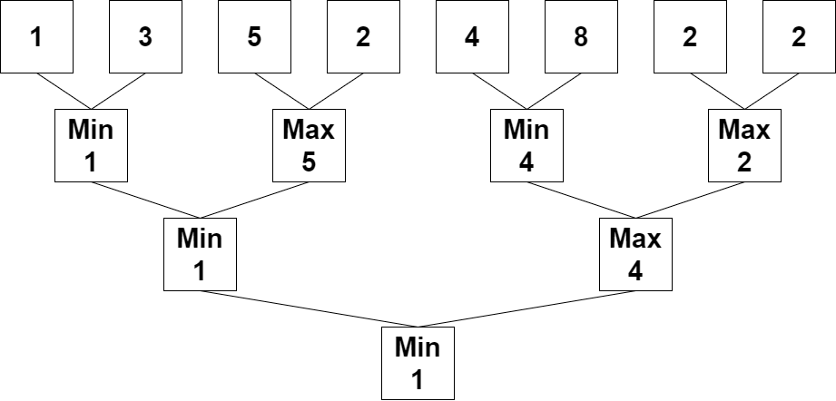

# 2293. 极大极小游戏

Easy · [力扣原题](https://leetcode.cn/problems/min-max-game/)

| 作者 | 题解 | 动画讲解 |
|---|---|---|
| 灵茶山艾府 | [📄 题解](灵茶山艾府.md) | [▶︎ 动画（GIF）](2293%20极大极小游戏%20·%20灵茶山艾府.gif) · [mp4 文件](2293%20极大极小游戏%20·%20灵茶山艾府.mp4) |
| yiduobo | [📄 题解](yiduobo.md) | [▶︎ 动画（GIF）](2293%20极大极小游戏%20·%20yiduobo.gif) · [mp4 文件](2293%20极大极小游戏%20·%20yiduobo.mp4) |

## 动画讲解

> 动图会循环播放；想暂停、拖进度条请下载上面表格里的 mp4 文件。

### 灵茶山艾府


### yiduobo


## 题目描述

给你一个下标从 **0** 开始的整数数组 `nums` ，其长度是 `2` 的幂。

对 `nums` 执行下述算法：

1. 设 `n` 等于 `nums` 的长度，如果 `n == 1` ，**终止** 算法过程。否则，**创建** 一个新的整数数组 `newNums` ，新数组长度为 `n / 2` ，下标从 **0** 开始。

2. 对于满足 `0 <= i < n / 2` 的每个 **偶数** 下标 `i` ，将 `newNums[i]` **赋值** 为 `min(nums[2 * i], nums[2 * i + 1])` 。

3. 对于满足 `0 <= i < n / 2` 的每个 **奇数** 下标 `i` ，将 `newNums[i]` **赋值** 为 `max(nums[2 * i], nums[2 * i + 1])` 。

4. 用 `newNums` 替换 `nums` 。

5. 从步骤 1 开始 **重复** 整个过程。

执行算法后，返回 `nums` 中剩下的那个数字。

**示例 1：**



```

输入：nums = [1,3,5,2,4,8,2,2]
输出：1
解释：重复执行算法会得到下述数组。
第一轮：nums = [1,5,4,2]
第二轮：nums = [1,4]
第三轮：nums = [1]
1 是最后剩下的那个数字，返回 1 。
```

**示例 2：**

```

输入：nums = [3]
输出：3
解释：3 就是最后剩下的数字，返回 3 。
```

**提示：**

- `1 <= nums.length <= 1024`

- `1 <= nums[i] <= 10⁹`

- `nums.length` 是 `2` 的幂

---
[↑ 返回 2200-2299](../README.md) · [总索引](../../../索引.md) · [仓库首页](../../../README.md)
