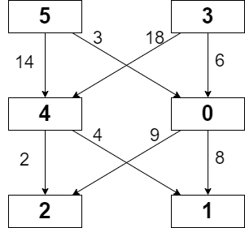

# 教你一步步思考动态规划：从记忆化搜索到递推，再到 O(1) 空间！（Python/Java/C++/Go/JS/Rust）

> **[2304. 网格中的最小路径代价](https://leetcode.cn/problems/minimum-path-cost-in-a-grid/solutions/2536856/jiao-ni-yi-bu-bu-si-kao-dong-tai-gui-hua-bd25/) · Medium · 难度分 1658**

> **所属题单**
> - [动态规划 · 二、网格图 DP](../../../刷题路径/灵神原版题单/动态规划/二、网格图%20DP.md) · §2.1 基础

> **题目描述**
> 给你一个下标从 **0** 开始的整数矩阵 `grid` ，矩阵大小为 `m x n` ，由从 `0` 到 `m * n - 1` 的不同整数组成。你可以在此矩阵中，从一个单元格移动到 **下一行** 的任何其他单元格。如果你位于单元格 `(x, y)` ，且满足 `x < m - 1` ，你可以移动到 `(x + 1, 0)`, `(x + 1, 1)`, ..., `(x + 1, n - 1)` 中的任何一个单元格。**注意：** 在最后一行中的单元格不能触发移动。
>
> 每次可能的移动都需要付出对应的代价，代价用一个下标从 **0** 开始的二维数组 `moveCost` 表示，该数组大小为 `(m * n) x n` ，其中 `moveCost[i][j]` 是从值为 `i` 的单元格移动到下一行第 `j` 列单元格的代价。从 `grid` 最后一行的单元格移动的代价可以忽略。
>
> `grid` 一条路径的代价是：所有路径经过的单元格的 **值之和** 加上 所有移动的 **代价之和** 。从 **第一行** 任意单元格出发，返回到达 **最后一行** 任意单元格的最小路径代价<em>。</em>
>
> **示例 1：**
>
> 
>
> ```
>
> 输入：grid = [[5,3],[4,0],[2,1]], moveCost = [[9,8],[1,5],[10,12],[18,6],[2,4],[14,3]]
> 输出：17
> 解释：最小代价的路径是 5 -> 0 -> 1 。
> - 路径途经单元格值之和 5 + 0 + 1 = 6 。
> - 从 5 移动到 0 的代价为 3 。
> - 从 0 移动到 1 的代价为 8 。
> 路径总代价为 6 + 3 + 8 = 17 。
> ```
>
> **示例 2：**
>
> ```
>
> 输入：grid = [[5,1,2],[4,0,3]], moveCost = [[12,10,15],[20,23,8],[21,7,1],[8,1,13],[9,10,25],[5,3,2]]
> 输出：6
> 解释：
> 最小代价的路径是 2 -> 3 。
> - 路径途经单元格值之和 2 + 3 = 5 。
> - 从 2 移动到 3 的代价为 1 。
> 路径总代价为 5 + 1 = 6 。
> ```
>
> **提示：**
>
> - `m == grid.length`
>
> - `n == grid[i].length`
>
> - `2 <= m, n <= 50`
>
> - `grid` 由从 `0` 到 `m * n - 1` 的不同整数组成
>
> - `moveCost.length == m * n`
>
> - `moveCost[i].length == n`
>
> - `1 <= moveCost[i][j] <= 100`

> **题解**
> ## 前置知识：动态规划入门
>
> 请看视频讲解 [动态规划入门：从记忆化搜索到递推](https://www.bilibili.com/video/BV1Xj411K7oF/)，制作不易，欢迎点赞！
>
> ## 一、启发思考：寻找子问题
>
> 
>
> 看示例 1。假设我们从第一行的 $\textit{grid}[0][0]$ 出发，要计算的问题是：从 $\textit{grid}[0][0]$ 出发，到达最后一行任意单元格的最小路径代价。
>
> 枚举下一步的位置。例如下一步移动到 $\textit{grid}[1][1]$，那么要计算的问题是：从 $\textit{grid}[1][1]$ 出发，到达最后一行任意单元格的最小路径代价。这是一个**和原问题相似的、规模更小的子问题**，所以我们可以用**递归**解决。
>
> > 注：动态规划有「选或不选」和「枚举选哪个」两种基本思考方式。在做题时，可根据题目要求，选择适合题目的一种来思考。本题用到的是「枚举选哪个」。
>
> ## 二、递归怎么写：状态定义与状态转移方程
>
> 如何用参数表示一个子问题？我们需要知道从哪个格子出发，所以用格子的坐标 $(i,j)$ 就能表示一个子问题。
>
> 因此，定义 $\textit{dfs}(i,j)$ 表示从 $\textit{grid}[i][j]$ 出发，到达最后一行任意单元格的最小路径代价。
>
> 枚举下一步的位置。假设移动到下一行的 $\textit{grid}[i+1][k]$，那么移动代价就是 
>
> $$
> \textit{moveCost}[\textit{grid}[i][j]][k]
> $$
>
> 枚举所有的 $k$，取最小值，再加上当前单元格的值 $\textit{grid}[i][j]$，得到
>
> $$
> \textit{dfs}(i,j) = \textit{grid}[i][j] + \min_{k=0}^{n-1} \textit{dfs}(i+1,k) + \textit{moveCost}[\textit{grid}[i][j]][k]
> $$
>
> 递归边界：$\textit{dfs}(m-1,j)=\textit{grid}[m-1][j]$。最后一行无需移动，代价只有单元格的值。
>
> 递归入口：$\textit{dfs}(0,j)$。枚举所有的 $j$，取最小值，答案就是 
>
> $$
> \min_{j=0}^{n-1} \textit{dfs}(0,j)
> $$
>
> ```python
> # 会超时的递归代码
> class Solution:
>     def minPathCost(self, grid: List[List[int]], moveCost: List[List[int]]) -> int:
>         m, n = len(grid), len(grid[0])
>
>         def dfs(i: int, j: int) -> int:
>             if i == m - 1:  # 递归边界
>                 return grid[i][j]
>             res = inf
>             for k, c in enumerate(moveCost[grid[i][j]]):  # 移动到下一行的第 k 列
>                 res = min(res, dfs(i + 1, k) + c)
>             return res + grid[i][j]
>
>         return min(dfs(0, j) for j in range(n))  # 枚举起点
> ```
>
>
> #### 复杂度分析
>
> - 时间复杂度：$\mathcal{O}(n^m)$，其中 $m$ 和 $n$ 分别为 $\textit{grid}$ 的行数和列数。搜索树是一棵 $n$ 叉树，树高为 $\mathcal{O}(m)$，所以节点个数为 $\mathcal{O}(n^m)$，遍历搜索树需要 $\mathcal{O}(n^m)$ 的时间。
> - 空间复杂度：$\mathcal{O}(m)$。递归需要 $\mathcal{O}(m)$ 的栈空间。
>
> ## 三、递归 + 记录返回值 = 记忆化搜索
>
> 上面的做法太慢了，怎么优化呢？
>
> 对于 $\textit{grid}[i][j]$ 来说，上一行的每个格子都可以移动到它，所以我们会多次递归到 $\textit{dfs}(i,j)$。
>
> 一叶知秋，整个递归中有大量重复递归调用（递归入参相同）。由于递归函数没有副作用，同样的入参无论计算多少次，算出来的结果都是一样的，因此可以用**记忆化搜索**来优化：
>
> - 如果一个状态（递归入参）是第一次遇到，那么可以在返回前，把状态及其结果记到一个 $\textit{memo}$ 数组中。
> - 如果一个状态不是第一次遇到（$\textit{memo}$ 中保存的结果不等于 $\textit{memo}$ 的初始值），那么可以直接返回 $\textit{memo}$ 中保存的结果。
>
> **注意**：$\textit{memo}$ 数组的初始值一定不能等于要记忆化的值！例如初始值设置为 $0$，并且要记忆化的 $\textit{dfs}(i,j)$ 也等于 $0$，那就没法判断 $0$ 到底表示第一次遇到这个状态，还是表示之前遇到过了，从而导致记忆化失效。一般把初始值设置为 $-1$。本题由于 $\textit{moveCost}$ 中的数都是正数，所以可以把初始值设置为 $0$。
>
> > Python 用户可以无视上面这段，直接用 `@cache` 装饰器。
>
> ```python
> class Solution:
>     def minPathCost(self, grid: List[List[int]], moveCost: List[List[int]]) -> int:
>         m, n = len(grid), len(grid[0])
>
>         @cache  # 缓存装饰器，避免重复计算 dfs 的结果
>         def dfs(i: int, j: int) -> int:
>             if i == m - 1:  # 递归边界
>                 return grid[i][j]
>             res = inf
>             for k, c in enumerate(moveCost[grid[i][j]]):  # 移动到下一行的第 k 列
>                 res = min(res, dfs(i + 1, k) + c)
>             return res + grid[i][j]
>
>         return min(dfs(0, j) for j in range(n))  # 枚举起点
> ```
>
>
> #### 复杂度分析
>
> - 时间复杂度：$\mathcal{O}(mn^2)$，其中 $m$ 和 $n$ 分别为 $\textit{grid}$ 的行数和列数。由于每个状态只会计算一次，动态规划的时间复杂度 $=$ 状态个数 $\times$ 单个状态的计算时间。本题状态个数等于 $\mathcal{O}(mn)$，单个状态的计算时间为 $\mathcal{O}(n)$，所以动态规划的时间复杂度为 $\mathcal{O}(mn^2)$。
> - 空间复杂度：$\mathcal{O}(mn)$。有多少个状态，$\textit{memo}$ 数组的大小就是多少。
>
> ## 四、1:1 翻译成递推
>
> 我们可以去掉递归中的「递」，只保留「归」的部分，即自底向上计算。
>
> 做法：
>
> - $\textit{dfs}$ 改成 $f$ 数组；
> - 递归改成循环（每个参数都对应一层循环）；
> - 递归边界改成 $f$ 数组的初始值。
> - 递归入口即为答案。
>
> > 相当于之前是用递归去计算每个状态，现在是**枚举**并计算每个状态。
>
> 具体来说，$f[i][j]$ 的定义和 $\textit{dfs}(i,j)$ 的定义是完全一样的，都表示从 $\textit{grid}[i][j]$ 出发，到达最后一行任意单元格的最小路径代价。
>
> 相应的递推式（状态转移方程）也和 $\textit{dfs}$ 一样：
>
> $$
> f[i][j] =\textit{grid}[i][j] + \min_{k=0}^{n-1} f[i+1][k] + \textit{moveCost}[\textit{grid}[i][j]][k]
> $$
>
> 初始值 $f[m-1][j]=\textit{grid}[m-1][j]$，翻译自递归边界 $\textit{dfs}(m-1,j)=\textit{grid}[m-1][j]$。
>
> 答案为 $\min\limits_{j=0}^{n-1}f[0][j]$，翻译自递归入口 $\min\limits_{j=0}^{n-1}\textit{dfs}(0,j)$。
>
> #### 答疑
>
> **问**：如何思考循环顺序？什么时候要正序枚举，什么时候要倒序枚举？
>
> **答**：这里有一个通用的做法：盯着状态转移方程，想一想，要计算 $f[i][j]$，必须先把 $f[i+1][\cdot]$ 算出来，那么只有 $i$ 从大到小枚举才能做到。对于 $j$ 来说，由于在计算 $f[i][j]$ 的时候，$f[i+1][\cdot]$ 已经全部计算完毕，所以 $j$ 无论是正序还是倒序枚举都可以。
>
> ```python
> class Solution:
>     def minPathCost(self, grid: List[List[int]], moveCost: List[List[int]]) -> int:
>         m, n = len(grid), len(grid[0])
>         f = [[inf] * n for _ in range(m)]
>         f[-1] = grid[-1]
>         for i in range(m - 2, -1, -1):
>             for j, g in enumerate(grid[i]):
>                 for k, c in enumerate(moveCost[g]):  # 移动到下一行的第 k 列
>                     f[i][j] = min(f[i][j], f[i + 1][k] + c)
>                 f[i][j] += g
>         return min(f[0])
> ```
>
>
> #### 复杂度分析
>
> - 时间复杂度：$\mathcal{O}(mn^2)$，其中 $m$ 和 $n$ 分别为 $\textit{grid}$ 的行数和列数。
> - 空间复杂度：$\mathcal{O}(mn)$。
>
> ## 五、原地计算
>
> 也可以直接把 $f[i][j]$ 保存在 $\textit{grid}[i][j]$ 中。
>
> 递推式变成：
>
> $$
> \textit{grid}[i][j] = \textit{grid}[i][j] + \min_{k=0}^{n-1} \textit{grid}[i+1][k] + \textit{moveCost}[\textit{grid}[i][j]][k]
> $$
>
> ```python
> class Solution:
>     def minPathCost(self, grid: List[List[int]], moveCost: List[List[int]]) -> int:
>         m, n = len(grid), len(grid[0])
>         for i in range(m - 2, -1, -1):
>             for j in range(n):
>                 grid[i][j] += min(g + c for g, c in zip(grid[i + 1], moveCost[grid[i][j]]))
>         return min(grid[0])
> ```
>
>
> #### 复杂度分析
>
> - 时间复杂度：$\mathcal{O}(mn^2)$，其中 $m$ 和 $n$ 分别为 $\textit{grid}$ 的行数和列数。
> - 空间复杂度：$\mathcal{O}(1)$。仅用到若干额外变量。
>
> ## 分类题单
>
> [如何科学刷题？](https://leetcode.cn/circle/discuss/RvFUtj/)
>
> 1. [滑动窗口与双指针（定长/不定长/单序列/双序列/三指针/分组循环）](https://leetcode.cn/circle/discuss/0viNMK/)
> 2. [二分算法（二分答案/最小化最大值/最大化最小值/第K小）](https://leetcode.cn/circle/discuss/SqopEo/)
> 3. [单调栈（基础/矩形面积/贡献法/最小字典序）](https://leetcode.cn/circle/discuss/9oZFK9/)
> 4. [网格图（DFS/BFS/综合应用）](https://leetcode.cn/circle/discuss/YiXPXW/)
> 5. [位运算（基础/性质/拆位/试填/恒等式/思维）](https://leetcode.cn/circle/discuss/dHn9Vk/)
> 6. [图论算法（DFS/BFS/拓扑排序/最短路/最小生成树/二分图/基环树/欧拉路径）](https://leetcode.cn/circle/discuss/01LUak/)
> 7. [动态规划（入门/背包/状态机/划分/区间/状压/数位/数据结构优化/树形/博弈/概率期望）](https://leetcode.cn/circle/discuss/tXLS3i/)
> 8. [常用数据结构（前缀和/差分/栈/队列/堆/字典树/并查集/树状数组/线段树）](https://leetcode.cn/circle/discuss/mOr1u6/)
> 9. [数学算法（数论/组合/概率期望/博弈/计算几何/随机算法）](https://leetcode.cn/circle/discuss/IYT3ss/)
> 10. [贪心与思维（基本贪心策略/反悔/区间/字典序/数学/思维/脑筋急转弯/构造）](https://leetcode.cn/circle/discuss/g6KTKL/)
> 11. [链表、二叉树与回溯（前后指针/快慢指针/DFS/BFS/直径/LCA/一般树）](https://leetcode.cn/circle/discuss/K0n2gO/)
> 12. [字符串（KMP/Z函数/Manacher/字符串哈希/AC自动机/后缀数组/子序列自动机）](https://leetcode.cn/circle/discuss/SJFwQI/)
>
> [我的题解精选（已分类）](https://github.com/EndlessCheng/codeforces-go/blob/master/leetcode/SOLUTIONS.md)
>
> 欢迎关注 [B站@灵茶山艾府](https://space.bilibili.com/206214)
