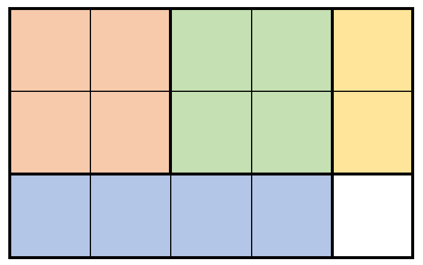

# 2312. 卖木头块

Hard · 难度分 2363 · [力扣原题](https://leetcode.cn/problems/selling-pieces-of-wood/)

所在刷题路径：灵神题单·动态规划

| 作者 | 题解 | 动画讲解 |
|---|---|---|
| 灵茶山艾府 | [📄 题解](灵茶山艾府.md) | [▶︎ 2312 卖木头块 · 灵茶山艾府.mp4](2312%20卖木头块%20·%20灵茶山艾府.mp4) |
| yiduobo | [📄 题解](yiduobo.md) | [▶︎ 2312 卖木头块 · yiduobo.mp4](2312%20卖木头块%20·%20yiduobo.mp4) |

## 题目描述

给你两个整数 `m` 和 `n` ，分别表示一块矩形木块的高和宽。同时给你一个二维整数数组 `prices` ，其中 `prices[i] = [h_i, w_i, price_i]` 表示你可以以 `price_i` 元的价格卖一块高为 `h_i` 宽为 `w_i` 的矩形木块。

每一次操作中，你必须按下述方式之一执行切割操作，以得到两块更小的矩形木块：

- 沿垂直方向按高度 **完全** 切割木块，或

- 沿水平方向按宽度 **完全** 切割木块

在将一块木块切成若干小木块后，你可以根据 `prices` 卖木块。你可以卖多块同样尺寸的木块。你不需要将所有小木块都卖出去。你 **不能** 旋转切好后木块来交换它的高度值和宽度值。

请你返回切割一块大小为 `m x n` 的木块后，能得到的 **最多** 钱数。

注意你可以切割木块任意次。

**示例 1：**



```

输入：m = 3, n = 5, prices = [[1,4,2],[2,2,7],[2,1,3]]
输出：19
解释：上图展示了一个可行的方案。包括：
- 2 块 2 x 2 的小木块，售出 2 * 7 = 14 元。
- 1 块 2 x 1 的小木块，售出 1 * 3 = 3 元。
- 1 块 1 x 4 的小木块，售出 1 * 2 = 2 元。
总共售出 14 + 3 + 2 = 19 元。
19 元是最多能得到的钱数。
```

**示例 2：**


```

输入：m = 4, n = 6, prices = [[3,2,10],[1,4,2],[4,1,3]]
输出：32
解释：上图展示了一个可行的方案。包括：
- 3 块 3 x 2 的小木块，售出 3 * 10 = 30 元。
- 1 块 1 x 4 的小木块，售出 1 * 2 = 2 元。
总共售出 30 + 2 = 32 元。
32 元是最多能得到的钱数。
注意我们不能旋转 1 x 4 的木块来得到 4 x 1 的木块。
```

**提示：**

- `1 <= m, n <= 200`

- `1 <= prices.length <= 2 * 10⁴`

- `prices[i].length == 3`

- `1 <= h_i <= m`

- `1 <= w_i <= n`

- `1 <= price_i <= 10⁶`

- 所有 `(h_i, w_i)` **互不相同** 。

---
[↑ 返回 2300-2399](../README.md) · [总索引](../../../索引.md) · [仓库首页](../../../README.md)
