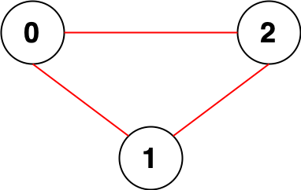

# DFS 求连通块大小（Python/Java/C++/Go/JS/Rust）

> **[2316. 统计无向图中无法互相到达点对数](https://leetcode.cn/problems/count-unreachable-pairs-of-nodes-in-an-undirected-graph/solutions/1625315/by-endlesscheng-7l50/) · Medium · 难度分 1604**

> **所属题单**
> - [图论算法 · 一、图的遍历](../../../刷题路径/灵神原版题单/图论算法/一、图的遍历.md) · §1.1 深度优先搜索（DFS）
> - [数学算法 · 二、组合数学](../../../刷题路径/灵神原版题单/数学算法/二、组合数学.md) · §2.1 乘法原理

> **题目描述**
> 给你一个整数 `n` ，表示一张 **无向图** 中有 `n` 个节点，编号为 `0` 到 `n - 1` 。同时给你一个二维整数数组 `edges` ，其中 `edges[i] = [a_i, b_i]` 表示节点 `a_i` 和 `b_i` 之间有一条 **无向** 边。
>
> 请你返回 **无法互相到达** 的不同 **点对数目** 。
>
> **示例 1：**
>
> 
>
> ```
> 输入：n = 3, edges = [[0,1],[0,2],[1,2]]
> 输出：0
> 解释：所有点都能互相到达，意味着没有点对无法互相到达，所以我们返回 0 。
> ```
>
> **示例 2：**
>
> 
>
> ```
> 输入：n = 7, edges = [[0,2],[0,5],[2,4],[1,6],[5,4]]
> 输出：14
> 解释：总共有 14 个点对互相无法到达：
> [[0,1],[0,3],[0,6],[1,2],[1,3],[1,4],[1,5],[2,3],[2,6],[3,4],[3,5],[3,6],[4,6],[5,6]]
> 所以我们返回 14 。
> ```
>
> **提示：**
>
> - `1 <= n <= 10⁵`
>
> - `0 <= edges.length <= 2 * 10⁵`
>
> - `edges[i].length == 2`
>
> - `0 <= a_i, b_i < n`
>
> - `a_i != b_i`
>
> - 不会有重复边。

> **题解**
> 建图后，用 DFS 可以求出每个连通块的大小。
>
> 求连通块的大小的同时，用一个变量 $\textit{total}$ 维护前面求出的连通块的大小之和。
>
> 设当前连通块的大小为 $\textit{size}$，那么这个连通块中的每个点，与前面遍历过的连通块的每个点，都是无法互相到达的，根据乘法原理，这有 $\textit{size}\cdot\textit{total}$ 个，加到答案中。
>
> ```python
> class Solution:
>     def countPairs(self, n: int, edges: List[List[int]]) -> int:
>         g = [[] for _ in range(n)]
>         for x, y in edges:
>             g[x].append(y)
>             g[y].append(x)  # 建图
>
>         vis = [False] * n
>         def dfs(x: int) -> int:
>             vis[x] = True  # 避免重复访问同一个点
>             size = 1
>             for y in g[x]:
>                 if not vis[y]:
>                     size += dfs(y)
>             return size
>
>         ans = total = 0
>         for i in range(n):
>             if not vis[i]:  # 未访问的点：说明找到了一个新的连通块
>                 size = dfs(i)
>                 ans += size * total
>                 total += size
>         return ans
> ```
>
>
> #### 复杂度分析
>
> - 时间复杂度：$\mathcal{O}(n+m)$，其中 $m$ 为 $\textit{edges}$ 的长度。
> - 空间复杂度：$\mathcal{O}(n+m)$。
>
> ## 分类题单
>
> [如何科学刷题？](https://leetcode.cn/circle/discuss/RvFUtj/)
>
> 1. [滑动窗口与双指针（定长/不定长/单序列/双序列/三指针/分组循环）](https://leetcode.cn/circle/discuss/0viNMK/)
> 2. [二分算法（二分答案/最小化最大值/最大化最小值/第K小）](https://leetcode.cn/circle/discuss/SqopEo/)
> 3. [单调栈（基础/矩形面积/贡献法/最小字典序）](https://leetcode.cn/circle/discuss/9oZFK9/)
> 4. [网格图（DFS/BFS/综合应用）](https://leetcode.cn/circle/discuss/YiXPXW/)
> 5. [位运算（基础/性质/拆位/试填/恒等式/思维）](https://leetcode.cn/circle/discuss/dHn9Vk/)
> 6. [图论算法（DFS/BFS/拓扑排序/基环树/最短路/最小生成树/网络流）](https://leetcode.cn/circle/discuss/01LUak/)
> 7. [动态规划（入门/背包/划分/状态机/区间/状压/数位/数据结构优化/树形/博弈/概率期望）](https://leetcode.cn/circle/discuss/tXLS3i/)
> 8. [常用数据结构（前缀和/差分/栈/队列/堆/字典树/并查集/树状数组/线段树）](https://leetcode.cn/circle/discuss/mOr1u6/)
> 9. [数学算法（数论/组合/概率期望/博弈/计算几何/随机算法）](https://leetcode.cn/circle/discuss/IYT3ss/)
> 10. [贪心与思维（基本贪心策略/反悔/区间/字典序/数学/思维/脑筋急转弯/构造）](https://leetcode.cn/circle/discuss/g6KTKL/)
> 11. [链表、树与回溯（前后指针/快慢指针/DFS/BFS/直径/LCA）](https://leetcode.cn/circle/discuss/K0n2gO/)
> 12. [字符串（KMP/Z函数/Manacher/字符串哈希/AC自动机/后缀数组/子序列自动机）](https://leetcode.cn/circle/discuss/SJFwQI/)
>
> [我的题解精选（已分类）](https://github.com/EndlessCheng/codeforces-go/blob/master/leetcode/SOLUTIONS.md)
>
> 欢迎关注 [B站@灵茶山艾府](https://space.bilibili.com/206214)
