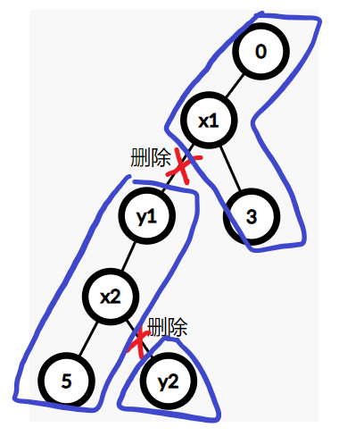
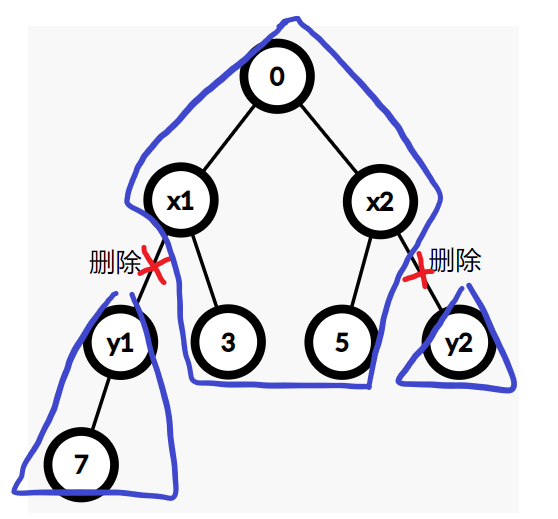

# DFS 时间戳——处理树上问题的有力工具（Python/Java/C++/Go）

> **[2322. 从树中删除边的最小分数](https://leetcode.cn/problems/minimum-score-after-removals-on-a-tree/solutions/1625899/dfs-shi-jian-chuo-chu-li-shu-shang-wen-t-x1kk/) · Hard · 难度分 2392**

> **所属题单**
> - [链表、二叉树与回溯 · 三、一般树](../../../刷题路径/灵神原版题单/链表、二叉树与回溯/三、一般树.md) · §3.7 DFS 时间戳

> **题目描述**
> 存在一棵无向连通树，树中有编号从 `0` 到 `n - 1` 的 `n` 个节点， 以及 `n - 1` 条边。
>
> 给你一个下标从 **0** 开始的整数数组 `nums` ，长度为 `n` ，其中 `nums[i]` 表示第 `i` 个节点的值。另给你一个二维整数数组 `edges` ，长度为 `n - 1` ，其中 `edges[i] = [a_i, b_i]` 表示树中存在一条位于节点 `a_i` 和 `b_i` 之间的边。
>
> 删除树中两条 **不同** 的边以形成三个连通组件。对于一种删除边方案，定义如下步骤以计算其分数：
>
> 1. 分别获取三个组件 **每个** 组件中所有节点值的异或值。
>
> 2. **最大** 异或值和 **最小** 异或值的 **差值** 就是这一种删除边方案的分数。
>
> - 例如，三个组件的节点值分别是：`[4,5,7]`、`[1,9]` 和 `[3,3,3]` 。三个异或值分别是 `4 ^ 5 ^ 7 = 6`、`1 ^ 9 = 8` 和 `3 ^ 3 ^ 3 = 3` 。最大异或值是 `8` ，最小异或值是 `3` ，分数是 `8 - 3 = 5` 。
>
> 返回在给定树上执行任意删除边方案可能的 **最小** 分数。
>
> **示例 1：**
>
> 
>
> ```
> 输入：nums = [1,5,5,4,11], edges = [[0,1],[1,2],[1,3],[3,4]]
> 输出：9
> 解释：上图展示了一种删除边方案。
> - 第 1 个组件的节点是 [1,3,4] ，值是 [5,4,11] 。异或值是 5 ^ 4 ^ 11 = 10 。
> - 第 2 个组件的节点是 [0] ，值是 [1] 。异或值是 1 = 1 。
> - 第 3 个组件的节点是 [2] ，值是 [5] 。异或值是 5 = 5 。
> 分数是最大异或值和最小异或值的差值，10 - 1 = 9 。
> 可以证明不存在分数比 9 小的删除边方案。
> ```
>
> **示例 2：**
>
> 
>
> ```
> 输入：nums = [5,5,2,4,4,2], edges = [[0,1],[1,2],[5,2],[4,3],[1,3]]
> 输出：0
> 解释：上图展示了一种删除边方案。
> - 第 1 个组件的节点是 [3,4] ，值是 [4,4] 。异或值是 4 ^ 4 = 0 。
> - 第 2 个组件的节点是 [1,0] ，值是 [5,5] 。异或值是 5 ^ 5 = 0 。
> - 第 3 个组件的节点是 [2,5] ，值是 [2,2] 。异或值是 2 ^ 2 = 0 。
> 分数是最大异或值和最小异或值的差值，0 - 0 = 0 。
> 无法获得比 0 更小的分数 0 。
> ```
>
> **提示：**
>
> - `n == nums.length`
>
> - `3 <= n <= 1000`
>
> - `1 <= nums[i] <= 10⁸`
>
> - `edges.length == n - 1`
>
> - `edges[i].length == 2`
>
> - `0 <= a_i, b_i < n`
>
> - `a_i != b_i`
>
> - `edges` 表示一棵有效的树

> **题解**
> ## 分类讨论
>
> 在以 $0$ 为根的前提下，设子树 $x$ 的点权异或和为 $\textit{xor}[x]$。
>
> 本题我们要计算连通块的点权异或和。由于 $n\le 1000$，可以考虑 $\mathcal{O}(n^2)$ 枚举要删除的两条边 $x_1\text{-}y_1$ 和 $x_2\text{-}y_2$（其中 $x_i$ 是 $y_i$ 的父节点），这会产生以下三种情况：
>
> 1. 删除的两条边在同一棵子树内，且 $y_1$ 在上，是 $x_2$ 的祖先（或重合）。
>    
>    如下图所示，这三个连通块从下到上，异或和分别为 $\textit{xor}[y_2]$、$\textit{xor}[y_1]\oplus\textit{xor}[y_2]$ 和 $\textit{xor}[0]\oplus\textit{xor}[y_1]$（$\oplus$ 表示异或运算）。**注**：把异或理解为减法，从子树中去掉节点的值，在异或运算下，就是异或这个节点的值。
>    
>    {:width=260px}
>    
> 2. 删除的两条边在同一棵子树内，且 $y_2$ 在上，是 $x_1$ 的祖先（或重合）。
>    
>    同上，这三个连通块的异或和分别为 $\textit{xor}[y_1]$、$\textit{xor}[y_2]\oplus\textit{xor}[y_1]$ 和 $\textit{xor}[0]\oplus\textit{xor}[y_2]$。
>    
> 3. 删除的两条边分别属于两棵不相交的子树。
>    
>    如下图所示，这三个连通块的异或和分别为 $\textit{xor}[y_1]$、$\textit{xor}[y_2]$ 和 $\textit{xor}[0]\oplus\textit{xor}[y_1]\oplus\textit{xor}[y_2]$。
>    
>    {:width=330px}
>
> 现在要解决的问题是，如何判断 $x_1\text{-}y_1$ 和 $x_2\text{-}y_2$ 这两条边的**位置关系**？谁在上，谁在下，还是分别属于两棵不相交的子树？
>
> ## 分析递归过程
>
> 我们把往下深入的过程叫做「递」，把往上返回的过程叫做「归」。
>
> 在递归过程中，对于两个节点 $x$ 和 $y$：
>
> - 如果顺序是 $递\ x\to 递\ y\to 归\ y\to 归\ x$，那么 $x$ 是 $y$ 的祖先。
> - 如果顺序是 $递\ y\to 递\ x\to 归\ x\to 归\ y$，那么 $y$ 是 $x$ 的祖先。
> - 如果顺序是 $递\ x\to 归\ x\to 递\ y\to 归\ y$，或者 $递\ y\to 归\ y\to 递\ x\to 归\ x$，那么 $x$ 和 $y$ 就分别属于两棵不相交的子树。
>
> ## 引入时间戳
>
> 怎么知道上述「递」和「归」发生的先后顺序？
>
> 在 DFS 一棵树的过程中，维护一个全局的时间戳 $\textit{clock}$，每访问一个新的节点，就把 $\textit{clock}$ 加一。
>
> 对于每个节点 $x$，记录进入这个节点的时间戳 $\textit{in}[x]$，和从这个节点往上返回时的时间戳 $\textit{out}[x]$。
>
> 根据时间戳，分类讨论：
>
> - 如果 $x$ 是 $y$ 的祖先，那么区间 $[\textit{in}[x],\textit{out}[x]]$ 包含区间 $[\textit{in}[y],\textit{out}[y]]$。
> - 如果 $y$ 是 $x$ 的祖先，那么区间 $[\textit{in}[y],\textit{out}[y]]$ 包含区间 $[\textit{in}[x],\textit{out}[x]]$。
> - 如果没有区间包含关系，那么 $x$ 和 $y$ 就分别属于两棵不相交的子树。
>
> 具体地，当 $x\ne y$ 时，如果
>
> $$
> \textit{in}[x]<\textit{in}[y]\le\textit{out}[y]\le\textit{out}[x]
> $$
>
> 那么 $x$ 是 $y$ 的祖先。其中 $\textit{out}[y]\le\textit{out}[x]$ 是因为递归结束的时候，时间戳是不变的，所以可以相等。
>
> 由于 $\textit{in}[y]\le\textit{out}[y]$ 恒成立，判断方式可以简化为
>
> $$
> \textit{in}[x]<\textit{in}[y] \wedge \textit{out}[y]\le\textit{out}[x]
> $$
>
> 或者更简单的
>
> $$
> \textit{in}[x]<\textit{in}[y]\le\textit{out}[x]
> $$
>
> > **注**：对于时间戳区间，要么不相交，要么一个完全包含另一个。所以只要区间 $A$ 有一个点在区间 $B$ 内，那么区间 $B$ 就包含区间 $A$。
>
> 代码实现时，由于不知道 $\textit{edges}[i]$ 两个端点的父子关系，枚举边的写法需要额外的判断。我们规定 $0$ 是树的根（没有父节点），枚举不是 $0$ 的两个节点，删除这两个节点到其父节点的边，这样写更简单。
>
> 对于子树异或和 $\textit{xor}[x]$ 的计算，类似计算子树元素和，把问题拆解为 $x$ 的所有儿子子树的异或和，再异或 $\textit{nums}[x]$，即为 $\textit{xor}[x]$。
>
> ```python
> class Solution:
>     def minimumScore(self, nums: List[int], edges: List[List[int]]) -> int:
>         n = len(nums)
>         g = [[] for _ in range(n)]
>         for x, y in edges:
>             g[x].append(y)
>             g[y].append(x)
>
>         xor, in_, out = [0] * n, [0] * n, [0] * n
>         clock = 0
>         def dfs(x: int, fa: int) -> None:
>             nonlocal clock
>             clock += 1
>             in_[x] = clock  # 递
>             xor[x] = nums[x]
>             for y in g[x]:
>                 if y != fa:
>                     dfs(y, x)
>                     xor[x] ^= xor[y]
>             out[x] = clock  # 归
>         dfs(0, -1)
>
>         # 判断 x 是否为 y 的祖先
>         def is_ancestor(x: int, y: int) -> bool:
>             return in_[x] < in_[y] <= out[x]
>
>         ans = inf
>         # 枚举：删除 x 与 x 父节点之间的边，删除 y 与 y 父节点之间的边
>         for x in range(2, n):
>             for y in range(1, x):
>                 if is_ancestor(x, y):  # x 是 y 的祖先
>                     a, b, c = xor[y], xor[x] ^ xor[y], xor[0] ^ xor[x]
>                 elif is_ancestor(y, x):  # y 是 x 的祖先
>                     a, b, c = xor[x], xor[x] ^ xor[y], xor[0] ^ xor[y]
>                 else:  # x 和 y 分别属于两棵不相交的子树
>                     a, b, c = xor[x], xor[y], xor[0] ^ xor[x] ^ xor[y]
>                 ans = min(ans, max(a, b, c) - min(a, b, c))
>                 if ans == 0:  # 不可能变小
>                     return 0  # 提前返回
>         return ans
> ```
>
>
> #### 复杂度分析
>
> - 时间复杂度：$\mathcal{O}(n^2)$，其中 $n$ 是 $\textit{nums}$ 的长度，也是树的节点个数。
> - 空间复杂度：$\mathcal{O}(n)$。
>
> ## 专题训练
>
> 见下面树题单的「**§3.7 DFS 时间戳**」。
>
> ## 分类题单
>
> [如何科学刷题？](https://leetcode.cn/discuss/post/3141566/ru-he-ke-xue-shua-ti-by-endlesscheng-q3yd/)
>
> 1. [滑动窗口与双指针（定长/不定长/单序列/双序列/三指针/分组循环）](https://leetcode.cn/discuss/post/3578981/ti-dan-hua-dong-chuang-kou-ding-chang-bu-rzz7/)
> 2. [二分算法（二分答案/最小化最大值/最大化最小值/第K小）](https://leetcode.cn/discuss/post/3579164/ti-dan-er-fen-suan-fa-er-fen-da-an-zui-x-3rqn/)
> 3. [单调栈（基础/矩形面积/贡献法/最小字典序）](https://leetcode.cn/discuss/post/3579480/ti-dan-dan-diao-zhan-ju-xing-xi-lie-zi-d-u4hk/)
> 4. [网格图（DFS/BFS/综合应用）](https://leetcode.cn/discuss/post/3580195/fen-xiang-gun-ti-dan-wang-ge-tu-dfsbfszo-l3pa/)
> 5. [位运算（基础/性质/拆位/试填/恒等式/思维）](https://leetcode.cn/discuss/post/3580371/fen-xiang-gun-ti-dan-wei-yun-suan-ji-chu-nth4/)
> 6. [图论算法（DFS/BFS/拓扑排序/基环树/最短路/最小生成树/网络流）](https://leetcode.cn/discuss/post/3581143/fen-xiang-gun-ti-dan-tu-lun-suan-fa-dfsb-qyux/)
> 7. [动态规划（入门/背包/划分/状态机/区间/状压/数位/数据结构优化/树形/博弈/概率期望）](https://leetcode.cn/discuss/post/3581838/fen-xiang-gun-ti-dan-dong-tai-gui-hua-ru-007o/)
> 8. [常用数据结构（前缀和/差分/栈/队列/堆/字典树/并查集/树状数组/线段树）](https://leetcode.cn/discuss/post/3583665/fen-xiang-gun-ti-dan-chang-yong-shu-ju-j-bvmv/)
> 9. [数学算法（数论/组合/概率期望/博弈/计算几何/随机算法）](https://leetcode.cn/discuss/post/3584388/fen-xiang-gun-ti-dan-shu-xue-suan-fa-shu-gcai/)
> 10. [贪心与思维（基本贪心策略/反悔/区间/字典序/数学/思维/脑筋急转弯/构造）](https://leetcode.cn/discuss/post/3091107/fen-xiang-gun-ti-dan-tan-xin-ji-ben-tan-k58yb/)
> 11. [链表、树与回溯（前后指针/快慢指针/DFS/BFS/直径/LCA）](https://leetcode.cn/discuss/post/3142882/fen-xiang-gun-ti-dan-lian-biao-er-cha-sh-6srp/)
> 12. [字符串（KMP/Z函数/Manacher/字符串哈希/AC自动机/后缀数组/子序列自动机）](https://leetcode.cn/discuss/post/3144832/fen-xiang-gun-ti-dan-zi-fu-chuan-kmpzhan-ugt4/)
>
> [我的题解精选（已分类）](https://github.com/EndlessCheng/codeforces-go/blob/master/leetcode/SOLUTIONS.md)
>
> 欢迎关注 [B站@灵茶山艾府](https://space.bilibili.com/206214)
