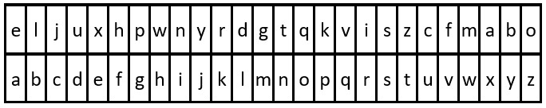

# 简化代码的小技巧

> **[2325. 解密消息](https://leetcode.cn/problems/decode-the-message/solutions/1641526/jian-hua-dai-ma-de-xiao-ji-qiao-by-endle-i81p/) · Easy**

> **题目描述**
> 给你字符串 `key` 和 `message` ，分别表示一个加密密钥和一段加密消息。解密 `message` 的步骤如下：
>
> 1. 使用 `key` 中 26 个英文小写字母第一次出现的顺序作为替换表中的字母 **顺序** 。
>
> 2. 将替换表与普通英文字母表对齐，形成对照表。
>
> 3. 按照对照表 **替换** `message` 中的每个字母。
>
> 4. 空格 `' '` 保持不变。
>
> - 例如，`key = "happy boy"`（实际的加密密钥会包含字母表中每个字母 **至少一次**），据此，可以得到部分对照表（`'h' -> 'a'`、`'a' -> 'b'`、`'p' -> 'c'`、`'y' -> 'd'`、`'b' -> 'e'`、`'o' -> 'f'`）。
>
> 返回解密后的消息。
>
> **示例 1：**
>
> 
>
> ```
>
> 输入：key = "the quick brown fox jumps over the lazy dog", message = "vkbs bs t suepuv"
> 输出："this is a secret"
> 解释：对照表如上图所示。
> 提取 "the quick brown fox jumps over the lazy dog" 中每个字母的首次出现可以得到替换表。
> ```
>
> **示例 2：**
>
> 
>
> ```
>
> 输入：key = "eljuxhpwnyrdgtqkviszcfmabo", message = "zwx hnfx lqantp mnoeius ycgk vcnjrdb"
> 输出："the five boxing wizards jump quickly"
> 解释：对照表如上图所示。
> 提取 "eljuxhpwnyrdgtqkviszcfmabo" 中每个字母的首次出现可以得到替换表。
> ```
>
> **提示：**
>
> - `26 <= key.length <= 2000`
>
> - `key` 由小写英文字母及 `' '` 组成
>
> - `key` 包含英文字母表中每个字符（`'a'` 到 `'z'`）**至少一次**
>
> - `1 <= message.length <= 2000`
>
> - `message` 由小写英文字母和 `' '` 组成

> **题解**
> 本题 [视频讲解](https://www.bilibili.com/video/BV1Yf4y1Z7Ac) 已出炉，欢迎点赞三连~
>
> ---
>
> 把空格映射到空格上，这样就不需要额外判断空格了。
>
> ```python
> class Solution:
>     def decodeMessage(self, key: str, message: str) -> str:
>         mp = {' ': ' '}
>         i = 0
>         for c in key:
>             if c not in mp:
>                 mp[c] = ascii_lowercase[i]
>                 i += 1
>         return ''.join(mp[c] for c in message)
> ```
