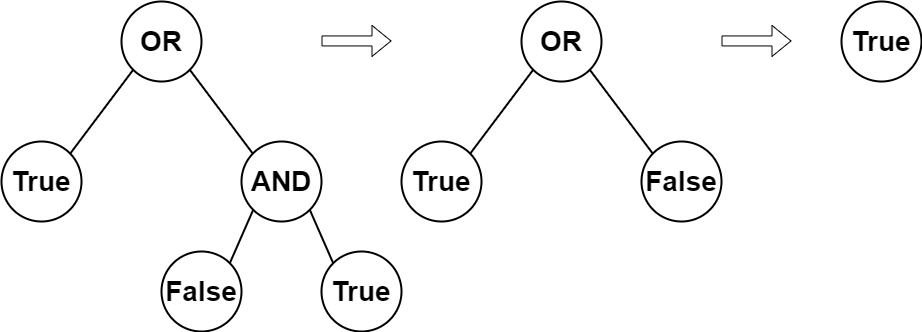

# 简洁写法，自身递归

> **[2331. 计算布尔二叉树的值](https://leetcode.cn/problems/evaluate-boolean-binary-tree/solutions/1658331/by-endlesscheng-391l/) · Easy · 难度分 1304**

> **所属题单**
> - [链表、二叉树与回溯 · 二、二叉树](../../../刷题路径/灵神原版题单/链表、二叉树与回溯/二、二叉树.md) · §2.3 自底向上 DFS（后序遍历）

> **题目描述**
> 给你一棵 **完整二叉树** 的根，这棵树有以下特征：
>
> - **叶子节点** 要么值为 `0` 要么值为 `1` ，其中 `0` 表示 `False` ，`1` 表示 `True` 。
>
> - **非叶子节点** 要么值为 `2` 要么值为 `3` ，其中 `2` 表示逻辑或 `OR` ，`3` 表示逻辑与 `AND` 。
>
> **计算** 一个节点的值方式如下：
>
> - 如果节点是个叶子节点，那么节点的 **值** 为它本身，即 `True` 或者 `False` 。
>
> - 否则，**计算** 两个孩子的节点值，然后将该节点的运算符对两个孩子值进行 **运算** 。
>
> 返回根节点 `root` 的布尔运算值。
>
> **完整二叉树** 是每个节点有 `0` 个或者 `2` 个孩子的二叉树。
>
> **叶子节点** 是没有孩子的节点。
>
> **示例 1：**
>
> 
>
> ```
> 输入：root = [2,1,3,null,null,0,1]
> 输出：true
> 解释：上图展示了计算过程。
> AND 与运算节点的值为 False AND True = False 。
> OR 运算节点的值为 True OR False = True 。
> 根节点的值为 True ，所以我们返回 true 。
> ```
>
> **示例 2：**
>
> ```
> 输入：root = [0]
> 输出：false
> 解释：根节点是叶子节点，且值为 false，所以我们返回 false 。
> ```
>
> **提示：**
>
> - 树中节点数目在 `[1, 1000]` 之间。
>
> - `0 <= Node.val <= 3`
>
> - 每个节点的孩子数为 `0` 或 `2` 。
>
> - 叶子节点的值为 `0` 或 `1` 。
>
> - 非叶子节点的值为 `2` 或 `3` 。


