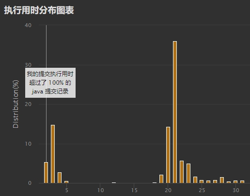

# 贪心及其证明（Python/Java/C++/Go）

> **[2350. 不可能得到的最短骰子序列](https://leetcode.cn/problems/shortest-impossible-sequence-of-rolls/solutions/1693351/by-endlesscheng-diiq/) · Hard · 难度分 1961**

> **所属题单**
> - [贪心算法 · 五、思维题](../../../刷题路径/灵神原版题单/贪心算法/五、思维题.md) · §5.1 从特殊到一般

> **题目描述**
> 给你一个长度为 `n` 的整数数组 `rolls` 和一个整数 `k` 。你扔一个 `k` 面的骰子 `n` 次，骰子的每个面分别是 `1` 到 `k` ，其中第 `i` 次扔得到的数字是 `rolls[i]` 。
>
> 请你返回 **无法** 从 `rolls` 中得到的 **最短** 骰子子序列的长度。
>
> 扔一个 `k` 面的骰子 `len` 次得到的是一个长度为 `len` 的 **骰子子序列** 。
>
> **注意** ，子序列只需要保持在原数组中的顺序，不需要连续。
>
> **示例 1：**
>
> ```
>
> 输入：rolls = [4,2,1,2,3,3,2,4,1], k = 4
> 输出：3
> 解释：所有长度为 1 的骰子子序列 [1] ，[2] ，[3] ，[4] 都可以从原数组中得到。
> 所有长度为 2 的骰子子序列 [1, 1] ，[1, 2] ，... ，[4, 4] 都可以从原数组中得到。
> 子序列 [1, 4, 2] 无法从原数组中得到，所以我们返回 3 。
> 还有别的子序列也无法从原数组中得到。
> ```
>
> **示例 2：**
>
> ```
>
> 输入：rolls = [1,1,2,2], k = 2
> 输出：2
> 解释：所有长度为 1 的子序列 [1] ，[2] 都可以从原数组中得到。
> 子序列 [2, 1] 无法从原数组中得到，所以我们返回 2 。
> 还有别的子序列也无法从原数组中得到，但 [2, 1] 是最短的子序列。
> ```
>
> **示例 3：**
>
> ```
>
> 输入：rolls = [1,1,3,2,2,2,3,3], k = 4
> 输出：1
> 解释：子序列 [4] 无法从原数组中得到，所以我们返回 1 。
> 还有别的子序列也无法从原数组中得到，但 [4] 是最短的子序列。
> ```
>
> **提示：**
>
> - `n == rolls.length`
>
> - `1 <= n <= 10⁵`
>
> - `1 <= rolls[i] <= k <= 10⁵`

> **题解**
> 本题 [视频讲解](https://www.bilibili.com/video/BV16e4y1Q73o?t=15m59s) 已出炉，欢迎点赞三连，在评论区分享你对这场双周赛的看法~
>
> ---
>
> #### 提示 1
>
> 考虑包含 $1$ 到 $k$ 的最短前缀 ，无法得到的子序列的**第一个数**必然在里面。
>
> #### 提示 2-1
>
> 这个前缀的最后一个数 $x$，在前缀中只会出现一次。
>
> 反证：如果 $x$ 出现多次，那么我们可以缩短前缀，同样可以包含 $1$ 到 $k$。
>
> #### 提示 2-2
>
> 我们可以取 $x$ 当做子序列的第一个数。
>
> #### 提示 3
>
> 去掉这个前缀，考虑**下一个**包含 $1$ 到 $k$ 的最短前缀。在提示 2-2 的前提下，子序列的**第二个数**必然在这个前缀中。同样地，取前缀最后一个数当做子序列的第二个数。
>
> 根据提示 2-1，按照这种取法，取到的这两个数组成的子序列，一定不会都位于第一个前缀中（读者可以用这两个数相同和不同来分类讨论）。因此这种取法是正确的。
>
> #### 提示 4
>
> 不断重复这一过程，直到剩余部分无法包含 $1$ 到 $k$ 时停止。
>
> 设我们取到了 $m$ 个数，对应着 $\textit{rolls}$ 的 $m$ 个子段。由于每一段都包含 $1$ 到 $k$，$\textit{rolls}$ 必然包含长度为 $m$ 的子序列：每一段都选一个元素即可组成这样的子序列。
>
> 因此答案至少为 $m+1$。
>
> 我们可以构造出一个长为 $m+1$ 的子序列，它不在 $\textit{rolls}$ 中：前 $m$ 个数分别取各个子段的最后一个数，第 $m+1$ 个数取不在剩余部分中的数。因此答案等于 $m+1$。
>
> 代码实现时，可以在遍历数组的同时，用一个 $\textit{mark}$ 数组标记当前元素属于哪个子段。这种做法的好处是每次调用时只会申请一次空间，效率更高，在 Java 上尤为明显，左侧是数组写法，右侧是哈希表写法：
>
> 
>
> #### 复杂度分析
>
> - 时间复杂度：$O(n+k)$，其中 $n$ 为 $\textit{rolls}$ 的长度。
> - 空间复杂度：$O(k)$。
>
> ```python
> class Solution:
>     def shortestSequence(self, rolls: List[int], k: int) -> int:
>         mark = [0] * (k + 1)  # mark[v] 标记 v 属于哪个子段
>         ans, left = 1, k
>         for v in rolls:
>             if mark[v] < ans:
>                 mark[v] = ans
>                 left -= 1
>                 if left == 0:
>                     left = k
>                     ans += 1
>         return ans
> ```
>
>
> #### 思考题
>
> 给你 $n$，$k$ 和答案 $\textit{ans}$，请你构造一个长为 $n$ 的 $\textit{rolls}$ 数组，使得 `shortestSequence(rolls, k)` 的输出恰好为 $\textit{ans}$。
