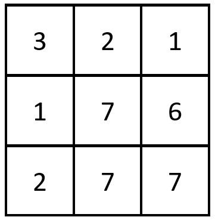
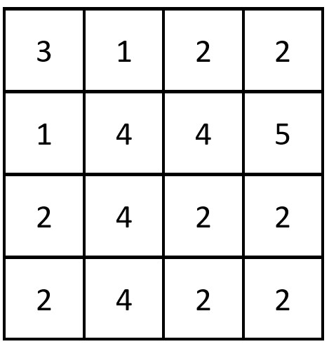

# 哈希表（Python 两行）

> **[2352. 相等行列对](https://leetcode.cn/problems/equal-row-and-column-pairs/solutions/1694047/ha-xi-biao-python-liang-xing-by-endlessc-ljae/) · Medium**

> **题目描述**
> 给你一个下标从 **0** 开始、大小为 `n x n` 的整数矩阵 `grid` ，返回满足 `R_i` 行和 `C_j` 列相等的行列对 `(R_i, C_j)` 的数目<em>。</em>
>
> 如果行和列以相同的顺序包含相同的元素（即相等的数组），则认为二者是相等的。
>
> **示例 1：**
>
> 
>
> ```
>
> 输入：grid = [[3,2,1],[1,7,6],[2,7,7]]
> 输出：1
> 解释：存在一对相等行列对：
> - (第 2 行，第 1 列)：[2,7,7]
> ```
>
> **示例 2：**
>
> 
>
> ```
>
> 输入：grid = [[3,1,2,2],[1,4,4,5],[2,4,2,2],[2,4,2,2]]
> 输出：3
> 解释：存在三对相等行列对：
> - (第 0 行，第 0 列)：[3,1,2,2]
> - (第 2 行, 第 2 列)：[2,4,2,2]
> - (第 3 行, 第 2 列)：[2,4,2,2]
> ```
>
> **提示：**
>
> - `n == grid.length == grid[i].length`
>
> - `1 <= n <= 200`
>
> - `1 <= grid[i][j] <= 10⁵`

> **题解**
> 用哈希表统计每行出现的次数，然后遍历列，累加哈希表中列出现的次数。
>
> ```python
> class Solution:
>     def equalPairs(self, grid: List[List[int]]) -> int:
>         cnt = Counter(tuple(row) for row in grid)
>         return sum(cnt[col] for col in zip(*grid))
> ```
>
>
> #### 复杂度分析
>
> - 时间复杂度：$\mathcal{O}(n^2)$，其中 $n$ 为 $\textit{grid}$ 的长度。
> - 空间复杂度：$\mathcal{O}(n^2)$。
>
> [往期每日一题题解（按 tag 分类）](https://github.com/EndlessCheng/codeforces-go/blob/master/leetcode/SOLUTIONS.md)
>
> ---
>
> 欢迎关注[ biIibiIi@灵茶山艾府](https://space.bilibili.com/206214)，高质量算法教学，持续输出中~
