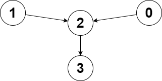
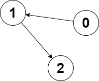

# 两种方法：最短路 / 我吹过你吹过的晚风（Python/Java/C++/Go）

> **[2359. 找到离给定两个节点最近的节点](https://leetcode.cn/problems/find-closest-node-to-given-two-nodes/solutions/1710829/ji-suan-dao-mei-ge-dian-de-ju-chi-python-gr2u/) · Medium · 难度分 1715**

> **所属题单**
> - [图论算法 · 二、拓扑排序](../../../刷题路径/灵神原版题单/图论算法/二、拓扑排序.md) · §2.3 基环树

> **题目描述**
> 给你一个 `n` 个节点的 **有向图** ，节点编号为 `0` 到 `n - 1` ，每个节点 **至多** 有一条出边。
>
> 有向图用大小为 `n` 下标从 **0** 开始的数组 `edges` 表示，表示节点 `i` 有一条有向边指向 `edges[i]` 。如果节点 `i` 没有出边，那么 `edges[i] == -1` 。
>
> 同时给你两个节点 `node1` 和 `node2` 。
>
> 请你返回一个从 `node1` 和 `node2` 都能到达节点的编号，使节点 `node1` 和节点 `node2` 到这个节点的距离 **较大值最小化**。如果有多个答案，请返回 **最小** 的节点编号。如果答案不存在，返回 `-1` 。
>
> 注意 `edges` 可能包含环。
>
> **示例 1：**
>
> 
>
> ```
> 输入：edges = [2,2,3,-1], node1 = 0, node2 = 1
> 输出：2
> 解释：从节点 0 到节点 2 的距离为 1 ，从节点 1 到节点 2 的距离为 1 。
> 两个距离的较大值为 1 。我们无法得到一个比 1 更小的较大值，所以我们返回节点 2 。
> ```
>
> **示例 2：**
>
> 
>
> ```
> 输入：edges = [1,2,-1], node1 = 0, node2 = 2
> 输出：2
> 解释：节点 0 到节点 2 的距离为 2 ，节点 2 到它自己的距离为 0 。
> 两个距离的较大值为 2 。我们无法得到一个比 2 更小的较大值，所以我们返回节点 2 。
> ```
>
> **提示：**
>
> - `n == edges.length`
>
> - `2 <= n <= 10⁵`
>
> - `-1 <= edges[i] < n`
>
> - `edges[i] != i`
>
> - `0 <= node1, node2 < n`

> **题解**
> ## 方法一：计算最短路
>
> 我们需要知道 $\textit{node}_1$ 到每个点的最短路长度 $\textit{dis}_1[i]$，以及 $\textit{node}_2$ 到每个点的最短路长度 $\textit{dis}_2[i]$。
>
> 题目要我们计算的，是 $\max(\textit{dis}_1[i],\textit{dis}_2[i])$ 的最小值对应的节点编号 $i$。若没有这样的节点，返回 $-1$。
>
> 求最短路可以用 BFS 做。不过，由于本题输入是树或者 [内向基环树](../../2100-2199/2127%20参加会议的最多员工数/灵茶山艾府.md)（森林），每个连通块至多有一个环，我们可以用一个简单的循环求出 $\textit{dis}_i$。
>
> ```python
> class Solution:
>     def closestMeetingNode(self, edges: List[int], node1: int, node2: int) -> int:
>         n = len(edges)
>         def calc_dis(x: int) -> List[int]:
>             dis = [n] * n  # 初始化成 n，表示无法到达或者尚未访问的节点
>             d = 0
>             # 从 x 出发，直到无路可走（x=-1）或者重复访问节点（dis[x]<n）
>             while x >= 0 and dis[x] == n:
>                 dis[x] = d
>                 d += 1
>                 x = edges[x]
>             return dis
>
>         dis1 = calc_dis(node1)
>         dis2 = calc_dis(node2)
>
>         min_dis, ans = n, -1
>         for i, (d1, d2) in enumerate(zip(dis1, dis2)):
>             d = max(d1, d2)
>             if d < min_dis:
>                 min_dis, ans = d, i
>         return ans
> ```
>
>
> #### 复杂度分析
>
> - 时间复杂度：$\mathcal{O}(n)$，其中 $n$ 为 $\textit{edges}$ 的长度。
> - 空间复杂度：$\mathcal{O}(n)$。
>
> ## 方法二：「我吹过你吹过的晚风」
>
> 为方便描述，把 $\textit{node}_1$ 和 $\textit{node}_2$ 分别视作两个人 $x$ 和 $y$。
>
> 两个人顺着 $\textit{edges}$ 移动，标记访问过的节点，即更新 $\textit{visX}[x]=\texttt{true}$ 以及 $\textit{visY}[y]=\texttt{true}$。
>
> 如果某个时刻，$x$ 到达 $y$ 走过的路，即 $\textit{visY}[x]$ 为 $\texttt{true}$，那么当前 $x$ 所在节点，就是两人都可以到达的节点，且距离最近。
>
> 如果某个时刻，$y$ 到达 $x$ 走过的路，即 $\textit{visX}[y]$ 为 $\texttt{true}$，那么当前 $y$ 所在节点，就是两人都可以到达的节点，且距离最近。
>
> 如果某个时刻上面两种情况同时发生，返回二者的最小值。
>
> 如果两个人都走到死路或者各自走过的路，返回 $-1$。
>
> ```python
> class Solution:
>     def closestMeetingNode(self, edges: List[int], x: int, y: int) -> int:
>         ans = n = len(edges)
>         vis_x = [False] * n
>         vis_y = [False] * n
>
>         while not vis_x[x] or not vis_y[y]:  # x 或 y 没有访问过
>             vis_x[x] = vis_y[y] = True  # 标记访问过
>
>             if vis_y[x]:  # 我吹过你吹过的晚风
>                 ans = x
>             if vis_x[y]:
>                 ans = min(ans, y)  # 如果有多个答案，返回最小的节点编号
>             if ans < n:
>                 return ans
>
>             if edges[x] >= 0:
>                 x = edges[x]  # 继续走
>             if edges[y] >= 0:
>                 y = edges[y]  # 继续走
>
>         return -1
> ```
>
>
> #### 复杂度分析
>
> - 时间复杂度：$\mathcal{O}(n)$，其中 $n$ 为 $\textit{edges}$ 的长度。单看 $x$ 或 $y$，每次循环会标记一个没有访问过的节点，一共有 $n$ 个节点，所以至多循环 $n$ 次。
> - 空间复杂度：$\mathcal{O}(n)$。
>
> ## 思考题
>
> 1. 如果输入的不止两个节点 $\textit{node}_1$ 和 $\textit{node}_2$，而是一个很长的 $\textit{nodes}$ 列表，要怎么做呢？
> 2. 如果输入的是 $\textit{queries}$ 询问数组，每个询问包含两个节点 $\textit{node}_1$ 和 $\textit{node}_2$，你需要快速计算 `closestMeetingNode(edges, node1, node2)`，要怎么做呢？
>
> **解答**：见 [视频讲解](https://www.bilibili.com/video/BV1Ba411N78j/?t=22m01s) 第三题。
>
> ## 分类题单
>
> [如何科学刷题？](https://leetcode.cn/circle/discuss/RvFUtj/)
>
> 1. [滑动窗口与双指针（定长/不定长/单序列/双序列/三指针/分组循环）](https://leetcode.cn/circle/discuss/0viNMK/)
> 2. [二分算法（二分答案/最小化最大值/最大化最小值/第K小）](https://leetcode.cn/circle/discuss/SqopEo/)
> 3. [单调栈（基础/矩形面积/贡献法/最小字典序）](https://leetcode.cn/circle/discuss/9oZFK9/)
> 4. [网格图（DFS/BFS/综合应用）](https://leetcode.cn/circle/discuss/YiXPXW/)
> 5. [位运算（基础/性质/拆位/试填/恒等式/思维）](https://leetcode.cn/circle/discuss/dHn9Vk/)
> 6. [图论算法（DFS/BFS/拓扑排序/基环树/最短路/最小生成树/网络流）](https://leetcode.cn/circle/discuss/01LUak/)
> 7. [动态规划（入门/背包/划分/状态机/区间/状压/数位/数据结构优化/树形/博弈/概率期望）](https://leetcode.cn/circle/discuss/tXLS3i/)
> 8. [常用数据结构（前缀和/差分/栈/队列/堆/字典树/并查集/树状数组/线段树）](https://leetcode.cn/circle/discuss/mOr1u6/)
> 9. [数学算法（数论/组合/概率期望/博弈/计算几何/随机算法）](https://leetcode.cn/circle/discuss/IYT3ss/)
> 10. [贪心与思维（基本贪心策略/反悔/区间/字典序/数学/思维/脑筋急转弯/构造）](https://leetcode.cn/circle/discuss/g6KTKL/)
> 11. [链表、二叉树与回溯（前后指针/快慢指针/DFS/BFS/直径/LCA/一般树）](https://leetcode.cn/circle/discuss/K0n2gO/)
> 12. [字符串（KMP/Z函数/Manacher/字符串哈希/AC自动机/后缀数组/子序列自动机）](https://leetcode.cn/circle/discuss/SJFwQI/)
>
> [我的题解精选（已分类）](https://github.com/EndlessCheng/codeforces-go/blob/master/leetcode/SOLUTIONS.md)
>
> 欢迎关注 [B站@灵茶山艾府](https://space.bilibili.com/206214)
