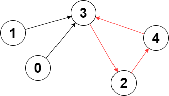
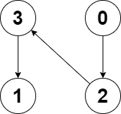

# 2360. 图中的最长环

Hard · 难度分 1897 · [力扣原题](https://leetcode.cn/problems/longest-cycle-in-a-graph/)

所在刷题路径：灵神题单·图论算法

| 作者 | 题解 | 动画讲解 |
|---|---|---|
| 灵茶山艾府 | [📄 题解](灵茶山艾府.md) | [▶︎ 2360 图中的最长环 · 灵茶山艾府.mp4](2360%20图中的最长环%20·%20灵茶山艾府.mp4) |
| yiduobo | [📄 题解](yiduobo.md) | [▶︎ 2360 图中的最长环 · yiduobo.mp4](2360%20图中的最长环%20·%20yiduobo.mp4) |

## 题目描述

给你一个 `n` 个节点的 **有向图** ，节点编号为 `0` 到 `n - 1` ，其中每个节点 **至多** 有一条出边。

图用一个大小为 `n` 下标从 **0** 开始的数组 `edges` 表示，节点 `i` 到节点 `edges[i]` 之间有一条有向边。如果节点 `i` 没有出边，那么 `edges[i] == -1` 。

请你返回图中的 **最长** 环，如果没有任何环，请返回 `-1` 。

一个环指的是起点和终点是 **同一个** 节点的路径。

**示例 1：**



```

输入：edges = [3,3,4,2,3]
输出去：3
解释：图中的最长环是：2 -> 4 -> 3 -> 2 。
这个环的长度为 3 ，所以返回 3 。
```

**示例 2：**



```

输入：edges = [2,-1,3,1]
输出：-1
解释：图中没有任何环。
```

**提示：**

- `n == edges.length`

- `2 <= n <= 10⁵`

- `-1 <= edges[i] < n`

- `edges[i] != i`

---
[↑ 返回 2300-2399](../README.md) · [总索引](../../../索引.md) · [仓库首页](../../../README.md)
