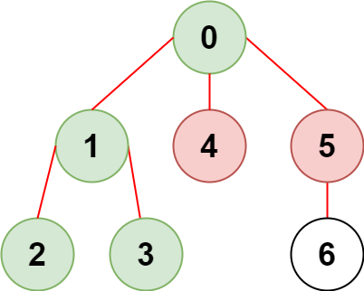
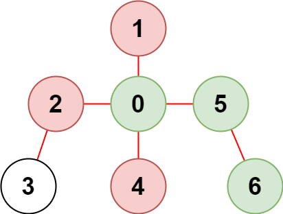

# 2368. 受限条件下可到达节点的数目

Medium · 难度分 1477 · [力扣原题](https://leetcode.cn/problems/reachable-nodes-with-restrictions/)

所在刷题路径：灵神题单·链表树与回溯

| 作者 | 题解 | 动画讲解 |
|---|---|---|
| 灵茶山艾府 | [📄 题解](灵茶山艾府.md) | [▶︎ 2368 受限条件下可到达节点的数目 · 灵茶山艾府.mp4](2368%20受限条件下可到达节点的数目%20·%20灵茶山艾府.mp4) |
| yiduobo | [📄 题解](yiduobo.md) | [▶︎ 2368 受限条件下可到达节点的数目 · yiduobo.mp4](2368%20受限条件下可到达节点的数目%20·%20yiduobo.mp4) |

## 题目描述

现有一棵由 `n` 个节点组成的无向树，节点编号从 `0` 到 `n - 1` ，共有 `n - 1` 条边。

给你一个二维整数数组 `edges` ，长度为 `n - 1` ，其中 `edges[i] = [a_i, b_i]` 表示树中节点 `a_i` 和 `b_i` 之间存在一条边。另给你一个整数数组 `restricted` 表示 **受限** 节点。

在不访问受限节点的前提下，返回你可以从节点 `0` 到达的 **最多** 节点数目<em>。</em>

注意，节点 `0` **不** 会标记为受限节点。

**示例 1：**



```
输入：n = 7, edges = [[0,1],[1,2],[3,1],[4,0],[0,5],[5,6]], restricted = [4,5]
输出：4
解释：上图所示正是这棵树。
在不访问受限节点的前提下，只有节点 [0,1,2,3] 可以从节点 0 到达。
```

**示例 2：**



```
输入：n = 7, edges = [[0,1],[0,2],[0,5],[0,4],[3,2],[6,5]], restricted = [4,2,1]
输出：3
解释：上图所示正是这棵树。
在不访问受限节点的前提下，只有节点 [0,5,6] 可以从节点 0 到达。
```

**提示：**

- `2 <= n <= 10⁵`

- `edges.length == n - 1`

- `edges[i].length == 2`

- `0 <= a_i, b_i < n`

- `a_i != b_i`

- `edges` 表示一棵有效的树

- `1 <= restricted.length < n`

- `1 <= restricted[i] < n`

- `restricted` 中的所有值 **互不相同**

---
[↑ 返回 2300-2399](../README.md) · [总索引](../../../索引.md) · [仓库首页](../../../README.md)
