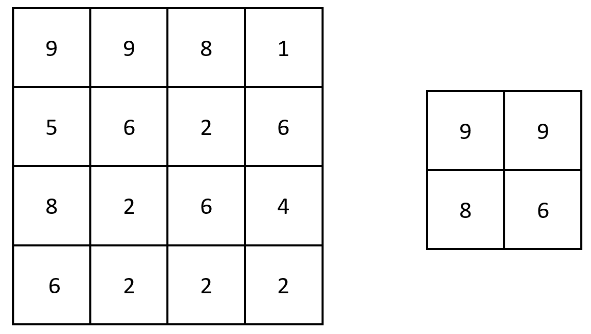
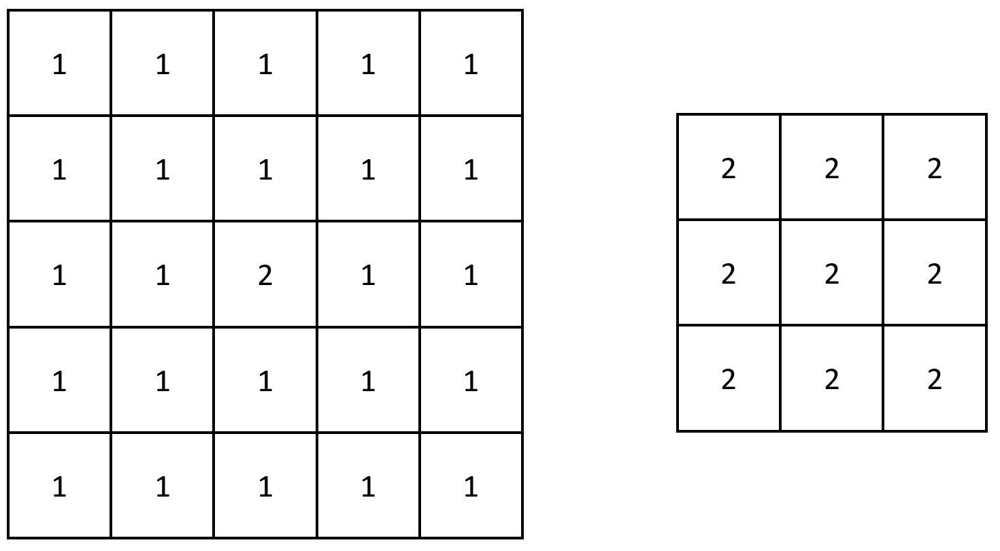

# 原地修改

> **[2373. 矩阵中的局部最大值](https://leetcode.cn/problems/largest-local-values-in-a-matrix/solutions/1746845/yuan-di-xiu-gai-by-endlesscheng-m1k3/) · Easy**

> **题目描述**
> 给你一个大小为 `n x n` 的整数矩阵 `grid` 。
>
> 生成一个大小为 `(n - 2) x (n - 2)` 的整数矩阵  `maxLocal` ，并满足：
>
> - `maxLocal[i][j]` 等于 `grid` 中以 `i + 1` 行和 `j + 1` 列为中心的 `3 x 3` 矩阵中的 **最大值** 。
>
> 换句话说，我们希望找出 `grid` 中每个 `3 x 3` 矩阵中的最大值。
>
> 返回生成的矩阵。
>
> **示例 1：**
>
> 
>
> ```
>
> 输入：grid = [[9,9,8,1],[5,6,2,6],[8,2,6,4],[6,2,2,2]]
> 输出：[[9,9],[8,6]]
> 解释：原矩阵和生成的矩阵如上图所示。
> 注意，生成的矩阵中，每个值都对应 grid 中一个相接的 3 x 3 矩阵的最大值。
> ```
>
> **示例 2：**
>
> 
>
> ```
>
> 输入：grid = [[1,1,1,1,1],[1,1,1,1,1],[1,1,2,1,1],[1,1,1,1,1],[1,1,1,1,1]]
> 输出：[[2,2,2],[2,2,2],[2,2,2]]
> 解释：注意，2 包含在 grid 中每个 3 x 3 的矩阵中。
> ```
>
> **提示：**
>
> - `n == grid.length == grid[i].length`
>
> - `3 <= n <= 100`
>
> - `1 <= grid[i][j] <= 100`

> **题解**
> 本题 [视频讲解](https://www.bilibili.com/video/BV1rS4y1s721) 已出炉，欢迎点赞~
>
> ---
>
> 把最大值直接保存在 $3\times 3$ 矩阵的左上角，这样无需创建返回矩阵。
>
> ```python
> class Solution:
>     def largestLocal(self, grid: List[List[int]]) -> List[List[int]]:
>         n = len(grid)
>         for i in range(n - 2):
>             for j in range(n - 2):
>                 grid[i][j] = max(max(row[j:j + 3]) for row in grid[i:i + 3])
>             del grid[i][-2:]
>         del grid[-2:]  # 不要 return grid[:-2] 那样会有额外的拷贝
>         return grid
> ```
>
>
> ### 复杂度分析
>
> - 时间复杂度：$O(n^2)$，其中 $n$ 为 $\textit{grid}$ 的长度。
> - 空间复杂度：$O(1)$。仅用到若干额外变量。
>
> #### 思考题
>
> 如果把 $3\times 3$ 改成一个比较大的 $h\times w$，你能想出一个非暴力做法吗？
>
> 见我的模板库中的[「二维单调队列」](https://github.com/EndlessCheng/codeforces-go/blob/master/copypasta/monotone_queue.go#L214)
