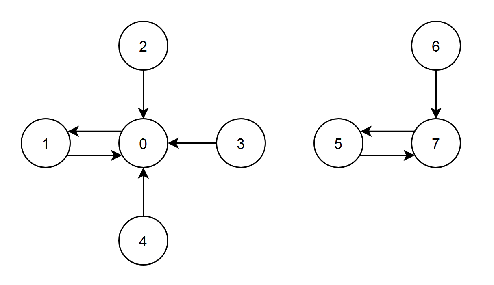
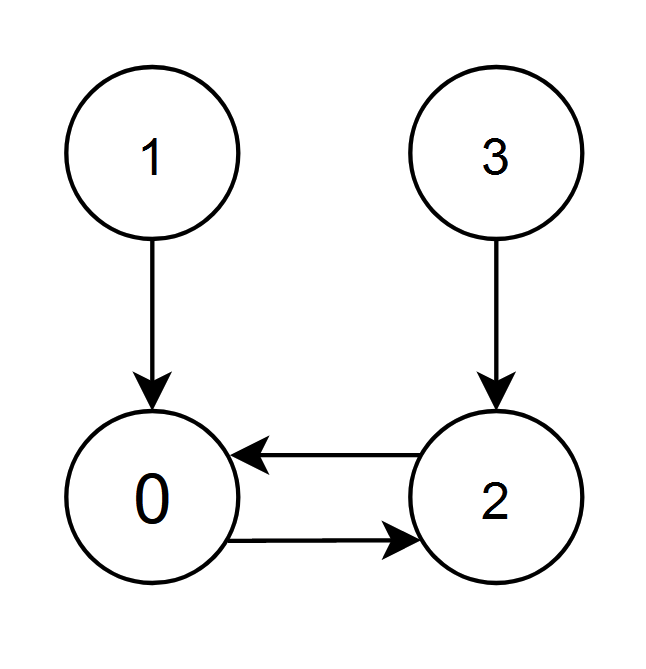

# 一次遍历（Python/Java/C++/C/Go/JS/Rust）

> **[2374. 边积分最高的节点](https://leetcode.cn/problems/node-with-highest-edge-score/solutions/1746842/by-endlesscheng-z1sm/) · Medium**

> **题目描述**
> 给你一个有向图，图中有 `n` 个节点，节点编号从 `0` 到 `n - 1` ，其中每个节点都 **恰有一条** 出边。
>
> 图由一个下标从 **0** 开始、长度为 `n` 的整数数组 `edges` 表示，其中 `edges[i]` 表示存在一条从节点 `i` 到节点 `edges[i]` 的 **有向** 边。
>
> 节点 `i` 的 **边积分** 定义为：所有存在一条指向节点 `i` 的边的节点的 **编号** 总和。
>
> 返回 **边积分** 最高的节点。如果多个节点的 **边积分** 相同，返回编号 **最小** 的那个。
>
> **示例 1：**
>
> 
>
> ```
> 输入：edges = [1,0,0,0,0,7,7,5]
> 输出：7
> 解释：
> - 节点 1、2、3 和 4 都有指向节点 0 的边，节点 0 的边积分等于 1 + 2 + 3 + 4 = 10 。
> - 节点 0 有一条指向节点 1 的边，节点 1 的边积分等于 0 。
> - 节点 7 有一条指向节点 5 的边，节点 5 的边积分等于 7 。
> - 节点 5 和 6 都有指向节点 7 的边，节点 7 的边积分等于 5 + 6 = 11 。
> 节点 7 的边积分最高，所以返回 7 。
> ```
>
> **示例 2：**
>
> 
>
> ```
> 输入：edges = [2,0,0,2]
> 输出：0
> 解释：
> - 节点 1 和 2 都有指向节点 0 的边，节点 0 的边积分等于 1 + 2 = 3 。
> - 节点 0 和 3 都有指向节点 2 的边，节点 2 的边积分等于 0 + 3 = 3 。
> 节点 0 和 2 的边积分都是 3 。由于节点 0 的编号更小，返回 0 。
> ```
>
> **提示：**
>
> - `n == edges.length`
>
> - `2 <= n <= 10⁵`
>
> - `0 <= edges[i] < n`
>
> - `edges[i] != i`

> **题解**
> 用一个长为 $n$ 的数组 $\textit{score}$ 记录每个节点的得分。
>
> 遍历 $\textit{edges}$，根据题意，把 $i$ 加到 $\textit{score}[\textit{edges}[i]]$ 中。
>
> 返回 $\textit{score}[i]$ 最大且（在积分相同时）$i$ 最小的 $i$。
>
> ```python
> class Solution:
>     def edgeScore(self, edges: List[int]) -> int:
>         ans = 0
>         score = [0] * len(edges)
>         for i, to in enumerate(edges):
>             score[to] += i
>             if score[to] > score[ans] or score[to] == score[ans] and to < ans:
>                 ans = to
>         return ans
> ```
>
> > [!example]- Python3 写法二
> > ```python
> > # 虽然简洁，但不是一次遍历
> > class Solution:
> >     def edgeScore(self, edges: List[int]) -> int:
> >         score = [0] * len(edges)
> >         for i, to in enumerate(edges):
> >             score[to] += i
> >         return score.index(max(score))
> > ```
>
>
> #### 复杂度分析
>
> - 时间复杂度：$\mathcal{O}(n)$，其中 $n$ 是 $\textit{edges}$ 的长度。
> - 空间复杂度：$\mathcal{O}(n)$。
>
> ## 分类题单
>
> [如何科学刷题？](https://leetcode.cn/circle/discuss/RvFUtj/)
>
> 1. [滑动窗口与双指针（定长/不定长/单序列/双序列/三指针）](https://leetcode.cn/circle/discuss/0viNMK/)
> 2. [二分算法（二分答案/最小化最大值/最大化最小值/第K小）](https://leetcode.cn/circle/discuss/SqopEo/)
> 3. [单调栈（基础/矩形面积/贡献法/最小字典序）](https://leetcode.cn/circle/discuss/9oZFK9/)
> 4. [网格图（DFS/BFS/综合应用）](https://leetcode.cn/circle/discuss/YiXPXW/)
> 5. [位运算（基础/性质/拆位/试填/恒等式/思维）](https://leetcode.cn/circle/discuss/dHn9Vk/)
> 6. [图论算法（DFS/BFS/拓扑排序/最短路/最小生成树/二分图/基环树/欧拉路径）](https://leetcode.cn/circle/discuss/01LUak/)
> 7. [动态规划（入门/背包/状态机/划分/区间/状压/数位/数据结构优化/树形/博弈/概率期望）](https://leetcode.cn/circle/discuss/tXLS3i/)
> 8. [常用数据结构（前缀和/差分/栈/队列/堆/字典树/并查集/树状数组/线段树）](https://leetcode.cn/circle/discuss/mOr1u6/)
> 9. [数学算法（数论/组合/概率期望/博弈/计算几何/随机算法）](https://leetcode.cn/circle/discuss/IYT3ss/)
> 10. [贪心与思维（基本贪心策略/反悔/区间/字典序/数学/思维/脑筋急转弯/构造）](https://leetcode.cn/circle/discuss/g6KTKL/)
> 11. [链表、二叉树与一般树（前后指针/快慢指针/DFS/BFS/直径/LCA）](https://leetcode.cn/circle/discuss/K0n2gO/)
>
> [我的题解精选（已分类）](https://github.com/EndlessCheng/codeforces-go/blob/master/leetcode/SOLUTIONS.md)
>
> 欢迎关注 [B站@灵茶山艾府](https://space.bilibili.com/206214)
