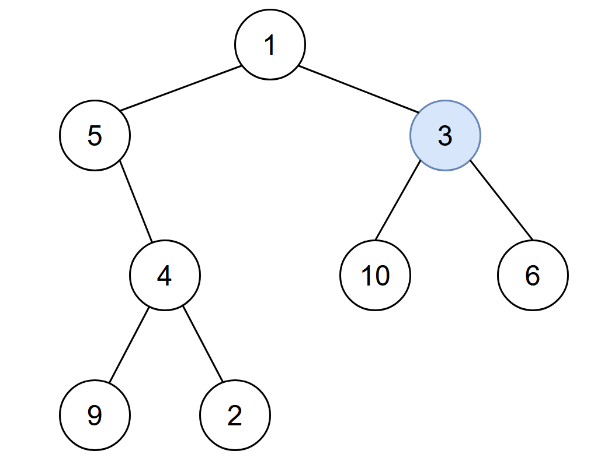
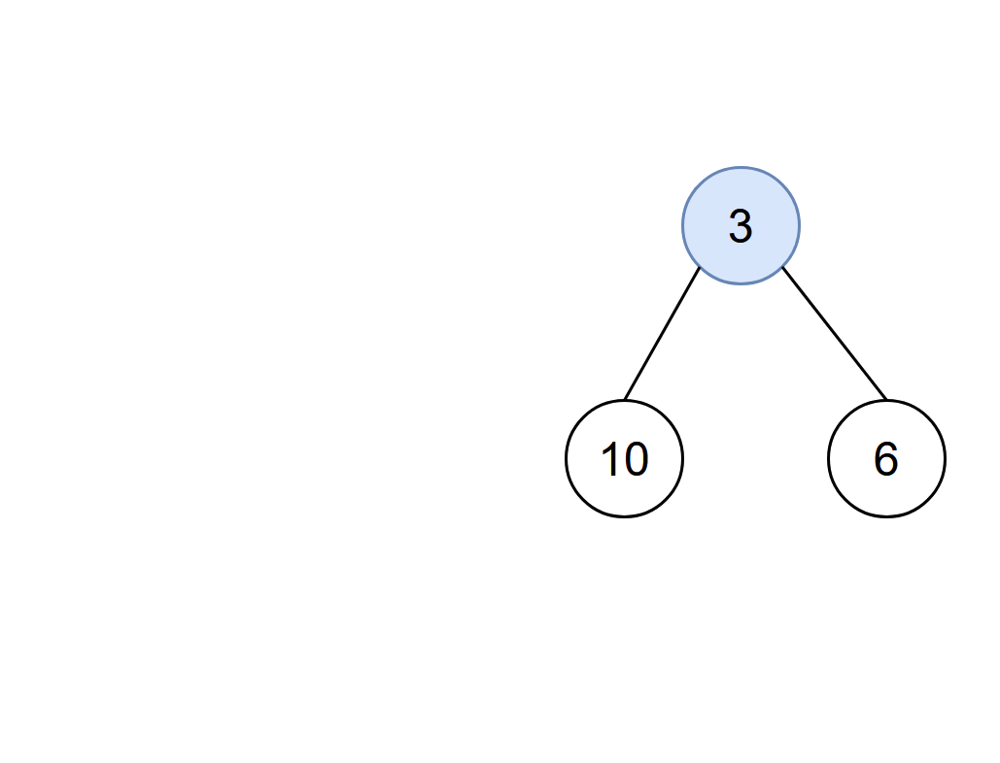
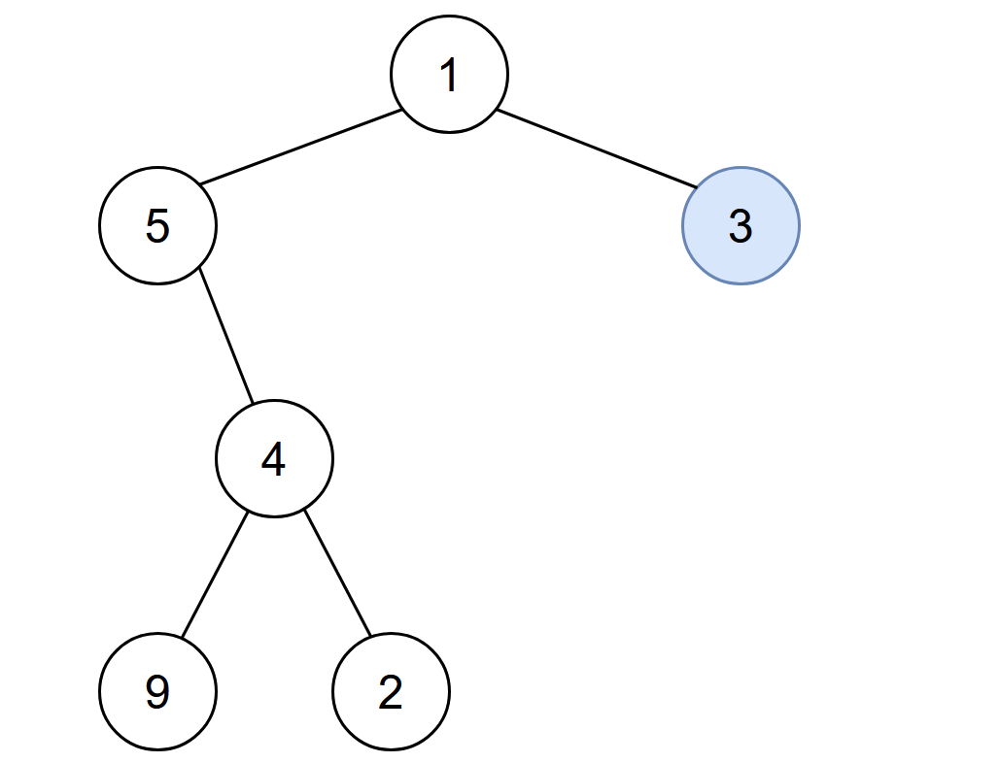

# 从两次遍历到一次遍历（Python/Java/C++/Go/JS/Rust）

> **[2385. 感染二叉树需要的总时间](https://leetcode.cn/problems/amount-of-time-for-binary-tree-to-be-infected/solutions/2753470/cong-liang-ci-bian-li-dao-yi-ci-bian-li-tmt0x/) · Medium · 难度分 1711**

> **所属题单**
> - [链表、二叉树与回溯 · 二、二叉树](../../../刷题路径/灵神原版题单/链表、二叉树与回溯/二、二叉树.md) · §2.6 二叉树的直径
> - [动态规划 · 十二、树形 DP](../../../刷题路径/灵神原版题单/动态规划/十二、树形%20DP.md) · §12.1 树的直径

> **题目描述**
> 给你一棵二叉树的根节点 `root` ，二叉树中节点的值 **互不相同** 。另给你一个整数 `start` 。在第 `0` 分钟，**感染** 将会从值为 `start` 的节点开始爆发。
>
> 每分钟，如果节点满足以下全部条件，就会被感染：
>
> - 节点此前还没有感染。
>
> - 节点与一个已感染节点相邻。
>
> 返回感染整棵树需要的分钟数<em>。</em>
>
> **示例 1：**
>
> 
>
> ```
> 输入：root = [1,5,3,null,4,10,6,9,2], start = 3
> 输出：4
> 解释：节点按以下过程被感染：
> - 第 0 分钟：节点 3
> - 第 1 分钟：节点 1、10、6
> - 第 2 分钟：节点5
> - 第 3 分钟：节点 4
> - 第 4 分钟：节点 9 和 2
> 感染整棵树需要 4 分钟，所以返回 4 。
> ```
>
> **示例 2：**
>
> 
>
> ```
> 输入：root = [1], start = 1
> 输出：0
> 解释：第 0 分钟，树中唯一一个节点处于感染状态，返回 0 。
> ```
>
> **提示：**
>
> - 树中节点的数目在范围 `[1, 10⁵]` 内
>
> - `1 <= Node.val <= 10⁵`
>
> - 每个节点的值 **互不相同**
>
> - 树中必定存在值为 `start` 的节点

> **题解**
> ## 题意
>
> 设 $v$ 是离 $\textit{start}$ 最远的节点，返回 $\textit{start}$ 到 $v$ 的距离。例如示例 1 中节点 $9$（或者节点 $2$）离 $\textit{start}=3$ 最远，二者距离为 $4$。
>
> ## 方法一：记录父节点 + DFS
>
> 首先从 $\textit{root}$ 出发 DFS 这棵树，找到节点值为 $\textit{start}$ 的节点 $\textit{startNode}$。DFS 的同时，用一个哈希表（或者数组）记录每个节点的父节点。
>
> 然后从 $\textit{startNode}$ 出发 DFS 这棵树，求出 [104. 二叉树的最大深度](https://leetcode.cn/problems/maximum-depth-of-binary-tree/)，即为答案（把 $\textit{startNode}$ 的深度当作 $0$）。注意除了递归左右儿子以外，还需要递归父节点。为避免重复访问节点，可以添加一个递归参数 $\textit{from}$，表示当前节点是从节点 $\textit{from}$ 过来的，我们不去重复访问节点 $\textit{from}$。
>
> 关于 104 题的讲解，见 [深刻理解递归【基础算法精讲 09】](https://www.bilibili.com/video/BV1UD4y1Y769/)。
>
> 这种方法需要遍历二叉树两次。
>
> ```python
> class Solution:
>     def amountOfTime(self, root: Optional[TreeNode], start: int) -> int:
>         fa = {}
>         start_node = None
>         def dfs(node: Optional[TreeNode], from_: Optional[TreeNode]) -> None:
>             if node is None:
>                 return
>             fa[node] = from_  # 记录每个节点的父节点
>             if node.val == start:  # 找到 start
>                 nonlocal start_node
>                 start_node = node
>             dfs(node.left, node)
>             dfs(node.right, node)
>         dfs(root, None)
>
>         def maxDepth(node: Optional[TreeNode], from_: TreeNode) -> int:
>             if node is None:
>                 return -1  # 注意这里是 -1，因为 start 的深度为 0
>             return max(maxDepth(x, node) for x in (node.left, node.right, fa[node]) if x != from_) + 1
>         return maxDepth(start_node, start_node)
> ```
>
>
> #### 复杂度分析
>
> - 时间复杂度：$\mathcal{O}(n)$，其中 $n$ 为二叉树的节点个数。
> - 空间复杂度：$\mathcal{O}(n)$。
>
> ## 方法二：树的直径
>
> 
>
> 以示例 1 为例，我们可以把问题拆分成两个问题。
>
> **第一个问题**：以 $3$ 为根节点的子树的 [104. 二叉树的最大深度](https://leetcode.cn/problems/maximum-depth-of-binary-tree/)，其中节点 $3$ 的深度为 $0$。
>
> 如下图，这棵子树的最大深度是 $1$，也就是 $3$ **往下走**的最远距离。
>
> 
>
> **第二个问题**：去掉 $3$ 的所有子孙节点，此时 $3$ 变成了一个叶子节点。我们相当于计算其中一个端点固定为 $3$ 的 [543. 二叉树的直径](https://leetcode.cn/problems/diameter-of-binary-tree/)。
>
> 如下图，若固定直径的一个端点为 $3$，则这条直径可以是 $3\text{-}1\text{-}5\text{-}4\text{-}9$，长度（边的个数）为 $4$。相当于从 $3$ 出发**往上走**，在某个点「拐弯」后再往下走。
>
> 
>
> 这两个问题的答案取最大值 $\max(1,4)=4$，即为原问题的答案。
>
> 关于 543 题的讲解，请看 [树的直径【基础算法精讲 23】](https://www.bilibili.com/video/BV17o4y187h1/)。
>
> 本题算法如下：
>
> 1. 递归时，除了返回当前子树的最大链长加一，还需要返回一个布尔值，表示当前子树是否包含 $\textit{start}$。
> 2. 如果当前节点是空节点，返回 $0$ 和 $\texttt{false}$。
> 3. 设左子树的返回的链长为 $\textit{lLen}$，右子树返回的链长为 $\textit{rLen}$。
> 4. 如果当前节点值等于 $\textit{start}$，初始化答案为 $\max(\textit{lLen},\textit{rLen})$，即子树 $\textit{start}$ 的最大深度。然后返回 $1$ 和 $\texttt{true}$。
> 5. 如果左右子树都不包含 $\textit{start}$，返回 $\max(\textit{lLen},\textit{rLen}) + 1$。
> 6. 如果左子树或右子树包含 $\textit{start}$，像计算直径那样，用 $\textit{lLen}+\textit{rLen}$ 更新答案的最大值。如果左子树包含 $\textit{start}$，则返回 $\textit{lLen}$ 和 $\texttt{true}$，否则返回 $\textit{rLen}$ 和 $\texttt{true}$。这种返回方式可以保证 $\textit{lLen}+\textit{rLen}$ 一定是端点为 $\textit{start}$ 的直径长度。
>
> ```python
> class Solution:
>     def amountOfTime(self, root: Optional[TreeNode], start: int) -> int:
>         ans = 0
>         def dfs(node: Optional[TreeNode]) -> (int, bool):
>             if node is None:
>                 return 0, False
>             l_len, l_found = dfs(node.left)
>             r_len, r_found = dfs(node.right)
>             nonlocal ans
>             if node.val == start:
>                 # 计算子树 start 的最大深度
>                 # 注意这里和方法一的区别，max 后面没有 +1，所以算出的也是最大深度
>                 ans = max(l_len, r_len)
>                 return 1, True  # 找到了 start
>             if l_found or r_found:
>                 # 只有在左子树或右子树包含 start 时，才能更新答案
>                 ans = max(ans, l_len + r_len)  # 两条链拼成直径
>                 # 保证 start 是直径端点
>                 return (l_len if l_found else r_len) + 1, True
>             return max(l_len, r_len) + 1, False
>         dfs(root)
>         return ans
> ```
>
>
> ## 另一种写法
>
> 上面的写法 DFS 会返回两个值，能否只返回一个值呢？
>
> 可以的，去掉布尔值，把**负数**利用起来：
>
> - 如果子树不含 $\textit{start}$，将原来的返回值改为相反数（负数）。
> - 如果子树包含 $\textit{start}$，返回值不变。
>
> ```python
> class Solution:
>     def amountOfTime(self, root: Optional[TreeNode], start: int) -> int:
>         ans = 0
>         def dfs(node: Optional[TreeNode]) -> int:
>             if node is None:
>                 return 0
>             l_len = dfs(node.left)
>             r_len = dfs(node.right)
>             nonlocal ans
>             if node.val == start:
>                 # 计算子树 start 的最大深度
>                 ans = -min(l_len, r_len)  # 负负得正
>                 return 1  # 用正数表示找到了 start
>             if l_len > 0 or r_len > 0:
>                 # 只有在左子树或右子树包含 start 时，才能更新答案
>                 ans = max(ans, abs(l_len) + abs(r_len))  # 两条链拼成直径
>                 return max(l_len, r_len) + 1  # max 会自动取到正数
>             return min(l_len, r_len) - 1  # 用负数表示没有找到 start
>         dfs(root)
>         return ans
> ```
>
>
> #### 复杂度分析
>
> - 时间复杂度：$\mathcal{O}(n)$，其中 $n$ 为二叉树的节点个数。
> - 空间复杂度：$\mathcal{O}(n)$。最坏情况下，二叉树退化成一条链，递归需要 $\mathcal{O}(n)$ 的栈空间。
>
> ## 相似题目
>
> - [863. 二叉树中所有距离为 K 的结点](https://leetcode.cn/problems/all-nodes-distance-k-in-binary-tree/)
>
> ## 分类题单
>
> 1. [滑动窗口（定长/不定长/多指针）](https://leetcode.cn/circle/discuss/0viNMK/)
> 2. [二分算法（二分答案/最小化最大值/最大化最小值/第K小）](https://leetcode.cn/circle/discuss/SqopEo/)
> 3. [单调栈（矩形系列/字典序最小/贡献法）](https://leetcode.cn/circle/discuss/9oZFK9/)
> 4. [网格图（DFS/BFS/综合应用）](https://leetcode.cn/circle/discuss/YiXPXW/)
> 5. [位运算（基础/性质/拆位/试填/恒等式/贪心/脑筋急转弯）](https://leetcode.cn/circle/discuss/dHn9Vk/)
> 6. [图论算法（DFS/BFS/拓扑排序/最短路/最小生成树/二分图/基环树/欧拉路径）](https://leetcode.cn/circle/discuss/01LUak/)
> 7. [动态规划（入门/背包/状态机/划分/区间/状压/数位/数据结构优化/树形/博弈/概率期望）](https://leetcode.cn/circle/discuss/tXLS3i/)
> 8. [常用数据结构（前缀和/差分/栈/队列/堆/字典树/并查集/树状数组/线段树）](https://leetcode.cn/circle/discuss/mOr1u6/)
>
> 欢迎关注 [B站@灵茶山艾府](https://space.bilibili.com/206214)
>
> [我的题解精选（已分类）](https://github.com/EndlessCheng/codeforces-go/blob/master/leetcode/SOLUTIONS.md)
