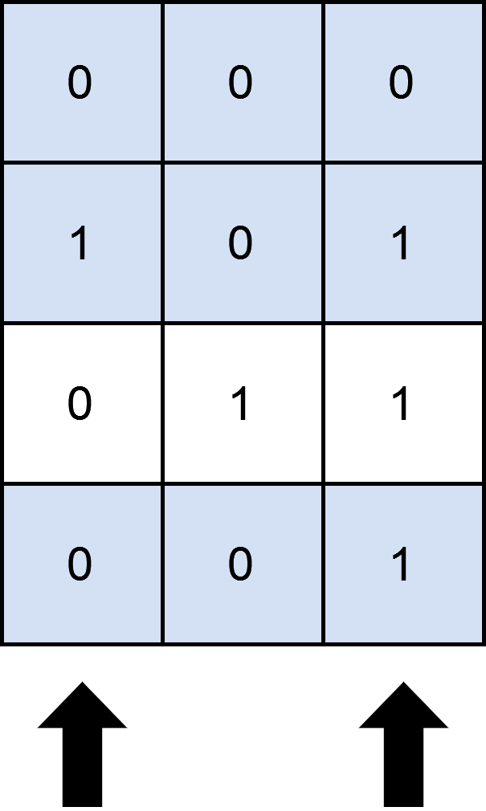

# 两种方法：二进制枚举 / Gosper's Hack（Python/Java/C++/Go）

> **[2397. 被列覆盖的最多行数](https://leetcode.cn/problems/maximum-rows-covered-by-columns/solutions/1798794/by-endlesscheng-dvxe/) · Medium · 难度分 1719**

> **所属题单**
> - [链表、二叉树与回溯 · 四、回溯](../../../刷题路径/灵神原版题单/链表、二叉树与回溯/四、回溯.md) · §4.2 子集型回溯

> **题目描述**
> 给你一个下标从 **0** 开始、大小为 `m x n` 的二进制矩阵 `matrix` ；另给你一个整数 `numSelect`，表示你必须从 `matrix` 中选择的 **不同** 列的数量。
>
> 如果一行中所有的 `1` 都被你选中的列所覆盖，则认为这一行被 **覆盖** 了。
>
> **形式上**，假设 `s = {c₁, c₂, ...., c_numSelect}` 是你选择的列的集合。对于矩阵中的某一行 `row` ，如果满足下述条件，则认为这一行被集合 `s` **覆盖**：
>
> - 对于满足 `matrix[row][col] == 1` 的每个单元格 `matrix[row][col]`（`0 <= col <= n - 1`），`col` 均存在于 `s` 中，或者
>
> - `row` 中 **不存在** 值为 `1` 的单元格。
>
> 你需要从矩阵中选出 `numSelect` 个列，使集合覆盖的行数最大化。
>
> 返回一个整数，表示可以由 `numSelect` 列构成的集合 **覆盖** 的 **最大行数** 。
>
> **示例 1：**
>
> 
>
> ```
>
> 输入：matrix = [[0,0,0],[1,0,1],[0,1,1],[0,0,1]], numSelect = 2
> 输出：3
> 解释：
> 图示中显示了一种覆盖 3 行的可行办法。
> 选择 s = {0, 2} 。
> - 第 0 行被覆盖，因为其中没有出现 1 。
> - 第 1 行被覆盖，因为值为 1 的两列（即 0 和 2）均存在于 s 中。
> - 第 2 行未被覆盖，因为 matrix[2][1] == 1 但是 1 未存在于 s 中。
> - 第 3 行被覆盖，因为 matrix[2][2] == 1 且 2 存在于 s 中。
> 因此，可以覆盖 3 行。
> 另外 s = {1, 2} 也可以覆盖 3 行，但可以证明无法覆盖更多行。
> ```
>
> **示例 2：**
>
> 
>
> ```
>
> 输入：matrix = [[1],[0]], numSelect = 1
> 输出：2
> 解释：
> 选择唯一的一列，两行都被覆盖了，因为整个矩阵都被覆盖了。
> 所以我们返回 2 。
> ```
>
> **提示：**
>
> - `m == matrix.length`
>
> - `n == matrix[i].length`
>
> - `1 <= m, n <= 12`
>
> - `matrix[i][j]` 要么是 `0` 要么是 `1`
>
> - `1 <= numSelect <= n`

> **题解**
> ## 方法一：二进制枚举
>
> 本文会用到很多位运算技巧，请先阅读：[从集合论到位运算，常见位运算技巧分类总结！](https://leetcode.cn/circle/discuss/CaOJ45/)
>
> 枚举 $\{0,1,2,\cdots, n-1\}$ 的所有大小为 $\textit{numSelect}$ 的子集 $\textit{subset}$，表示我们所选的列。
>
> 对于每个 $\textit{subset}$，遍历 $\textit{mat}$ 的每一行，看这一行的 $1$ 的列号集合是否为 $\textit{subset}$ 的子集。统计是子集的行的个数，更新答案的最大值。
>
> ```python
> class Solution:
>     def maximumRows(self, mat: List[List[int]], numSelect: int) -> int:
>         mask = [sum(x << j for j, x in enumerate(row)) for i, row in enumerate(mat)]
>         ans = 0
>         for subset in range(1 << len(mat[0])):
>             if subset.bit_count() == numSelect:  # subset 的大小等于 numSelect
>                 covered_rows = sum(row & subset == row for row in mask)
>                 ans = max(ans, covered_rows)
>         return ans
> ```
>
>
> #### 复杂度分析
>
> - 时间复杂度：$\mathcal{O}(2^n + m\cdot C_{n}^{\textit{numSelect}})$。其中 $m$ 和 $n$ 分别为 $\textit{mat}$ 的行数和列数。枚举了 $2^n$ 个子集，其中有 $C_{n}^{\textit{numSelect}}$ 个子集是符合要求的，统计 $\textit{coveredRows}$ 需要 $\mathcal{O}(m)$ 的时间。
> - 空间复杂度：$\mathcal{O}(m)$。
>
> ## 方法二：Gosper's Hack
>
> 上面的代码有很多无效枚举，即大小不等于 $\textit{numSelect}$ 的集合，如何优化呢？
>
> 通过使用 Gosper's Hack，我们可以在 $\mathcal{O}(1)$ 的时间内找到下一个大小为 $\textit{numSelect}$ 的集合。
>
> [本题视频讲解](https://www.bilibili.com/video/BV1na41137jv) 中介绍了这个算法。
>
> ```python
> class Solution:
>     def maximumRows(self, mat: List[List[int]], numSelect: int) -> int:
>         mask = [sum(x << j for j, x in enumerate(row)) for i, row in enumerate(mat)]
>         ans = 0
>         u = 1 << len(mat[0])
>         subset = (1 << numSelect) - 1
>         while subset < u:
>             covered_rows = sum(row & subset == row for row in mask)
>             ans = max(ans, covered_rows)
>             lb = subset & -subset
>             x = subset + lb
>             subset = ((subset ^ x) // lb >> 2) | x
>         return ans
> ```
>
>
> #### 复杂度分析
>
> - 时间复杂度：$\mathcal{O}(m\cdot C_{n}^{\textit{numSelect}})$。其中 $m$ 为 $\textit{mat}$ 的行数，$n$ 为 $\textit{mat}$ 的列数。
> - 空间复杂度：$\mathcal{O}(m)$。
>
> ## 分类题单
>
> [如何科学刷题？](https://leetcode.cn/circle/discuss/RvFUtj/)
>
> 1. [滑动窗口（定长/不定长/多指针）](https://leetcode.cn/circle/discuss/0viNMK/)
> 2. [二分算法（二分答案/最小化最大值/最大化最小值/第K小）](https://leetcode.cn/circle/discuss/SqopEo/)
> 3. [单调栈（基础/矩形面积/贡献法/最小字典序）](https://leetcode.cn/circle/discuss/9oZFK9/)
> 4. [网格图（DFS/BFS/综合应用）](https://leetcode.cn/circle/discuss/YiXPXW/)
> 5. [位运算（基础/性质/拆位/试填/恒等式/思维）](https://leetcode.cn/circle/discuss/dHn9Vk/)
> 6. [图论算法（DFS/BFS/拓扑排序/最短路/最小生成树/二分图/基环树/欧拉路径）](https://leetcode.cn/circle/discuss/01LUak/)
> 7. [动态规划（入门/背包/状态机/划分/区间/状压/数位/数据结构优化/树形/博弈/概率期望）](https://leetcode.cn/circle/discuss/tXLS3i/)
> 8. [常用数据结构（前缀和/差分/栈/队列/堆/字典树/并查集/树状数组/线段树）](https://leetcode.cn/circle/discuss/mOr1u6/)
> 9. [数学算法（数论/组合/概率期望/博弈/计算几何/随机算法）](https://leetcode.cn/circle/discuss/IYT3ss/)
> 10. [贪心算法（基本贪心策略/反悔/区间/字典序/数学/思维/脑筋急转弯/构造）](https://leetcode.cn/circle/discuss/g6KTKL/)
>
> [我的题解精选（已分类）](https://github.com/EndlessCheng/codeforces-go/blob/master/leetcode/SOLUTIONS.md)
>
> 欢迎关注 [B站@灵茶山艾府](https://space.bilibili.com/206214)
