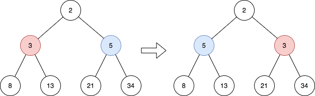
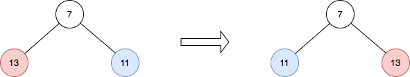

# 直接交换值：BFS / DFS

> **[2415. 反转二叉树的奇数层](https://leetcode.cn/problems/reverse-odd-levels-of-binary-tree/solutions/1831556/zhi-jie-jiao-huan-zhi-by-endlesscheng-o8ze/) · Medium · 难度分 1431**

> **所属题单**
> - [链表、二叉树与回溯 · 二、二叉树](../../../刷题路径/灵神原版题单/链表、二叉树与回溯/二、二叉树.md) · §2.13 二叉树 BFS

> **题目描述**
> 给你一棵 **完美** 二叉树的根节点 `root` ，请你反转这棵树中每个 **奇数** 层的节点值。
>
> - 例如，假设第 3 层的节点值是 `[2,1,3,4,7,11,29,18]` ，那么反转后它应该变成 `[18,29,11,7,4,3,1,2]` 。
>
> 反转后，返回树的根节点。
>
> **完美** 二叉树需满足：二叉树的所有父节点都有两个子节点，且所有叶子节点都在同一层。
>
> 节点的 **层数** 等于该节点到根节点之间的边数。
>
> **示例 1：**
>
> 
>
> ```
>
> 输入：root = [2,3,5,8,13,21,34]
> 输出：[2,5,3,8,13,21,34]
> 解释：
> 这棵树只有一个奇数层。
> 在第 1 层的节点分别是 3、5 ，反转后为 5、3 。
> ```
>
> **示例 2：**
>
> 
>
> ```
>
> 输入：root = [7,13,11]
> 输出：[7,11,13]
> 解释：
> 在第 1 层的节点分别是 13、11 ，反转后为 11、13 。
> ```
>
> **示例 3：**
>
> ```
>
> 输入：root = [0,1,2,0,0,0,0,1,1,1,1,2,2,2,2]
> 输出：[0,2,1,0,0,0,0,2,2,2,2,1,1,1,1]
> 解释：奇数层由非零值组成。
> 在第 1 层的节点分别是 1、2 ，反转后为 2、1 。
> 在第 3 层的节点分别是 1、1、1、1、2、2、2、2 ，反转后为 2、2、2、2、1、1、1、1 。
> ```
>
> **提示：**
>
> - 树中的节点数目在范围 `[1, 2¹⁴]` 内
>
> - `0 <= Node.val <= 10⁵`
>
> - `root` 是一棵 **完美** 二叉树

> **题解**
> [视频讲解](https://www.bilibili.com/video/BV1AP411p7pK) 已出炉，欢迎点赞三连，在评论区分享你对这场周赛的看法~
>
> ---
>
> #### 方法一：BFS
>
> BFS 这棵树，对于奇数层，直接交换层里面的所有元素值（交换的是元素值，不是节点）。
>
> ```python
> class Solution:
>     def reverseOddLevels(self, root: Optional[TreeNode]) -> Optional[TreeNode]:
>         q, level = [root], 0
>         while q[0].left:
>             q = list(chain.from_iterable((node.left, node.right) for node in q))
>             if level == 0:
>                 for i in range(len(q) // 2):
>                     x, y = q[i], q[len(q) - 1 - i]
>                     x.val, y.val = y.val, x.val
>             level ^= 1
>         return root
> ```
>
>
> #### 方法二：DFS
>
> 依然是交换值的思路，通过同时递归左右子树实现。
>
> 不了解这一做法的同学可以做做 [101. 对称二叉树](https://leetcode.cn/problems/symmetric-tree/)。
>
> ```python
> class Solution:
>     def reverseOddLevels(self, root: Optional[TreeNode]) -> Optional[TreeNode]:
>         def dfs(node1: Optional[TreeNode], node2: Optional[TreeNode], is_odd_level: bool) -> None:
>             if node1 is None: return
>             if is_odd_level: node1.val, node2.val = node2.val, node1.val
>             dfs(node1.left, node2.right, not is_odd_level)
>             dfs(node1.right, node2.left, not is_odd_level)
>         dfs(root.left, root.right, True)
>         return root
> ```
