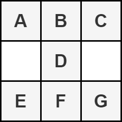
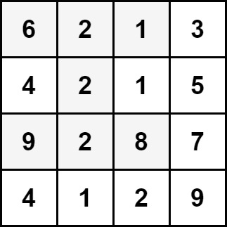

# 遍历

> **[2428. 沙漏的最大总和](https://leetcode.cn/problems/maximum-sum-of-an-hourglass/solutions/1864066/bian-li-by-endlesscheng-k17h/) · Medium**

> **题目描述**
> 给你一个大小为 `m x n` 的整数矩阵 `grid` 。
>
> 按以下形式将矩阵的一部分定义为一个 **沙漏** ：
>
> 
>
> 返回沙漏中元素的 **最大** 总和。
>
> **注意：**沙漏无法旋转且必须整个包含在矩阵中。
>
> **示例 1：**
>
> 
>
> ```
> 输入：grid = [[6,2,1,3],[4,2,1,5],[9,2,8,7],[4,1,2,9]]
> 输出：30
> 解释：上图中的单元格表示元素总和最大的沙漏：6 + 2 + 1 + 2 + 9 + 2 + 8 = 30 。
> ```
>
> **示例 2：**
>
> 
>
> ```
> 输入：grid = [[1,2,3],[4,5,6],[7,8,9]]
> 输出：35
> 解释：上图中的单元格表示元素总和最大的沙漏：1 + 2 + 3 + 5 + 7 + 8 + 9 = 35 。
> ```
>
> **提示：**
>
> - `m == grid.length`
>
> - `n == grid[i].length`
>
> - `3 <= m, n <= 150`
>
> - `0 <= grid[i][j] <= 10⁶`

> **题解**
> [视频讲解](https://www.bilibili.com/video/BV1kd4y1q7fC) 已出炉，欢迎点赞三连，在评论区分享你对这场周赛的看法~
>
> ---
>
> 按题意模拟即可。 
>
> ```python
> class Solution:
>     def maxSum(self, grid: List[List[int]]) -> int:
>         return max(grid[i - 1][j - 1] + grid[i - 1][j] + grid[i - 1][j + 1] + grid[i][j] +
>                    grid[i + 1][j - 1] + grid[i + 1][j] + grid[i + 1][j + 1]
>                    for i in range(1, len(grid) - 1) for j in range(1, len(grid[i]) - 1))
> ```
>
>
> #### 复杂度分析
>
> - 时间复杂度：$O(mn)$，其中 $m$ 和 $n$ 分别为 $\textit{grid}$ 的行数和列数。
> - 空间复杂度：$O(1)$，仅用到若干变量。
