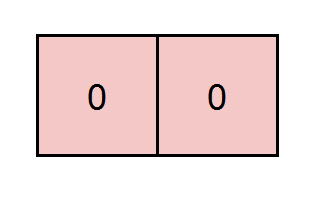

# 动态规划：从记忆化搜索到递推（Python/Java/C++/Go）

> **[2435. 矩阵中和能被 K 整除的路径](https://leetcode.cn/problems/paths-in-matrix-whose-sum-is-divisible-by-k/solutions/1878910/dong-tai-gui-hua-pythonjavacgo-by-endles-94wq/) · Hard · 难度分 1952**

> **所属题单**
> - [动态规划 · 二、网格图 DP](../../../刷题路径/灵神原版题单/动态规划/二、网格图%20DP.md) · §2.2 进阶

> **题目描述**
> 给你一个下标从 **0** 开始的 `m x n` 整数矩阵 `grid` 和一个整数 `k` 。你从起点 `(0, 0)` 出发，每一步只能往 **下** 或者往 **右** ，你想要到达终点 `(m - 1, n - 1)` 。
>
> 请你返回路径和能被 `k` 整除的路径数目，由于答案可能很大，返回答案对 `10⁹ + 7` **取余** 的结果。
>
> **示例 1：**
>
> 
>
> ```
> 输入：grid = [[5,2,4],[3,0,5],[0,7,2]], k = 3
> 输出：2
> 解释：有两条路径满足路径上元素的和能被 k 整除。
> 第一条路径为上图中用红色标注的路径，和为 5 + 2 + 4 + 5 + 2 = 18 ，能被 3 整除。
> 第二条路径为上图中用蓝色标注的路径，和为 5 + 3 + 0 + 5 + 2 = 15 ，能被 3 整除。
> ```
>
> **示例 2：**
>
> 
>
> ```
> 输入：grid = [[0,0]], k = 5
> 输出：1
> 解释：红色标注的路径和为 0 + 0 = 0 ，能被 5 整除。
> ```
>
> **示例 3：**
>
> 
>
> ```
> 输入：grid = [[7,3,4,9],[2,3,6,2],[2,3,7,0]], k = 1
> 输出：10
> 解释：每个数字都能被 1 整除，所以每一条路径的和都能被 k 整除。
> ```
>
> **提示：**
>
> - `m == grid.length`
>
> - `n == grid[i].length`
>
> - `1 <= m, n <= 5 * 10⁴`
>
> - `1 <= m * n <= 5 * 10⁴`
>
> - `0 <= grid[i][j] <= 100`
>
> - `1 <= k <= 50`

> **题解**
> **前置题目**：[62. 不同路径](https://leetcode.cn/problems/unique-paths/)，[我的题解](../../0000-0099/0062%20不同路径/灵茶山艾府.md)。
>
> ## 一、记忆化搜索
>
> 本题需要统计路径和是 $k$ 的倍数的路径数目。
>
> 在 62 题的基础上，额外增加一个参数 $s$，表示当前路径和模 $k$ 的结果。为什么可以在中途取模？请看 [模运算的世界：当加减乘除遇上取模](https://leetcode.cn/circle/discuss/mDfnkW/)。
>
> 具体地，定义 $\textit{dfs}(i,j,s)$ 表示从起点 $(0,0)$ 走到 $(i,j)$，且路径和模 $k$ 为 $s$ 的路径数。
>
> 设 $\textit{preS} = (s-\textit{grid}[i][j])\bmod k$。如果结果是负数则加 $k$ 调整为非负数。
>
> 讨论我们是如何到达 $(i,j)$ 的：
>
> - 如果是从 $(i-1,j)$ 过来，那么问题变成从起点 $(0,0)$ 走到 $(i-1,j)$，且路径和模 $k$ 为 $\textit{preS}$ 的路径数，即 $\textit{dfs}(i-1,j,\textit{preS})$。
> - 如果是从 $(i,j-1)$ 过来，那么问题变成从起点 $(0,0)$ 走到 $(i,j-1)$，且路径和模 $k$ 为 $\textit{preS}$ 的路径数，即 $\textit{dfs}(i,j-1,\textit{preS})$。
>
> 这两种情况互斥，根据**加法原理**，有
>
> $$
> \textit{dfs}(i,j,s) = \textit{dfs}(i-1,j,\textit{preS}) + \textit{dfs}(i,j-1,\textit{preS})
> $$
>
> **递归边界**：
>
> - $\textit{dfs}(-1,j,s)=\textit{dfs}(i,-1,s)=0$。无法从 $(0,0)$ 到达这些位置。
> - $\textit{dfs}(0,0,\textit{grid}[0][0]\bmod k)=1$。起点到它自己有一条路径，即原地不动。
>
> **递归入口**：题目让我们求从起点 $(0,0)$ 走到 $(m-1,n-1)$，且路径和模 $k$ 为 $0$ 的路径数，即 $\textit{dfs}(m-1,n-1,0)$。
>
> ### 写法一
>
> ```python
> class Solution:
>     def numberOfPaths(self, grid: List[List[int]], k: int) -> int:
>         MOD = 1_000_000_007
>
>         @cache  # 缓存装饰器，避免重复计算 dfs（一行代码实现记忆化）
>         def dfs(i: int, j: int, s: int) -> int:
>             if i < 0 or j < 0:  # 出界
>                 return 0
>             pre_s = (s - grid[i][j]) % k
>             if i == 0 and j == 0:  # 起点
>                 return 1 if pre_s == 0 else 0  # pre_s == 0 说明 s == grid[i][j] % k
>             return (dfs(i - 1, j, pre_s) + dfs(i, j - 1, pre_s)) % MOD
>
>         ans = dfs(len(grid) - 1, len(grid[0]) - 1, 0)
>         dfs.cache_clear()  # 避免超出内存限制
>         return ans
> ```
>
>
> ### 写法二
>
> 也可以用暴搜的方式写。
>
> 把 $s$ 定义成从终点 $(m-1,n-1)$ 走到 $(i,j)$ 的前一个位置的路径和模 $k$（意思是路径和不包括 $\textit{grid}[i][j]$）。
>
> 设 $\textit{newS} = (s+\textit{grid}[i][j])\bmod k$，继续移动，计算方案数，即
>
> $$
> \textit{dfs}(i,j,s) = \textit{dfs}(i-1,j,\textit{newS}) + \textit{dfs}(i,j-1,\textit{newS})
> $$
>
> **递归边界**：
>
> - $\textit{dfs}(-1,0,0) = 1$。为方便翻译成递推，把 $(-1,0)$ 视作一个合法的位置。从终点 $(m-1,n-1)$ 走到 $(-1,0)$ 时，如果路径和 $s$ 是 $k$ 的倍数，则找到了一条合法路径。
> - $\textit{dfs}(-1,j,s)=\textit{dfs}(i,-1,s)=0$。除了 $(-1,0)$，其余出界位置视作非法。
>
> **递归入口**：$\textit{dfs}(m-1,n-1,0)$。
>
> ```python
> class Solution:
>     def numberOfPaths(self, grid: List[List[int]], k: int) -> int:
>         MOD = 1_000_000_007
>
>         @cache
>         def dfs(i: int, j: int, s: int) -> int:
>             if i < 0 and j == 0:
>                 return 1 if s == 0 else 0
>             if i < 0 or j < 0:
>                 return 0
>             new_s = (s + grid[i][j]) % k
>             return (dfs(i - 1, j, new_s) + dfs(i, j - 1, new_s)) % MOD
>
>         ans = dfs(len(grid) - 1, len(grid[0]) - 1, 0)
>         dfs.cache_clear()
>         return ans
> ```
>
>
> #### 复杂度分析
>
> - 时间复杂度：$\mathcal{O}(mnk)$，其中 $m$ 和 $n$ 分别是 $\textit{grid}$ 的行数和列数。由于每个状态只会计算一次，动态规划的时间复杂度 $=$ 状态个数 $\times$ 单个状态的计算时间。本题状态个数等于 $\mathcal{O}(mnk)$，单个状态的计算时间为 $\mathcal{O}(1)$，所以总的时间复杂度为 $\mathcal{O}(mnk)$。
> - 空间复杂度：$\mathcal{O}(mnk)$。保存多少状态，就需要多少空间。
>
> ## 二、1:1 翻译成递推
>
> 原理见 [62 题我的题解](../../0000-0099/0062%20不同路径/灵茶山艾府.md)。
>
> ```python
> class Solution:
>     def numberOfPaths(self, grid: List[List[int]], k: int) -> int:
>         MOD = 1_000_000_007
>         m, n = len(grid), len(grid[0])
>         f = [[[0] * k for _ in range(n + 1)] for _ in range(m + 1)]
>         f[0][1][0] = 1
>         for i, row in enumerate(grid):
>             for j, x in enumerate(row):
>                 for s in range(k):
>                     new_s = (s + x) % k
>                     f[i + 1][j + 1][s] = (f[i][j + 1][new_s] + f[i + 1][j][new_s]) % MOD
>         return f[m][n][0]
> ```
>
>
> #### 复杂度分析
>
> - 时间复杂度：$\mathcal{O}(mnk)$，其中 $m$ 和 $n$ 分别是 $\textit{grid}$ 的行数和列数。
> - 空间复杂度：$\mathcal{O}(mnk)$。
>
> ## 三、空间优化
>
> ### 写法一
>
> ```python
> class Solution:
>     def numberOfPaths(self, grid: List[List[int]], k: int) -> int:
>         MOD = 1_000_000_007
>         m, n = len(grid), len(grid[0])
>         f = [[0] * k for _ in range(n + 1)]
>         f[1][0] = 1
>         for row in grid:
>             for j, x in enumerate(row):
>                 new_f = [0] * k  # 为避免提前把 f[j+1][s] 覆盖，先保存到 new_f[s] 中
>                 for s in range(k):
>                     new_s = (s + x) % k
>                     new_f[s] = (f[j + 1][new_s] + f[j][new_s]) % MOD
>                 f[j + 1] = new_f  # 循环结束后再赋给 f[j+1]
>         return f[n][0]
> ```
>
>
> ### 写法二
>
> ```python
> class Solution:
>     def numberOfPaths(self, grid: List[List[int]], k: int) -> int:
>         MOD = 1_000_000_007
>         m, n = len(grid), len(grid[0])
>         f = [[0] * k for _ in range(n + 1)]
>         f[1][0] = 1
>         new_f = [0] * k  # 避免在循环内反复创建 list
>         for row in grid:
>             for j, x in enumerate(row):
>                 for s in range(k):
>                     new_s = (s + x) % k
>                     new_f[s] = (f[j + 1][new_s] + f[j][new_s]) % MOD
>                 f[j + 1][:] = new_f  # 把 new_f 复制到 f[j+1] 中
>         return f[n][0]
> ```
>
>
> #### 复杂度分析
>
> - 时间复杂度：$\mathcal{O}(mnk)$，其中 $m$ 和 $n$ 分别是 $\textit{grid}$ 的行数和列数。
> - 空间复杂度：$\mathcal{O}(nk)$。
>
> ## 思考题
>
> 如果 $k=10^{18}$，而 $m=n=20$，要怎么做？
>
> 见 [CF1006F. Xor-Paths](https://codeforces.com/problemset/problem/1006/F)。
>
> ## 分类题单
>
> [如何科学刷题？](https://leetcode.cn/circle/discuss/RvFUtj/)
>
> 1. [滑动窗口与双指针（定长/不定长/单序列/双序列/三指针/分组循环）](https://leetcode.cn/circle/discuss/0viNMK/)
> 2. [二分算法（二分答案/最小化最大值/最大化最小值/第K小）](https://leetcode.cn/circle/discuss/SqopEo/)
> 3. [单调栈（基础/矩形面积/贡献法/最小字典序）](https://leetcode.cn/circle/discuss/9oZFK9/)
> 4. [网格图（DFS/BFS/综合应用）](https://leetcode.cn/circle/discuss/YiXPXW/)
> 5. [位运算（基础/性质/拆位/试填/恒等式/思维）](https://leetcode.cn/circle/discuss/dHn9Vk/)
> 6. [图论算法（DFS/BFS/拓扑排序/基环树/最短路/最小生成树/网络流）](https://leetcode.cn/circle/discuss/01LUak/)
> 7. [动态规划（入门/背包/划分/状态机/区间/状压/数位/数据结构优化/树形/博弈/概率期望）](https://leetcode.cn/circle/discuss/tXLS3i/)
> 8. [常用数据结构（前缀和/差分/栈/队列/堆/字典树/并查集/树状数组/线段树）](https://leetcode.cn/circle/discuss/mOr1u6/)
> 9. [数学算法（数论/组合/概率期望/博弈/计算几何/随机算法）](https://leetcode.cn/circle/discuss/IYT3ss/)
> 10. [贪心与思维（基本贪心策略/反悔/区间/字典序/数学/思维/脑筋急转弯/构造）](https://leetcode.cn/circle/discuss/g6KTKL/)
> 11. [链表、树与回溯（前后指针/快慢指针/DFS/BFS/直径/LCA）](https://leetcode.cn/circle/discuss/K0n2gO/)
> 12. [字符串（KMP/Z函数/Manacher/字符串哈希/AC自动机/后缀数组/子序列自动机）](https://leetcode.cn/circle/discuss/SJFwQI/)
>
> [我的题解精选（已分类）](https://github.com/EndlessCheng/codeforces-go/blob/master/leetcode/SOLUTIONS.md)
>
> 欢迎关注 [B站@灵茶山艾府](https://space.bilibili.com/206214)
