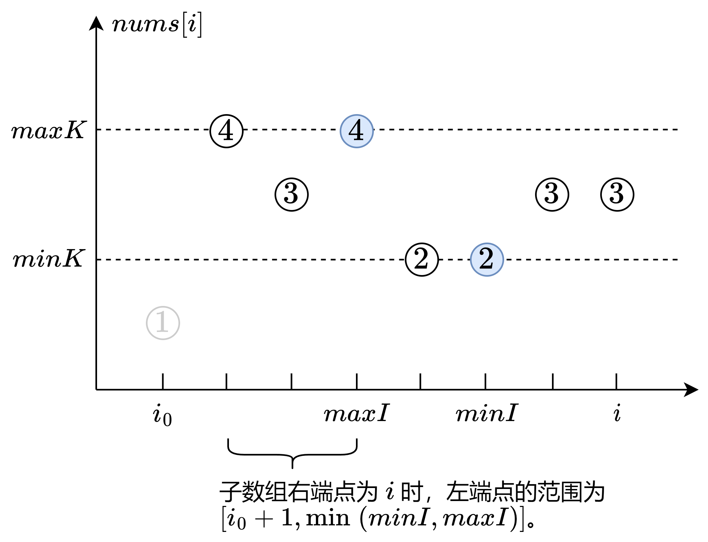

# 一次遍历，简洁写法（Python/Java/C++/C/Go/JS/Rust）

> **[2444. 统计定界子数组的数目](https://leetcode.cn/problems/count-subarrays-with-fixed-bounds/solutions/1895713/jian-ji-xie-fa-pythonjavacgo-by-endlessc-gag2/) · Hard · 难度分 2093**

> **所属题单**
> - [滑动窗口与双指针 · 五、三指针](../../../刷题路径/灵神原版题单/滑动窗口与双指针/五、三指针.md)

> **题目描述**
> 给你一个整数数组 `nums` 和两个整数 `minK` 以及 `maxK` 。
>
> `nums` 的定界子数组是满足下述条件的一个子数组：
>
> - 子数组中的 **最小值** 等于 `minK` 。
>
> - 子数组中的 **最大值** 等于 `maxK` 。
>
> 返回定界子数组的数目。
>
> 子数组是数组中的一个连续部分。
>
> **示例 1：**
>
> ```
> 输入：nums = [1,3,5,2,7,5], minK = 1, maxK = 5
> 输出：2
> 解释：定界子数组是 [1,3,5] 和 [1,3,5,2] 。
> ```
>
> **示例 2：**
>
> ```
> 输入：nums = [1,1,1,1], minK = 1, maxK = 1
> 输出：10
> 解释：nums 的每个子数组都是一个定界子数组。共有 10 个子数组。
> ```
>
> **提示：**
>
> - `2 <= nums.length <= 10⁵`
>
> - `1 <= nums[i], minK, maxK <= 10⁶`

> **题解**
> 从特殊到一般。首先考虑一个简单的情况，$\textit{nums}$ 的所有元素都在 $[\textit{minK},\textit{maxK}]$ 范围内。
>
> 在这种情况下，问题相当于：
>
> - **同时包含** $\textit{minK}$ 和 $\textit{maxK}$ 的子数组的个数。
>
> **核心思路**：枚举子数组的右端点，统计有多少个合法的左端点。
>
> 遍历 $\textit{nums}$，记录 $\textit{minK}$ 最近出现的位置 $\textit{minI}$，以及 $\textit{maxK}$ 最近出现的位置 $\textit{maxI}$，当遍历到 $\textit{nums}[i]$ 时，如果 $\textit{minK}$ 和 $\textit{maxK}$ 都遇到过，则左端点在 $[0,\min(\textit{minI},\textit{maxI})]$ 中的子数组，包含 $\textit{minK}$ 和 $\textit{maxK}$，最小值一定是 $\textit{minK}$，最大值一定是 $\textit{maxK}$。
>
> 以 $i$ 为右端点的合法子数组的个数为 
>
> $$
> \min(\textit{minI},\textit{maxI})+1
> $$
>
> 回到原问题，由于子数组不能包含在 $[\textit{minK},\textit{maxK}]$ 范围之外的元素，我们需要额外记录在 $[\textit{minK},\textit{maxK}]$ **范围之外**的最近元素位置，记作 $i_0$，则左端点在 $[i_0+1,\min(\textit{minI},\textit{maxI})]$ 中的子数组都是合法的。
>
> 以 $i$ 为右端点的合法子数组的个数为 
>
> $$
> \min(\textit{minI},\textit{maxI})-i_0
> $$
>
> 例如 $\textit{nums}=[1,4,3,4,2,2,3,3]$，如下图所示。
>
> {:width=700}
>
> 代码实现时：
>
> - 可以初始化 $\textit{minI}=\textit{maxI}=i_0=-1$，兼容没有找到相应元素的情况。
> - 如果 $\min(\textit{minI},\textit{maxI})-i_0 < 0$，则表示在 $i_0$ 右侧 $\textit{minK}$ 和 $\textit{maxK}$ 没有同时出现，此时以 $i$ 为右端点的合法子数组的个数为 $0$。所以加到答案中的是 $\max(\min(\textit{minI},\textit{maxI})-i_0, 0)$。
>
> ```python
> class Solution:
>     def countSubarrays(self, nums: List[int], minK: int, maxK: int) -> int:
>         ans = 0
>         min_i = max_i = i0 = -1
>         for i, x in enumerate(nums):
>             if x == minK:
>                 min_i = i  # 最近的 minK 位置
>             if x == maxK:
>                 max_i = i  # 最近的 maxK 位置
>             if not minK <= x <= maxK:
>                 i0 = i  # 子数组不能包含 nums[i0]
>             ans += max(min(min_i, max_i) - i0, 0)
>         return ans
> ```
>
> > [!example]- Python3 更快写法
> > ```python
> > class Solution:
> >     def countSubarrays(self, nums: List[int], minK: int, maxK: int) -> int:
> >         ans = 0
> >         min_i = max_i = i0 = -1
> >         for i, x in enumerate(nums):
> >             if x == minK:
> >                 min_i = i
> >             if x == maxK:
> >                 max_i = i
> >             if not minK <= x <= maxK:
> >                 i0 = i
> >             j = min_i if min_i < max_i else max_i
> >             if j > i0:
> >                 ans += j - i0
> >         return ans
> > ```
>
>
> #### 复杂度分析
>
> - 时间复杂度：$\mathcal{O}(n)$，其中 $n$ 为 $\textit{nums}$ 的长度。
> - 空间复杂度：$\mathcal{O}(1)$。
>
> ## 相似题目
>
> - [795. 区间子数组个数](https://leetcode.cn/problems/number-of-subarrays-with-bounded-maximum/)
>
> ## 分类题单
>
> [如何科学刷题？](https://leetcode.cn/circle/discuss/RvFUtj/)
>
> 1. [滑动窗口与双指针（定长/不定长/单序列/双序列/三指针/分组循环）](https://leetcode.cn/circle/discuss/0viNMK/)
> 2. [二分算法（二分答案/最小化最大值/最大化最小值/第K小）](https://leetcode.cn/circle/discuss/SqopEo/)
> 3. [单调栈（基础/矩形面积/贡献法/最小字典序）](https://leetcode.cn/circle/discuss/9oZFK9/)
> 4. [网格图（DFS/BFS/综合应用）](https://leetcode.cn/circle/discuss/YiXPXW/)
> 5. [位运算（基础/性质/拆位/试填/恒等式/思维）](https://leetcode.cn/circle/discuss/dHn9Vk/)
> 6. [图论算法（DFS/BFS/拓扑排序/最短路/最小生成树/二分图/基环树/欧拉路径）](https://leetcode.cn/circle/discuss/01LUak/)
> 7. [动态规划（入门/背包/状态机/划分/区间/状压/数位/数据结构优化/树形/博弈/概率期望）](https://leetcode.cn/circle/discuss/tXLS3i/)
> 8. [常用数据结构（前缀和/差分/栈/队列/堆/字典树/并查集/树状数组/线段树）](https://leetcode.cn/circle/discuss/mOr1u6/)
> 9. [数学算法（数论/组合/概率期望/博弈/计算几何/随机算法）](https://leetcode.cn/circle/discuss/IYT3ss/)
> 10. [贪心与思维（基本贪心策略/反悔/区间/字典序/数学/思维/脑筋急转弯/构造）](https://leetcode.cn/circle/discuss/g6KTKL/)
> 11. [链表、二叉树与回溯（前后指针/快慢指针/DFS/BFS/直径/LCA/一般树）](https://leetcode.cn/circle/discuss/K0n2gO/)
> 12. [字符串（KMP/Z函数/Manacher/字符串哈希/AC自动机/后缀数组/子序列自动机）](https://leetcode.cn/circle/discuss/SJFwQI/)
>
> [我的题解精选（已分类）](https://github.com/EndlessCheng/codeforces-go/blob/master/leetcode/SOLUTIONS.md)
>
> 欢迎关注 [B站@灵茶山艾府](https://space.bilibili.com/206214)
