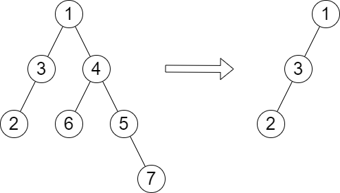

# 两遍 DFS（Python/Java/C++/Go）

> **[2458. 移除子树后的二叉树高度](https://leetcode.cn/problems/height-of-binary-tree-after-subtree-removal-queries/solutions/1936338/liang-bian-dfspythonjavacgo-by-endlessch-vvs4/) · Hard · 难度分 2299**

> **所属题单**
> - [链表、二叉树与回溯 · 二、二叉树](../../../刷题路径/灵神原版题单/链表、二叉树与回溯/二、二叉树.md) · §2.16 其他

> **题目描述**
> 给你一棵 **二叉树** 的根节点 `root` ，树中有 `n` 个节点。每个节点都可以被分配一个从 `1` 到 `n` 且互不相同的值。另给你一个长度为 `m` 的数组 `queries` 。
>
> 你必须在树上执行 `m` 个 **独立** 的查询，其中第 `i` 个查询你需要执行以下操作：
>
> - 从树中 **移除** 以 `queries[i]` 的值作为根节点的子树。题目所用测试用例保证 `queries[i]` **不** 等于根节点的值。
>
> 返回一个长度为 `m` 的数组 `answer` ，其中 `answer[i]` 是执行第 `i` 个查询后树的高度。
>
> **注意：**
>
> - 查询之间是独立的，所以在每个查询执行后，树会回到其 **初始** 状态。
>
> - 树的高度是从根到树中某个节点的 **最长简单路径中的边数** 。
>
> **示例 1：**
>
> 
>
> ```
>
> 输入：root = [1,3,4,2,null,6,5,null,null,null,null,null,7], queries = [4]
> 输出：[2]
> 解释：上图展示了从树中移除以 4 为根节点的子树。
> 树的高度是 2（路径为 1 -> 3 -> 2）。
> ```
>
> **示例 2：**
>
> 
>
> ```
>
> 输入：root = [5,8,9,2,1,3,7,4,6], queries = [3,2,4,8]
> 输出：[3,2,3,2]
> 解释：执行下述查询：
> - 移除以 3 为根节点的子树。树的高度变为 3（路径为 5 -> 8 -> 2 -> 4）。
> - 移除以 2 为根节点的子树。树的高度变为 2（路径为 5 -> 8 -> 1）。
> - 移除以 4 为根节点的子树。树的高度变为 3（路径为 5 -> 8 -> 2 -> 6）。
> - 移除以 8 为根节点的子树。树的高度变为 2（路径为 5 -> 9 -> 3）。
> ```
>
> **提示：**
>
> - 树中节点的数目是 `n`
>
> - `2 <= n <= 10⁵`
>
> - `1 <= Node.val <= n`
>
> - 树中的所有值 **互不相同**
>
> - `m == queries.length`
>
> - `1 <= m <= min(n, 10⁴)`
>
> - `1 <= queries[i] <= n`
>
> - `queries[i] != root.val`

> **题解**
> [视频讲解](https://www.bilibili.com/video/BV1Em4y1c7Hc) 已出炉，欢迎点赞三连，在评论区分享你对这场周赛的看法~
>
> ---
>
> 既然是求树的高度，我们可以先跑一遍 DFS，求出每棵子树的高度 $\textit{height}$（这里定义成最长路径的**节点数**）。
>
> 然后再 DFS 一遍这棵树，同时维护当前节点深度 $\textit{depth}$（从 $0$ 开始），以及删除当前子树后剩余部分的树的高度 $\textit{restH}$（这里定义成最长路径的**边数**）。
>
> 具体做法如下：
>
> - 往左走，递归前算一下从根节点到当前节点右子树最深节点的长度，即 $\textit{depth} + \textit{height}[\textit{node}.\textit{right}]$，与 $\textit{restH}$ 取最大值，然后往下递归；
> - 往右走，递归前算一下从根节点到当前节点左子树最深节点的长度，即 $\textit{depth} + \textit{height}[\textit{node}.\textit{left}]$，与 $\textit{restH}$ 取最大值，然后往下递归。
>
> 每个节点的答案即为递归到该节点时的 $\textit{restH}$ 值。
>
> 代码实现时可以直接把答案覆盖到 $\textit{queries}$ 数组中。
>
> ```python
> class Solution:
>     def treeQueries(self, root: Optional[TreeNode], queries: List[int]) -> List[int]:
>         height = defaultdict(int)  # 每棵子树的高度
>         def get_height(node: Optional[TreeNode]) -> int:
>             if node is None: return 0
>             height[node] = 1 + max(get_height(node.left), get_height(node.right))
>             return height[node]
>         get_height(root)
>
>         res = [0] * (len(height) + 1)  # 每个节点的答案
>         def dfs(node: Optional[TreeNode], depth: int, rest_h: int) -> None:
>             if node is None: return
>             depth += 1
>             res[node.val] = rest_h
>             dfs(node.left, depth, max(rest_h, depth + height[node.right]))
>             dfs(node.right, depth, max(rest_h, depth + height[node.left]))
>         dfs(root, -1, 0)
>
>         for i, q in enumerate(queries):
>             queries[i] = res[q]
>         return queries
> ```
>
>
> #### 复杂度分析
>
> - 时间复杂度：$O(n)$，其中 $n$ 为二叉树的节点个数。
> - 空间复杂度：$O(n)$。
