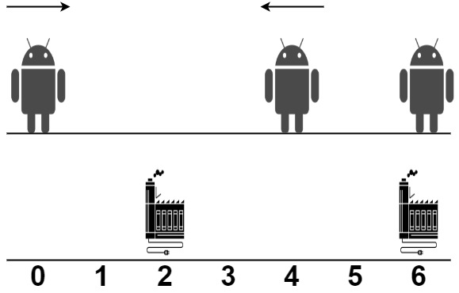
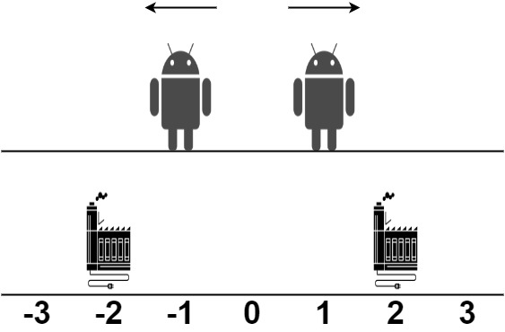
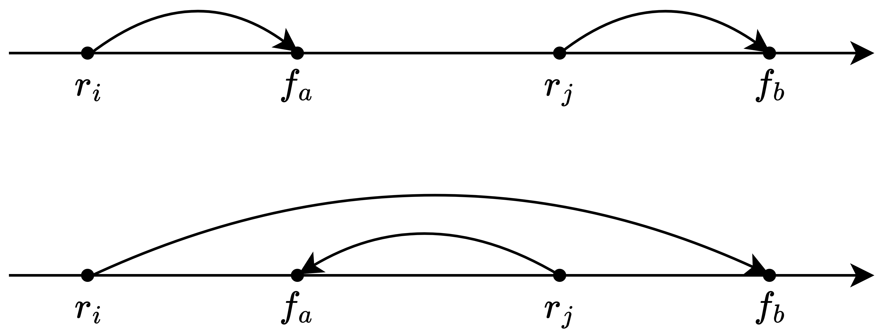

# 三种方法：记忆化搜索 -> 递推 -> 单调队列优化（Python/Java/C++/Go）

> **[2463. 最小移动总距离](https://leetcode.cn/problems/minimum-total-distance-traveled/solutions/1951947/ji-yi-hua-sou-suo-by-endlesscheng-qctr/) · Hard · 难度分 2454**

> **所属题单**
> - [动态规划 · 五、划分型 DP](../../../刷题路径/灵神原版题单/动态规划/五、划分型%20DP.md) · §5.2 最优划分
> - [动态规划 · 十一、优化 DP](../../../刷题路径/灵神原版题单/动态规划/十一、优化%20DP.md) · §11.3 单调队列优化 DP
> - [图论算法 · 八、网络流](../../../刷题路径/灵神原版题单/图论算法/八、网络流.md)

> **题目描述**
> X 轴上有一些机器人和工厂。给你一个整数数组 `robot` ，其中 `robot[i]` 是第 `i` 个机器人的位置。再给你一个二维整数数组 `factory` ，其中 `factory[j] = [position_j, limit_j]` ，表示第 `j` 个工厂的位置在 `position_j` ，且第 `j` 个工厂最多可以修理 `limit_j` 个机器人。
>
> 每个机器人所在的位置 **互不相同** 。每个工厂所在的位置也 **互不相同** 。注意一个机器人可能一开始跟一个工厂在 **相同的位置** 。
>
> 所有机器人一开始都是坏的，他们会沿着设定的方向一直移动。设定的方向要么是 X 轴的正方向，要么是 X 轴的负方向。当一个机器人经过一个没达到上限的工厂时，这个工厂会维修这个机器人，且机器人停止移动。
>
> **任何时刻**，你都可以设置 **部分** 机器人的移动方向。你的目标是最小化所有机器人总的移动距离。
>
> 请你返回所有机器人移动的最小总距离。测试数据保证所有机器人都可以被维修。
>
> **注意：**
>
> - 所有机器人移动速度相同。
>
> - 如果两个机器人移动方向相同，它们永远不会碰撞。
>
> - 如果两个机器人迎面相遇，它们也不会碰撞，它们彼此之间会擦肩而过。
>
> - 如果一个机器人经过了一个已经达到上限的工厂，机器人会当作工厂不存在，继续移动。
>
> - 机器人从位置 `x` 到位置 `y` 的移动距离为 `|y - x|` 。
>
> **示例 1：**
>
> 
>
> ```
>
> 输入：robot = [0,4,6], factory = [[2,2],[6,2]]
> 输出：4
> 解释：如上图所示：
> - 第一个机器人从位置 0 沿着正方向移动，在第一个工厂处维修。
> - 第二个机器人从位置 4 沿着负方向移动，在第一个工厂处维修。
> - 第三个机器人在位置 6 被第二个工厂维修，它不需要移动。
> 第一个工厂的维修上限是 2 ，它维修了 2 个机器人。
> 第二个工厂的维修上限是 2 ，它维修了 1 个机器人。
> 总移动距离是 |2 - 0| + |2 - 4| + |6 - 6| = 4 。没有办法得到比 4 更少的总移动距离。
> ```
>
> **示例 2：**
>
> 
>
> ```
>
> 输入：robot = [1,-1], factory = [[-2,1],[2,1]]
> 输出：2
> 解释：如上图所示：
> - 第一个机器人从位置 1 沿着正方向移动，在第二个工厂处维修。
> - 第二个机器人在位置 -1 沿着负方向移动，在第一个工厂处维修。
> 第一个工厂的维修上限是 1 ，它维修了 1 个机器人。
> 第二个工厂的维修上限是 1 ，它维修了 1 个机器人。
> 总移动距离是 |2 - 1| + |(-2) - (-1)| = 2 。没有办法得到比 2 更少的总移动距离。
> ```
>
> **提示：**
>
> - `1 <= robot.length, factory.length <= 100`
>
> - `factory[j].length == 2`
>
> - `-10⁹ <= robot[i], position_j <= 10⁹`
>
> - `0 <= limit_j <= robot.length`
>
> - 测试数据保证所有机器人都可以被维修。

> **题解**
> ## 一、贪心性质
>
> 看上去，一个工厂修理一段连续的机器人是最优的。为什么？
>
> 先排序，设工厂的位置为 $f_1 < f_2 < \cdots < f_n$，机器人的位置为 $r_1 < r_2 < \cdots < r_m$。
>
> > **注**：题目保证工厂的位置互不相同，机器人的位置互不相同。
>
> 对于序列中的两个工厂 $f_a$ 和 $f_b$（$a<b$），两个机器人 $r_i$ 和 $r_j$（$i<j$），对比如下两个方案：
>
> - $r_i$ 去 $f_a$，$r_j$ 去 $f_b$，移动距离之和为 $|r_i - f_a| + |r_j - f_b|$。
> - $r_i$ 去 $f_b$，$r_j$ 去 $f_a$，移动距离之和为 $|r_i - f_b| + |r_j - f_a|$。
>
> 下图是其中一种情况。
>
> {:width=600px}
>
> 用分类讨论可以证明，$|r_i - f_a| + |r_j - f_b|\le |r_i - f_b| + |r_j - f_a|$。
>
> 换句话说，存在这样的最优解，对于任意一对机器人 $i$ 和 $j$（$i<j$），机器人 $i$ 去的工厂编号 $\le $ 机器人 $j$ 去的工厂编号。**同一个工厂修理的机器人，在排序后的机器人序列里是连续的一段**。
>
> ## 二、寻找子问题
>
> 在示例 1 中，我们要解决的问题（原问题）是：
>
> - 工厂下标区间 $[0,1]$ 修理机器人下标区间 $[0,2]$，机器人移动的最小总距离。
>
> 从右往左思考，枚举最后一个工厂修多少个机器人：
>
> - 修 $0$ 个机器人，问题变成：工厂 $[0,0]$ 修理机器人 $[0,2]$，机器人移动的最小总距离。
> - 修 $1$ 个机器人，问题变成：工厂 $[0,0]$ 修理机器人 $[0,1]$，机器人移动的最小总距离。
> - 修 $2$ 个机器人，问题变成：工厂 $[0,0]$ 修理机器人 $[0,0]$，机器人移动的最小总距离。
> - 至多修 $2$ 个，因为 $\textit{limit}_1 = 2$。 
>
> 这些问题都是**和原问题相似的、规模更小的子问题**，可以用**递归**解决。
>
> > **注**：从右往左思考，主要是方便把递归翻译成递推。从左往右思考也是可以的。
>
> ## 三、状态定义与状态转移方程
>
> 根据上面的讨论，定义 $\textit{dfs}(i,j)$ 表示工厂下标区间 $[0,i]$ 修理机器人下标区间 $[0,j]$，机器人移动的最小总距离。
>
> 枚举工厂 $i$ 修 $k=0,1,2\ldots,\min(j+1,\textit{limit}_i)$ 个机器人，问题变成工厂下标区间 $[0,i-1]$ 修理机器人下标区间 $[0,j-k]$，机器人移动的最小总距离，即 $\textit{dfs}(i-1, j-k)$，再加上机器人 $[j-k+1, j]$ 到工厂 $i$ 的距离。
>
> 对所有 $k$ 取最小值，就得到了 $\textit{dfs}(i,j)$，即
>
> $$
> \textit{dfs}(i,j) = \min_{k=0}^{\min(j+1,\textit{limit}_i)} \left\{ \textit{dfs}(i-1, j-k) + \sum_{p=j-k+1}^{j} |\textit{robot}[p]-\textit{position}[i]| \right\}
> $$
>
> 由于 $k$ 每增加 $1$，距离和 $\displaystyle\sum_{p=j-k+1}^{j} |\textit{robot}[p]-\textit{position}[i]|$ 就会新增一项 $|\textit{robot}[j-k+1]-\textit{position}[i]|$，所以可以用一个变量 $\textit{disSum}$ 维护距离和，而不是对每个 $k$ 都跑一个循环算距离和。
>
> **递归边界**：
>
> - $\textit{dfs}(i,-1)=0$。没有机器人了，总移动距离为 $0$。
> - $\textit{dfs}(-1,j)=\infty\ (j\ge 0)$。没有工厂，但还有剩下的机器人，不合法。返回 $\infty$，这样上面公式中的 $\min$ 不会取到不合法的情况。
>
> **递归入口**：$\textit{dfs}(n-1,m-1)$，这是原问题，也是答案。
>
> > **注**：题目保证所有机器人都可以被维修。
>
> ## 四、递归搜索 + 保存递归返回值 = 记忆化搜索
>
> 考虑到整个递归过程中有大量重复递归调用（递归入参相同）。由于递归函数没有副作用，同样的入参无论计算多少次，算出来的结果都是一样的，因此可以用**记忆化搜索**来优化：
>
> - 如果一个状态（递归入参）是第一次遇到，那么可以在返回前，把状态及其结果记到一个 $\textit{memo}$ 数组中。
> - 如果一个状态不是第一次遇到（$\textit{memo}$ 中保存的结果不等于 $\textit{memo}$ 的初始值），那么可以直接返回 $\textit{memo}$ 中保存的结果。
>
> ⚠**注意**：$\textit{memo}$ 数组的**初始值**一定不能等于要记忆化的值！例如初始值设置为 $0$，并且要记忆化的 $\textit{dfs}(i,j)$ 也等于 $0$，那就没法判断 $0$ 到底表示第一次遇到这个状态，还是表示之前遇到过了，从而导致记忆化失效。一般把初始值设置为 $-1$。
>
> > Python 用户可以无视上面这段，直接用 `@cache` 装饰器。
>
> 关于记忆化搜索的原理，请看视频讲解 [动态规划入门：从记忆化搜索到递推【基础算法精讲 17】](https://www.bilibili.com/video/BV1Xj411K7oF/)，其中包含把记忆化搜索 1:1 翻译成递推的技巧。
>
> ```python
> class Solution:
>     def minimumTotalDistance(self, robot: List[int], factory: List[List[int]]) -> int:
>         factory.sort(key=lambda f: f[0])
>         robot.sort()
>
>         @cache  # 缓存装饰器，避免重复计算 dfs（一行代码实现记忆化）
>         def dfs(i: int, j: int) -> int:
>             if j < 0:  # 所有机器人都修完了
>                 return 0
>             if i < 0:  # 还有机器人没修，但没有工厂了
>                 return inf
>
>             # 工厂 i 不修机器人
>             res = dfs(i - 1, j)
>
>             position, limit = factory[i]
>             dis_sum = 0
>             # 枚举修 k 个机器人
>             for k in range(1, min(j + 1, limit) + 1):
>                 dis_sum += abs(robot[j - k + 1] - position)
>                 res = min(res, dfs(i - 1, j - k) + dis_sum)
>
>             return res
>
>         return dfs(len(factory) - 1, len(robot) - 1)
> ```
>
>
> #### 复杂度分析
>
> - 时间复杂度：$\mathcal{O}(nm^2 + n\log n)$，其中 $n$ 是 $\textit{factory}$ 的长度，$m$ 是 $\textit{robot}$ 的长度。由于每个状态只会计算一次，动态规划的时间复杂度 $=$ 状态个数 $\times$ 单个状态的计算时间。本题状态个数等于 $\mathcal{O}(nm)$，单个状态的计算时间为 $\mathcal{O}(m)$，所以记忆化搜索的时间复杂度为 $\mathcal{O}(nm^2)$。剩下的 $\mathcal{O}(n\log n + m\log m)$ 是排序的时间复杂度，由于 $\mathcal{O}(m\log m)$ 比 $\mathcal{O}(nm^2)$ 小，可以省略。
> - 空间复杂度：$\mathcal{O}(nm)$。保存多少状态，就需要多少空间。
>
> ## 五、1:1 翻译成递推
>
> 我们可以去掉递归中的「递」，只保留「归」的部分，即自底向上计算。
>
> 具体来说，$f[i+1][j+1]$ 的定义和 $\textit{dfs}(i,j)$ 的定义是一样的，都表示工厂下标区间 $[0,i]$ 修理机器人下标区间 $[0,j]$，机器人移动的最小总距离。这里 $+1$ 是为了把 $\textit{dfs}(i,-1)$ 和 $\textit{dfs}(-1,j)$ 也翻译过来，这样我们可以把 $f[i][0]$ 和 $f[0][j]$ 作为初始值。
>
> 相应的递推式（状态转移方程）也和 $\textit{dfs}$ 一样：
>
> $$
> f[i+1][j+1] = \min_{k=0}^{\min(\textit{limit}_i, j+1)} \left\{ f[i][j-k+1] + \sum_{p=j-k+1}^{j} |\textit{robot}[p]-\textit{position}[i]| \right\}
> $$
>
> 初始值 $f[i][0] = 0$ 以及 $f[0][j] = \infty\ (j\ge 1)$，翻译自递归边界。
>
> 答案为 $f[n][m]$，翻译自递归入口。
>
> ### 写法一
>
> ```python
> class Solution:
>     def minimumTotalDistance(self, robot: List[int], factory: List[List[int]]) -> int:
>         factory.sort(key=lambda f: f[0])
>         robot.sort()
>
>         n, m = len(factory), len(robot)
>         f = [[0] * (m + 1) for _ in range(n + 1)]
>         f[0][1:] = [inf] * m
>
>         for i, (position, limit) in enumerate(factory):
>             for j in range(m):
>                 # 工厂 i 不修机器人
>                 res = f[i][j + 1]
>
>                 # 枚举修 k 个机器人
>                 dis_sum = 0
>                 for k in range(1, min(j + 1, limit) + 1):
>                     dis_sum += abs(robot[j - k + 1] - position)
>                     res = min(res, f[i][j - k + 1] + dis_sum)
>
>                 f[i + 1][j + 1] = res
>
>         return f[n][m]
> ```
>
>
> ### 写法二
>
> 为了方便大家阅读下一章（单调队列优化），先**微调**一下状态定义和状态转移方程。
>
> 把 $j+1$ 替换成 $j$，定义 $f[i+1][j]$ 表示工厂下标区间 $[0,i]$ 修理机器人下标区间 $[0,j-1]$，机器人移动的最小总距离。
>
> 状态转移方程为：
>
> $$
> f[i+1][j] = \min_{k=0}^{\min(\textit{limit}_i, j)} \left\{ f[i][j-k] + \sum_{p=j-k}^{j-1} |\textit{robot}[p]-\textit{position}[i]| \right\}
> $$
>
> 这样可以少写很多 $+1$。
>
> 在 $k$ 从 $0$ 增大到 $\min(\textit{limit}_i, j)$ 的过程中，$j-k$ 从 $j$ 减小到 $\max(j-\textit{limit}_i, 0)$。
>
> 把 $j-k$ 替换成 $k$，状态转移方程为：
>
> $$
> f[i+1][j] = \min_{k=\max(j-\textit{limit}_i, 0)}^{j} \left\{ f[i][k] + \sum_{p=k}^{j-1} |\textit{robot}[p]-\textit{position}[i]| \right\}
> $$
>
> 这样转移方程就更干净了，从而方便我们进一步优化。
>
> > **注**：这相当于在枚举工厂 $i$ 修理的最左边的机器人的编号 $k$。
>
> ```python
> class Solution:
>     def minimumTotalDistance(self, robot: List[int], factory: List[List[int]]) -> int:
>         factory.sort(key=lambda f: f[0])
>         robot.sort()
>
>         n, m = len(factory), len(robot)
>         f = [[0] * (m + 1) for _ in range(n + 1)]
>         f[0][1:] = [inf] * m
>
>         for i, (position, limit) in enumerate(factory):
>             for j in range(1, m + 1):
>                 # 工厂 i 不修机器人
>                 res = f[i][j]
>
>                 # 修理下标在 [k, j-1] 中的机器人
>                 dis_sum = 0
>                 for k in range(j - 1, max(j - limit, 0) - 1, -1):
>                     dis_sum += abs(robot[k] - position)
>                     res = min(res, f[i][k] + dis_sum)
>
>                 f[i + 1][j] = res
>
>         return f[n][m]
> ```
>
>
> #### 复杂度分析
>
> - 时间复杂度：$\mathcal{O}(nm^2 + n\log n)$，其中 $n$ 是 $\textit{factory}$ 的长度，$m$ 是 $\textit{robot}$ 的长度。DP 的时间复杂度为 $\mathcal{O}(nm^2)$。剩下的 $\mathcal{O}(n\log n + m\log m)$ 是排序的时间复杂度，由于 $\mathcal{O}(m\log m)$ 比 $\mathcal{O}(nm^2)$ 小，可以省略。
> - 空间复杂度：$\mathcal{O}(nm)$。
>
> ## 六、单调队列优化
>
> **前置题目**：[239. 滑动窗口最大值](https://leetcode.cn/problems/sliding-window-maximum/)，视频讲解 [单调队列【基础算法精讲 27】](https://www.bilibili.com/video/BV1bM411X72E/)。
>
> 定义 $d_i[p] = |\textit{robot}[p]-\textit{position}[i]|$。
>
> 设 $d_i$ 数组的**前缀和**数组为 $s_i$。关于 $s_i$ 的定义，请看 [前缀和](../../0300-0399/0303%20区域和检索%20-%20数组不可变/灵茶山艾府.md)。
>
> 状态转移方程为：
>
> $$
> \begin{aligned}
> f[i+1][j] &= \min_{k=\max(j-\textit{limit}_i, 0)}^{j} \left\{ f[i][k] + s_i[j] - s_i[k]\right\}         \\
>           &= s_i[j] + \min_{k=\max(j-\textit{limit}_i, 0)}^{j} \left\{ f[i][k] - s_i[k]\right\}         \\
> \end{aligned}
> $$
>
> 当 $j$ 增大时，$k$ 的范围是一个向右移动的滑动窗口，我们计算的是 $f[i][k] - s_i[k]$ 的**滑动窗口最小值**。上式的 $\min$ 可以用**单调队列**优化至均摊 $\mathcal{O}(1)$ 时间复杂度。 
>
> #### 答疑
>
> **问**：对于单调队列优化 DP，什么时候先把元素入队再计算 DP，什么时候先计算 DP 再把元素入队？
>
> **答**：这取决于计算的 DP 是否包含要入队的元素。如果包含，那就先入队再计算 DP；如果不包含，那就先计算 DP 再入队。本题是前者。
>
> ```python
> class Solution:
>     def minimumTotalDistance(self, robot: List[int], factory: List[List[int]]) -> int:
>         factory.sort(key=lambda f: f[0])
>         robot.sort()
>
>         n, m = len(factory), len(robot)
>         f = [[0] * (m + 1) for _ in range(n + 1)]
>         f[0][1:] = [inf] * m
>
>         for i, (position, limit) in enumerate(factory):
>             dis_sum = list(accumulate((abs(r - position) for r in robot), initial=0))  # 前缀和
>             q = deque([(0, 0)])
>             for j in range(1, m + 1):
>                 # 1. 入
>                 v = f[i][j] - dis_sum[j]
>                 while q and q[-1][1] >= v:
>                     q.pop()
>                 q.append((j, v))
>
>                 # 2. 出
>                 while q[0][0] < j - limit:
>                     q.popleft()
>
>                 # 3. 队首为滑动窗口最小值
>                 f[i + 1][j] = dis_sum[j] + q[0][1]
>
>         return f[n][m]
> ```
>
>
> #### 复杂度分析
>
> - 时间复杂度：$\mathcal{O}(nm + n\log n + m\log m)$，其中 $n$ 是 $\textit{factory}$ 的长度，$m$ 是 $\textit{robot}$ 的长度。对于三重循环里面的二重循环，站在每个元素的视角看，这个元素在二重循环中最多入队出队各一次，因此二重循环的循环次数**之和**是 $\mathcal{O}(m)$，所以三重循环的时间复杂度是 $\mathcal{O}(nm)$。剩下的 $\mathcal{O}(n\log n + m\log m)$ 是排序的时间复杂度。
> - 空间复杂度：$\mathcal{O}(nm)$。
>
> ## 七、空间优化
>
> 观察上面的代码，计算 $f[i+1][j]$ 只会用到 $f[i][j]$。
>
> 所以只需要一个长为 $m+1$ 的一维数组 $f$，我们直接把计算结果覆盖到 $f[j]$ 中。
>
> 此外，前缀和可以一边枚举 $j$ 一边计算，从而优化成一个变量。
>
> ```python
> class Solution:
>     def minimumTotalDistance(self, robot: List[int], factory: List[List[int]]) -> int:
>         factory.sort(key=lambda f: f[0])
>         robot.sort()
>
>         m = len(robot)
>         f = [0] + [inf] * m
>
>         for position, limit in factory:
>             dis_sum = 0
>             q = deque([(0, 0)])
>             for j, r in enumerate(robot, 1):  # r = robot[j - 1]
>                 dis_sum += abs(r - position)
>
>                 # 1. 入
>                 v = f[j] - dis_sum
>                 while q and q[-1][1] >= v:
>                     q.pop()
>                 q.append((j, v))
>
>                 # 2. 出
>                 while q[0][0] < j - limit:
>                     q.popleft()
>
>                 # 3. 队首为滑动窗口最小值
>                 f[j] = dis_sum + q[0][1]
>
>         return f[m]
> ```
>
>
> #### 复杂度分析
>
> - 时间复杂度：$\mathcal{O}(nm + n\log n + m\log m)$，其中 $n$ 是 $\textit{factory}$ 的长度，$m$ 是 $\textit{robot}$ 的长度。对于三重循环里面的二重循环，站在每个元素的视角看，这个元素在二重循环中最多入队出队各一次，因此二重循环的循环次数**之和**是 $\mathcal{O}(m)$，所以三重循环的时间复杂度是 $\mathcal{O}(nm)$。剩下的 $\mathcal{O}(n\log n + m\log m)$ 是排序的时间复杂度。
> - 空间复杂度：$\mathcal{O}(m)$。忽略排序的栈开销。
>
> ## 专题训练
>
> 见下面动态规划题单的「**五、划分型 DP**」和「**§11.3 单调队列优化 DP**」。
>
> ## 分类题单
>
> [如何科学刷题？](https://leetcode.cn/circle/discuss/RvFUtj/)
>
> 1. [滑动窗口与双指针（定长/不定长/单序列/双序列/三指针/分组循环）](https://leetcode.cn/circle/discuss/0viNMK/)
> 2. [二分算法（二分答案/最小化最大值/最大化最小值/第K小）](https://leetcode.cn/circle/discuss/SqopEo/)
> 3. [单调栈（基础/矩形面积/贡献法/最小字典序）](https://leetcode.cn/circle/discuss/9oZFK9/)
> 4. [网格图（DFS/BFS/综合应用）](https://leetcode.cn/circle/discuss/YiXPXW/)
> 5. [位运算（基础/性质/拆位/试填/恒等式/思维）](https://leetcode.cn/circle/discuss/dHn9Vk/)
> 6. [图论算法（DFS/BFS/拓扑排序/基环树/最短路/最小生成树/网络流）](https://leetcode.cn/circle/discuss/01LUak/)
> 7. [动态规划（入门/背包/划分/状态机/区间/状压/数位/数据结构优化/树形/博弈/概率期望）](https://leetcode.cn/circle/discuss/tXLS3i/)
> 8. [常用数据结构（前缀和/差分/栈/队列/堆/字典树/并查集/树状数组/线段树）](https://leetcode.cn/circle/discuss/mOr1u6/)
> 9. [数学算法（数论/组合/概率期望/博弈/计算几何/随机算法）](https://leetcode.cn/circle/discuss/IYT3ss/)
> 10. [贪心与思维（基本贪心策略/反悔/区间/字典序/数学/思维/脑筋急转弯/构造）](https://leetcode.cn/circle/discuss/g6KTKL/)
> 11. [链表、树与回溯（前后指针/快慢指针/DFS/BFS/直径/LCA）](https://leetcode.cn/circle/discuss/K0n2gO/)
> 12. [字符串（KMP/Z函数/Manacher/字符串哈希/AC自动机/后缀数组/子序列自动机）](https://leetcode.cn/circle/discuss/SJFwQI/)
>
> [我的题解精选（已分类）](https://github.com/EndlessCheng/codeforces-go/blob/master/leetcode/SOLUTIONS.md)
>
> 欢迎关注 [B站@灵茶山艾府](https://space.bilibili.com/206214)
