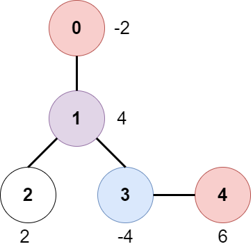
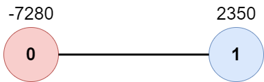

# 两遍 DFS（视频讲解）

> **[2467. 树上最大得分和路径](https://leetcode.cn/problems/most-profitable-path-in-a-tree/solutions/1964916/liang-bian-dfs-by-endlesscheng-da7j/) · Medium · 难度分 2053**

> **所属题单**
> - [链表、二叉树与回溯 · 三、一般树](../../../刷题路径/灵神原版题单/链表、二叉树与回溯/三、一般树.md) · §3.2 自顶向下 DFS

> **题目描述**
> 一个 `n` 个节点的无向树，节点编号为 `0` 到 `n - 1` ，树的根结点是 `0` 号节点。给你一个长度为 `n - 1` 的二维整数数组 `edges` ，其中 `edges[i] = [a_i, b_i]` ，表示节点 `a_i` 和 `b_i` 在树中有一条边。
>
> 在每一个节点 `i` 处有一扇门。同时给你一个都是偶数的数组 `amount` ，其中 `amount[i]` 表示：
>
> - 如果 `amount[i]` 的值是负数，那么它表示打开节点 `i` 处门扣除的分数。
>
> - 如果 `amount[i]` 的值是正数，那么它表示打开节点 `i` 处门加上的分数。
>
> 游戏按照如下规则进行：
>
> - 一开始，Alice 在节点 `0` 处，Bob 在节点 `bob` 处。
>
> - 每一秒钟，Alice 和 Bob **分别** 移动到相邻的节点。Alice 朝着某个 **叶子结点** 移动，Bob 朝着节点 `0` 移动。
>
> - 对于他们之间路径上的 **每一个** 节点，Alice 和 Bob 要么打开门并扣分，要么打开门并加分。注意：
>
>     - 如果门 **已经打开** （被另一个人打开），不会有额外加分也不会扣分。
>
>     - 如果 Alice 和 Bob **同时** 到达一个节点，他们会共享这个节点的加分或者扣分。换言之，如果打开这扇门扣 `c` 分，那么 Alice 和 Bob 分别扣 `c / 2` 分。如果这扇门的加分为 `c` ，那么他们分别加 `c / 2` 分。
>
> - 如果 Alice 到达了一个叶子结点，她会停止移动。类似的，如果 Bob 到达了节点 `0` ，他也会停止移动。注意这些事件互相 **独立** ，不会影响另一方移动。
>
> 请你返回 Alice 朝最优叶子结点移动的 **最大** 净得分。
>
> **示例 1：**
>
> 
>
> ```
> 输入：edges = [[0,1],[1,2],[1,3],[3,4]], bob = 3, amount = [-2,4,2,-4,6]
> 输出：6
> 解释：
> 上图展示了输入给出的一棵树。游戏进行如下：
> - Alice 一开始在节点 0 处，Bob 在节点 3 处。他们分别打开所在节点的门。
>   Alice 得分为 -2 。
> - Alice 和 Bob 都移动到节点 1 。
>   因为他们同时到达这个节点，他们一起打开门并平分得分。
>   Alice 的得分变为 -2 + (4 / 2) = 0 。
> - Alice 移动到节点 3 。因为 Bob 已经打开了这扇门，Alice 得分不变。
>   Bob 移动到节点 0 ，并停止移动。
> - Alice 移动到节点 4 并打开这个节点的门，她得分变为 0 + 6 = 6 。
> 现在，Alice 和 Bob 都不能进行任何移动了，所以游戏结束。
> Alice 无法得到更高分数。
> ```
>
> **示例 2：**
>
> 
>
> ```
> 输入：edges = [[0,1]], bob = 1, amount = [-7280,2350]
> 输出：-7280
> 解释：
> Alice 按照路径 0->1 移动，同时 Bob 按照路径 1->0 移动。
> 所以 Alice 只打开节点 0 处的门，她的得分为 -7280 。
> ```
>
> **提示：**
>
> - `2 <= n <= 10⁵`
>
> - `edges.length == n - 1`
>
> - `edges[i].length == 2`
>
> - `0 <= a_i, b_i < n`
>
> - `a_i != b_i`
>
> - `edges` 表示一棵有效的树。
>
> - `1 <= bob < n`
>
> - `amount.length == n`
>
> - `amount[i]` 是范围 `[-10⁴, 10⁴]` 之间的一个 **偶数** 。

> **题解**
> [视频讲解](https://www.bilibili.com/video/BV1gd4y1b7qj) 已出炉，欢迎点赞三连，在评论区分享你对这场双周赛的看法~
>
> ---
>
> 1. DFS，求出 $\textit{bob}$ 到 $0$ 的路径上，Bob 经过每个点的时间 $\textit{bobTime}$。
> 2. DFS，从 $0$ 到每个叶节点，按照题目要求累加 $\textit{amount}$，在叶子节点上更新答案的最大值。
>
> ```python
> class Solution:
>     def mostProfitablePath(self, edges: List[List[int]], bob: int, amount: List[int]) -> int:
>         n = len(edges) + 1
>         g = [[] for _ in range(n)]
>         for x, y in edges:
>             g[x].append(y)
>             g[y].append(x)  # 建树
>
>         bob_time = [n] * n  # bobTime[x] 表示 bob 访问节点 x 的时间
>         def dfs_bob(x: int, fa: int, t: int) -> bool:
>             if x == 0:
>                 bob_time[x] = t
>                 return True
>             for y in g[x]:
>                 if y != fa and dfs_bob(y, x, t + 1):
>                     bob_time[x] = t  # 只有可以到达 0 才标记访问时间
>                     return True
>             return False
>         dfs_bob(bob, -1, 0)
>
>         g[0].append(-1)  # 防止把根节点当作叶子
>         ans = -inf
>         def dfs_alice(x: int, fa: int, alice_time: int, tot: int) -> None:
>             if alice_time < bob_time[x]:
>                 tot += amount[x]
>             elif alice_time == bob_time[x]:
>                 tot += amount[x] // 2
>             if len(g[x]) == 1:  # 叶子
>                 nonlocal ans
>                 ans = max(ans, tot)  # 更新答案
>                 return
>             for y in g[x]:
>                 if y != fa:
>                     dfs_alice(y, x, alice_time + 1, tot)
>         dfs_alice(0, -1, 0, 0)
>         return ans
> ```
>
>
> #### 复杂度分析
>
> - 时间复杂度：$O(n)$，其中 $n$ 为树的节点个数，即 $\textit{edges}$ 的长度加一。
> - 空间复杂度：$O(n)$。
