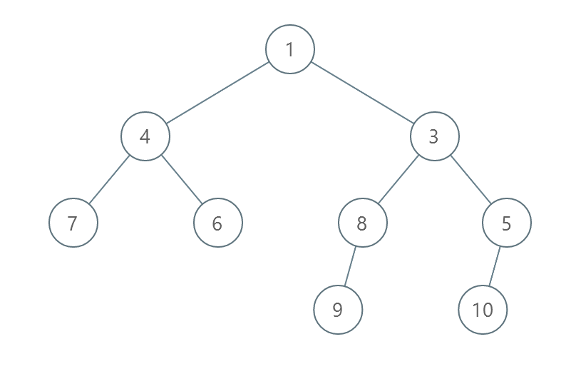
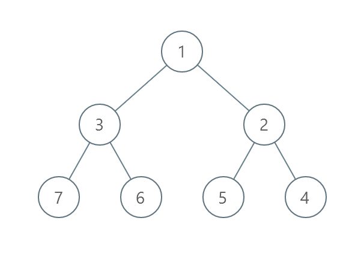
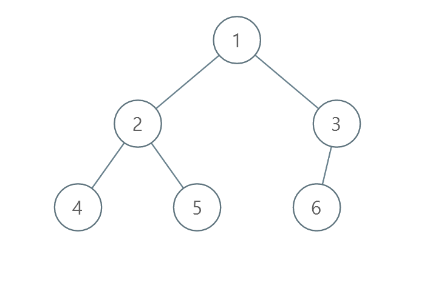

# BFS + 置换环 + 离散化

> **[2471. 逐层排序二叉树所需的最少操作数目](https://leetcode.cn/problems/minimum-number-of-operations-to-sort-a-binary-tree-by-level/solutions/1965422/by-endlesscheng-97i9/) · Medium · 难度分 1635**

> **所属题单**
> - [常用数据结构 · 七、并查集](../../../刷题路径/灵神原版题单/常用数据结构/七、并查集.md) · §7.2 进阶
> - [链表、二叉树与回溯 · 二、二叉树](../../../刷题路径/灵神原版题单/链表、二叉树与回溯/二、二叉树.md) · §2.13 二叉树 BFS

> **题目描述**
> 给你一个 **值互不相同** 的二叉树的根节点 `root` 。
>
> 在一步操作中，你可以选择 **同一层** 上任意两个节点，交换这两个节点的值。
>
> 返回每一层按 **严格递增顺序** 排序所需的最少操作数目。
>
> 节点的 **层数** 是该节点和根节点之间的路径的边数。
>
> **示例 1 ：**
>
> 
>
> ```
> 输入：root = [1,4,3,7,6,8,5,null,null,null,null,9,null,10]
> 输出：3
> 解释：
> - 交换 4 和 3 。第 2 层变为 [3,4] 。
> - 交换 7 和 5 。第 3 层变为 [5,6,8,7] 。
> - 交换 8 和 7 。第 3 层变为 [5,6,7,8] 。
> 共计用了 3 步操作，所以返回 3 。
> 可以证明 3 是需要的最少操作数目。
> ```
>
> **示例 2 ：**
>
> 
>
> ```
> 输入：root = [1,3,2,7,6,5,4]
> 输出：3
> 解释：
> - 交换 3 和 2 。第 2 层变为 [2,3] 。
> - 交换 7 和 4 。第 3 层变为 [4,6,5,7] 。
> - 交换 6 和 5 。第 3 层变为 [4,5,6,7] 。
> 共计用了 3 步操作，所以返回 3 。
> 可以证明 3 是需要的最少操作数目。
> ```
>
> **示例 3 ：**
>
> 
>
> ```
> 输入：root = [1,2,3,4,5,6]
> 输出：0
> 解释：每一层已经按递增顺序排序，所以返回 0 。
> ```
>
> **提示：**
>
> - 树中节点的数目在范围 `[1, 10⁵]` 。
>
> - `1 <= Node.val <= 10⁵`
>
> - 树中的所有值 **互不相同** 。

> **题解**
> [视频讲解](https://www.bilibili.com/video/BV13841187gz/) 已出炉，欢迎点赞三连，在评论区分享你对这场周赛的看法~
>
> ---
>
> 这是一个经典问题，做法是置换环。
>
> 例如在数组 $[2,0,1,4,3]$ 中，$[2,0,1]$ 和 $[4,3]$ 分别是两个置换环，环与环之间是数字是不需要发生交换的，只会在环内发生交换。
>
> 怎么找到环呢？从第一个数开始，把这个数字当成下标去访问数组，不断循环直到回到这个数本身。
>
> 我们只需要计算每个环内需要多少次交换。对于每个环，交换次数为环的大小减一。
>
> 代码实现时需要离散化。
>
> ```python
> class Solution:
>     def minimumOperations(self, root: Optional[TreeNode]) -> int:
>         ans, q = 0, [root]
>         while q:
>             a = []
>             tmp = q
>             q = []
>             for node in tmp:
>                 a.append(node.val)
>                 if node.left: q.append(node.left)
>                 if node.right: q.append(node.right)
>
>             n = len(a)
>             a = sorted(range(n), key=lambda i: a[i])  # 离散化
>
>             ans += n
>             vis = [False] * n
>             for v in a:
>                 if vis[v]: continue
>                 while not vis[v]:
>                     vis[v] = True
>                     v = a[v]
>                 ans -= 1
>         return ans
> ```
>
>
> #### 复杂度分析
>
> - 时间复杂度：$O(n\log n)$，其中 $n$ 为二叉树的节点个数。瓶颈在排序上，对于完全二叉树而言，最后一层的节点个数可以达到 $O(n)$。
> - 空间复杂度：$O(n)$。
>
> #### 相似题目
>
> - [765. 情侣牵手](https://leetcode.cn/problems/couples-holding-hands/)
