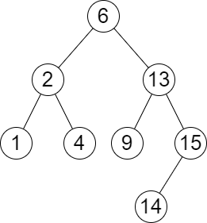
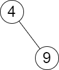

# 中序遍历+二分查找（Python/Java/C++/Go/JS/Rust）

> **[2476. 二叉搜索树最近节点查询](https://leetcode.cn/problems/closest-nodes-queries-in-a-binary-search-tree/solutions/2651916/zhong-xu-bian-li-er-fen-cha-zhao-pythonj-4ic0/) · Medium · 难度分 1597**

> **所属题单**
> - [二分算法 · 一、二分查找](../../../刷题路径/灵神原版题单/二分算法/一、二分查找.md) · §1.2 进阶
> - [链表、二叉树与回溯 · 二、二叉树](../../../刷题路径/灵神原版题单/链表、二叉树与回溯/二、二叉树.md) · §2.9 二叉搜索树

> **题目描述**
> 给你一个 **二叉搜索树** 的根节点 `root` ，和一个由正整数组成、长度为 `n` 的数组 `queries` 。
>
> 请你找出一个长度为 `n` 的 **二维** 答案数组 `answer` ，其中 `answer[i] = [min_i, max_i]` ：
>
> - `min_i` 是树中小于等于 `queries[i]` 的 **最大值** 。如果不存在这样的值，则使用 `-1` 代替。
>
> - `max_i` 是树中大于等于 `queries[i]` 的 **最小值** 。如果不存在这样的值，则使用 `-1` 代替。
>
> 返回数组 `answer` 。
>
> **示例 1 ：**
>
> 
>
> ```
>
> 输入：root = [6,2,13,1,4,9,15,null,null,null,null,null,null,14], queries = [2,5,16]
> 输出：[[2,2],[4,6],[15,-1]]
> 解释：按下面的描述找出并返回查询的答案：
> - 树中小于等于 2 的最大值是 2 ，且大于等于 2 的最小值也是 2 。所以第一个查询的答案是 [2,2] 。
> - 树中小于等于 5 的最大值是 4 ，且大于等于 5 的最小值是 6 。所以第二个查询的答案是 [4,6] 。
> - 树中小于等于 16 的最大值是 15 ，且大于等于 16 的最小值不存在。所以第三个查询的答案是 [15,-1] 。
> ```
>
> **示例 2 ：**
>
> 
>
> ```
>
> 输入：root = [4,null,9], queries = [3]
> 输出：[[-1,4]]
> 解释：树中不存在小于等于 3 的最大值，且大于等于 3 的最小值是 4 。所以查询的答案是 [-1,4] 。
> ```
>
> **提示：**
>
> - 树中节点的数目在范围 `[2, 10⁵]` 内
>
> - `1 <= Node.val <= 10⁶`
>
> - `n == queries.length`
>
> - `1 <= n <= 10⁵`
>
> - `1 <= queries[i] <= 10⁶`

> **题解**
> 首先，题目没说二叉搜索树是**平衡**的，最坏情况下这棵树是一条链，此时单次询问的复杂度是 $\mathcal{O}(n)$ 的，其中 $n$ 为二叉搜索树的节点个数。
>
> 为了加快回答询问的速度，可以通过一次 [94. 二叉树的中序遍历](https://leetcode.cn/problems/binary-tree-inorder-traversal/) 得到有一个**严格递增**数组 $a$，再在 $a$ 上做二分查找，就可以做到单次询问 $\mathcal{O}(\log n)$ 的时间了。
>
> 关于二分查找的原理，请看[【基础算法精讲 04】](https://www.bilibili.com/video/BV1AP41137w7/)。
>
> 设 $j$ 是大于等于 $q=\textit{queries}_i$ 的第一个数的下标，如果不存在则 $j=n$。
>
> 对于 $\textit{max}_i$：
>
> - 如果 $j<n$，那么 $\textit{max}_i = a[j]$。
> - 否则 $\textit{max}_i = -1$。
>
> 对于 $\textit{min}_i$：
>
> - 如果 $j<n$ 且 $a[j] = q$，那么 $\textit{min}_i = a[j]$。
> - 否则如果 $j>0$，那么 $\textit{min}_i = a[j-1]$。
> - 否则 $\textit{min}_i = -1$。
>
> ```python
> class Solution:
>     def closestNodes(self, root: Optional[TreeNode], queries: List[int]) -> List[List[int]]:
>         a = []
>         def dfs(node: Optional[TreeNode]) -> None:
>             if node is None:
>                 return
>             dfs(node.left)
>             a.append(node.val)
>             dfs(node.right)
>         dfs(root)
>
>         n = len(a)
>         ans = []
>         for q in queries:
>             j = bisect_left(a, q)
>             mx = a[j] if j < n else -1
>             if j == n or a[j] != q:  # a[j]>q, a[j-1]<q
>                 j -= 1
>             mn = a[j] if j >= 0 else -1
>             ans.append([mn, mx])
>         return ans
> ```
>
>
> #### 复杂度分析
>
> - 时间复杂度：$\mathcal{O}(n + q\log n)$，其中 $n$ 为二叉搜索树的节点个数，$q$ 为 $\textit{queries}$ 的长度。
> - 空间复杂度：$\mathcal{O}(n)$。返回值的空间不计入。
>
> [【题单】二分算法（二分答案/最小化最大值/最大化最小值/第K小）](https://leetcode.cn/circle/discuss/SqopEo/)
