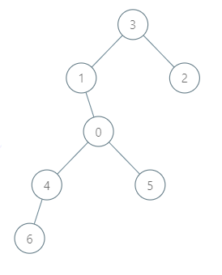
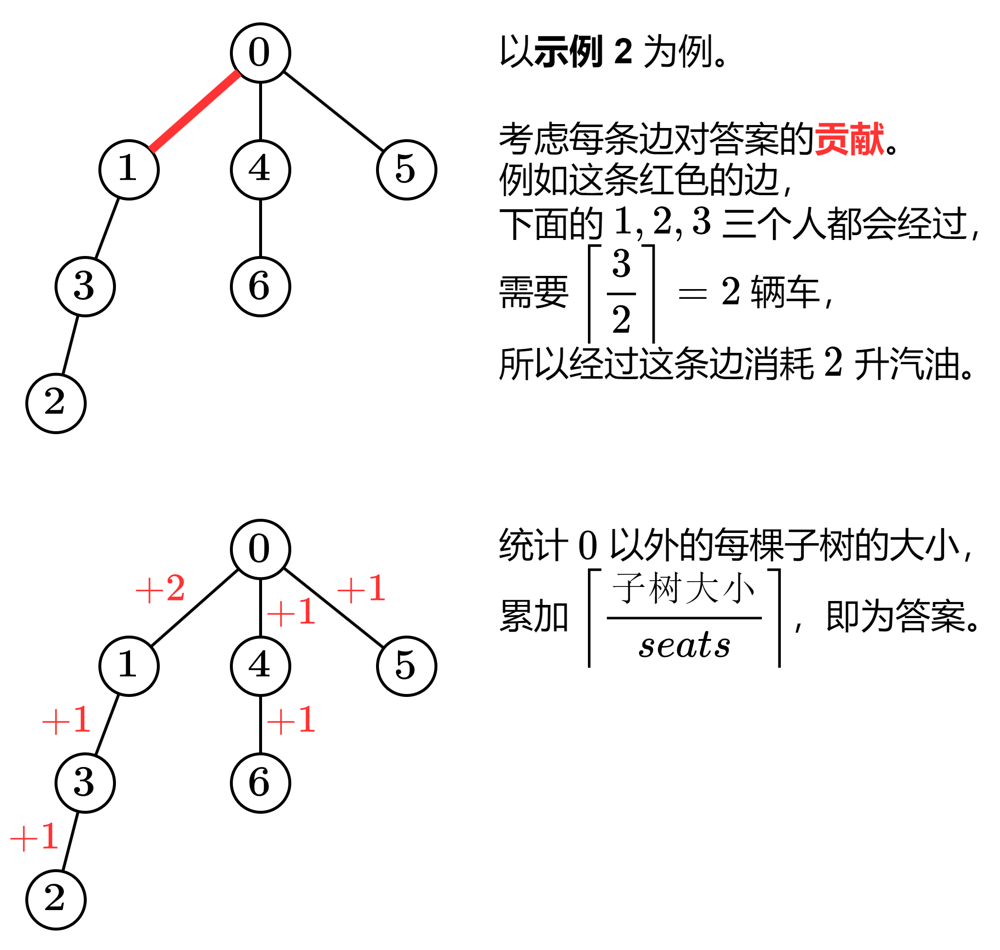

# 【图解】没有思路？一张图秒懂！（Python/Java/C++/Go/JS/Rust）

> **[2477. 到达首都的最少油耗](https://leetcode.cn/problems/minimum-fuel-cost-to-report-to-the-capital/solutions/1981361/kao-lu-mei-tiao-bian-shang-zhi-shao-xu-y-uamv/) · Medium · 难度分 2012**

> **所属题单**
> - [链表、二叉树与回溯 · 三、一般树](../../../刷题路径/灵神原版题单/链表、二叉树与回溯/三、一般树.md) · §3.3 自底向上 DFS
> - [贪心算法 · 五、思维题](../../../刷题路径/灵神原版题单/贪心算法/五、思维题.md) · §5.5 贡献法

> **题目描述**
> 给你一棵 `n` 个节点的树（一个无向、连通、无环图），每个节点表示一个城市，编号从 `0` 到 `n - 1` ，且恰好有 `n - 1` 条路。`0` 是首都。给你一个二维整数数组 `roads` ，其中 `roads[i] = [a_i, b_i]` ，表示城市 `a_i` 和 `b_i` 之间有一条 **双向路** 。
>
> 每个城市里有一个代表，他们都要去首都参加一个会议。
>
> 每座城市里有一辆车。给你一个整数 `seats` 表示每辆车里面座位的数目。
>
> 城市里的代表可以选择乘坐所在城市的车，或者乘坐其他城市的车。相邻城市之间一辆车的油耗是一升汽油。
>
> 请你返回到达首都最少需要多少升汽油。
>
> **示例 1：**
>
> 
>
> ```
> 输入：roads = [[0,1],[0,2],[0,3]], seats = 5
> 输出：3
> 解释：
> - 代表 1 直接到达首都，消耗 1 升汽油。
> - 代表 2 直接到达首都，消耗 1 升汽油。
> - 代表 3 直接到达首都，消耗 1 升汽油。
> 最少消耗 3 升汽油。
> ```
>
> **示例 2：**
>
> 
>
> ```
> 输入：roads = [[3,1],[3,2],[1,0],[0,4],[0,5],[4,6]], seats = 2
> 输出：7
> 解释：
> - 代表 2 到达城市 3 ，消耗 1 升汽油。
> - 代表 2 和代表 3 一起到达城市 1 ，消耗 1 升汽油。
> - 代表 2 和代表 3 一起到达首都，消耗 1 升汽油。
> - 代表 1 直接到达首都，消耗 1 升汽油。
> - 代表 5 直接到达首都，消耗 1 升汽油。
> - 代表 6 到达城市 4 ，消耗 1 升汽油。
> - 代表 4 和代表 6 一起到达首都，消耗 1 升汽油。
> 最少消耗 7 升汽油。
> ```
>
> **示例 3：**
>
> 
>
> ```
> 输入：roads = [], seats = 1
> 输出：0
> 解释：没有代表需要从别的城市到达首都。
> ```
>
> **提示：**
>
> - `1 <= n <= 10⁵`
>
> - `roads.length == n - 1`
>
> - `roads[i].length == 2`
>
> - `0 <= a_i, b_i < n`
>
> - `a_i != b_i`
>
> - `roads` 表示一棵合法的树。
>
> - `1 <= seats <= 10⁵`

> **题解**
> 
>
> ```python
> class Solution:
>     def minimumFuelCost(self, roads: List[List[int]], seats: int) -> int:
>         g = [[] for _ in range(len(roads) + 1)]
>         for x, y in roads:
>             g[x].append(y)  # 记录每个点的邻居
>             g[y].append(x)
>
>         ans = 0
>         def dfs(x: int, fa: int) -> int:
>             size = 1
>             for y in g[x]:
>                 if y != fa:  # 递归子节点，不能递归父节点
>                     size += dfs(y, x)  # 统计子树大小
>             if x:  # x 不是根节点
>                 nonlocal ans
>                 ans += (size - 1) // seats + 1  # ceil(size/seats)
>             return size
>         dfs(0, -1)
>         return ans
> ```
>
>
> #### 复杂度分析
>
> - 时间复杂度：$O(n)$，其中 $n$ 为 $\textit{roads}$ 的长度。递归这棵树，每个节点至多访问一次。
> - 空间复杂度：$O(n)$。
>
> ## 相似题目
>
> - [979. 在二叉树中分配硬币](https://leetcode.cn/problems/distribute-coins-in-binary-tree/)，[我的题解](../../0900-0999/0979%20在二叉树中分配硬币/灵茶山艾府.md)
>
> 欢迎关注 [B站@灵茶山艾府](https://space.bilibili.com/206214)
>
> 更多精彩题解，请看 [往期题解精选（已分类）](https://github.com/EndlessCheng/codeforces-go/blob/master/leetcode/SOLUTIONS.md)
