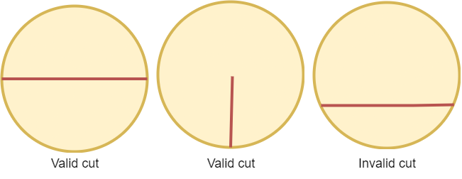

# 2481. 分割圆的最少切割次数

Easy · [力扣原题](https://leetcode.cn/problems/minimum-cuts-to-divide-a-circle/)

| 作者 | 题解 | 动画讲解 |
|---|---|---|
| 灵茶山艾府 | [📄 题解](灵茶山艾府.md) | [▶︎ 动画（GIF）](2481%20分割圆的最少切割次数%20·%20灵茶山艾府.gif) · [mp4 文件](2481%20分割圆的最少切割次数%20·%20灵茶山艾府.mp4) |
| yiduobo | [📄 题解](yiduobo.md) | [▶︎ 动画（GIF）](2481%20分割圆的最少切割次数%20·%20yiduobo.gif) · [mp4 文件](2481%20分割圆的最少切割次数%20·%20yiduobo.mp4) |

## 动画讲解

> 动图会循环播放；想暂停、拖进度条请下载上面表格里的 mp4 文件。

### 灵茶山艾府


### yiduobo


## 题目描述

圆内一个 **有效切割** ，符合以下二者之一：

- 该切割是两个端点在圆上的线段，且该线段经过圆心。

- 该切割是一端在圆心另一端在圆上的线段。

一些有效和无效的切割如下图所示。



给你一个整数 `n` ，请你返回将圆切割成相等的 `n` 等分的 **最少** 切割次数。

**示例 1：**


```

输入：n = 4
输出：2
解释：
上图展示了切割圆 2 次，得到四等分。
```

**示例 2：**


```

输入：n = 3
输出：3
解释：
最少需要切割 3 次，将圆切成三等分。
少于 3 次切割无法将圆切成大小相等面积相同的 3 等分。
同时可以观察到，第一次切割无法将圆切割开。
```

**提示：**

- `1 <= n <= 100`

---
[↑ 返回 2400-2499](../README.md) · [总索引](../../../索引.md) · [仓库首页](../../../README.md)
