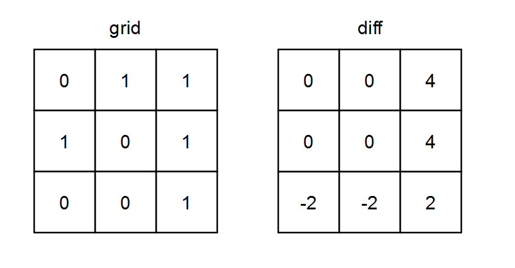
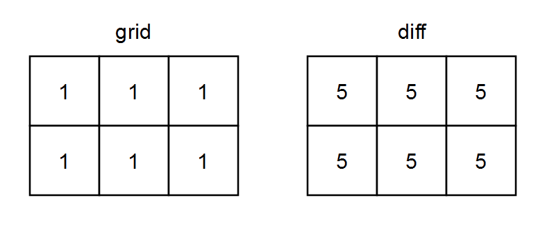

# 模拟 + 两个优化

> **[2482. 行和列中一和零的差值](https://leetcode.cn/problems/difference-between-ones-and-zeros-in-row-and-column/solutions/1993060/mo-ni-liang-ge-you-hua-by-endlesscheng-jldf/) · Medium**

> **题目描述**
> 给你一个下标从 **0** 开始的 `m x n` 二进制矩阵 `grid` 。
>
> 我们按照如下过程，定义一个下标从 **0** 开始的 `m x n` 差值矩阵 `diff` ：
>
> - 令第 `i` 行一的数目为 `onesRow_i` 。
>
> - 令第 `j` 列一的数目为 `onesCol_j`<sub> </sub>。
>
> - 令第 `i` 行零的数目为 `zerosRow_i` 。
>
> - 令第 `j` 列零的数目为 `zerosCol_j` 。
>
> - `diff[i][j] = onesRow_i + onesCol_j - zerosRow_i - zerosCol_j`
>
> 请你返回差值矩阵 `diff` 。
>
> **示例 1：**
>
> 
>
> ```
> 输入：grid = [[0,1,1],[1,0,1],[0,0,1]]
> 输出：[[0,0,4],[0,0,4],[-2,-2,2]]
> 解释：
> - diff[0][0] = onesRow₀ + onesCol₀ - zerosRow₀ - zerosCol₀ = 2 + 1 - 1 - 2 = 0
> - diff[0][1] = onesRow₀ + onesCol₁ - zerosRow₀ - zerosCol₁ = 2 + 1 - 1 - 2 = 0
> - diff[0][2] = onesRow₀ + onesCol₂ - zerosRow₀ - zerosCol₂ = 2 + 3 - 1 - 0 = 4
> - diff[1][0] = onesRow₁ + onesCol₀ - zerosRow₁ - zerosCol₀ = 2 + 1 - 1 - 2 = 0
> - diff[1][1] = onesRow₁ + onesCol₁ - zerosRow₁ - zerosCol₁ = 2 + 1 - 1 - 2 = 0
> - diff[1][2] = onesRow₁ + onesCol₂ - zerosRow₁ - zerosCol₂ = 2 + 3 - 1 - 0 = 4
> - diff[2][0] = onesRow₂ + onesCol₀ - zerosRow₂ - zerosCol₀ = 1 + 1 - 2 - 2 = -2
> - diff[2][1] = onesRow₂ + onesCol₁ - zerosRow₂ - zerosCol₁ = 1 + 1 - 2 - 2 = -2
> - diff[2][2] = onesRow₂ + onesCol₂ - zerosRow₂ - zerosCol₂ = 1 + 3 - 2 - 0 = 2
> ```
>
> **示例 2：**
>
> 
>
> ```
> 输入：grid = [[1,1,1],[1,1,1]]
> 输出：[[5,5,5],[5,5,5]]
> 解释：
> - diff[0][0] = onesRow₀ + onesCol₀ - zerosRow₀ - zerosCol₀ = 3 + 2 - 0 - 0 = 5
> - diff[0][1] = onesRow₀ + onesCol₁ - zerosRow₀ - zerosCol₁ = 3 + 2 - 0 - 0 = 5
> - diff[0][2] = onesRow₀ + onesCol₂ - zerosRow₀ - zerosCol₂ = 3 + 2 - 0 - 0 = 5
> - diff[1][0] = onesRow₁ + onesCol₀ - zerosRow₁ - zerosCol₀ = 3 + 2 - 0 - 0 = 5
> - diff[1][1] = onesRow₁ + onesCol₁ - zerosRow₁ - zerosCol₁ = 3 + 2 - 0 - 0 = 5
> - diff[1][2] = onesRow₁ + onesCol₂ - zerosRow₁ - zerosCol₂ = 3 + 2 - 0 - 0 = 5
> ```
>
> **提示：**
>
> - `m == grid.length`
>
> - `n == grid[i].length`
>
> - `1 <= m, n <= 10⁵`
>
> - `1 <= m * n <= 10⁵`
>
> - `grid[i][j]` 要么是 `0` ，要么是 `1` 。

> **题解**
> [视频讲解](https://www.bilibili.com/video/BV1uG4y157Rc) 已出炉，欢迎点赞三连，在评论区分享你对这场双周赛的看法~
>
> ---
>
> 按要求模拟。
>
> 优化 1：由于行和列都可以看成是 $1$ 的个数减去 $0$ 的个数，所以统计的时候，可以把 $0$ 当成 $-1$。
>
> 优化 2：答案可以直接填到 $\textit{grid}$ 中。
>
> ```python
> class Solution:
>     def onesMinusZeros(self, grid: List[List[int]]) -> List[List[int]]:
>         r = [0] * len(grid)
>         c = [0] * len(grid[0])
>         for i, row in enumerate(grid):
>             for j, x in enumerate(row):
>                 r[i] += x * 2 - 1
>                 c[j] += x * 2 - 1  # 1 -> 1, 0 -> -1
>         for i, x in enumerate(r):
>             for j, y in enumerate(c):
>                 grid[i][j] = x + y
>         return grid
> ```
>
>
> #### 复杂度分析
>
> - 时间复杂度：$O(mn)$，其中 $m$ 和 $n$ 分别为 $\textit{grid}$ 的行数和列数。
> - 空间复杂度：$O(m+n)$。
