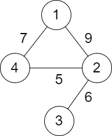

# 2492. 两个城市间路径的最小分数

Medium · 难度分 1680 · [力扣原题](https://leetcode.cn/problems/minimum-score-of-a-path-between-two-cities/)

所在刷题路径：灵神题单·图论算法

| 作者 | 题解 | 动画讲解 |
|---|---|---|
| 灵茶山艾府 | [📄 题解](灵茶山艾府.md) | [▶︎ 动画（GIF）](2492%20两个城市间路径的最小分数%20·%20灵茶山艾府.gif) · [mp4 文件](2492%20两个城市间路径的最小分数%20·%20灵茶山艾府.mp4) |
| yiduobo | [📄 题解](yiduobo.md) | [▶︎ 动画（GIF）](2492%20两个城市间路径的最小分数%20·%20yiduobo.gif) · [mp4 文件](2492%20两个城市间路径的最小分数%20·%20yiduobo.mp4) |

## 动画讲解

> 动图会循环播放；想暂停、拖进度条请下载上面表格里的 mp4 文件。

### 灵茶山艾府


### yiduobo


## 题目描述

给你一个正整数 `n` ，表示总共有 `n` 个城市，城市从 `1` 到 `n` 编号。给你一个二维数组 `roads` ，其中 `roads[i] = [a_i, b_i, distance_i]` 表示城市 `a_i` 和 `b_i` 之间有一条 **双向** 道路，道路距离为 `distance_i` 。城市构成的图不一定是连通的。

两个城市之间一条路径的 **分数** 定义为这条路径中道路的 **最小** 距离。

返回城市 `1` 和城市 `n` 之间的所有路径的 **最小** 分数。

**注意：**

- 一条路径指的是两个城市之间的道路序列。

- 一条路径可以 **多次** 包含同一条道路，你也可以沿着路径多次到达城市 `1` 和城市 `n` 。

- 测试数据保证城市 `1` 和城市`n` 之间 **至少** 有一条路径。

**示例 1：**



```

输入：n = 4, roads = [[1,2,9],[2,3,6],[2,4,5],[1,4,7]]
输出：5
解释：城市 1 到城市 4 的路径中，分数最小的一条为：1 -> 2 -> 4 。这条路径的分数是 min(9,5) = 5 。
不存在分数更小的路径。
```

**示例 2：**


```

输入：n = 4, roads = [[1,2,2],[1,3,4],[3,4,7]]
输出：2
解释：城市 1 到城市 4 分数最小的路径是：1 -> 2 -> 1 -> 3 -> 4 。这条路径的分数是 min(2,2,4,7) = 2 。
```

**提示：**

- `2 <= n <= 10⁵`

- `1 <= roads.length <= 10⁵`

- `roads[i].length == 3`

- `1 <= a_i, b_i <= n`

- `a_i != b_i`

- `1 <= distance_i <= 10⁴`

- 不会有重复的边。

- 城市 `1` 和城市 `n` 之间至少有一条路径。

---
[↑ 返回 2400-2499](../README.md) · [总索引](../../../索引.md) · [仓库首页](../../../README.md)
