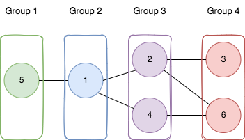

# 枚举起点跑 BFS（Python/Java/C++/Go）

> **[2493. 将节点分成尽可能多的组](https://leetcode.cn/problems/divide-nodes-into-the-maximum-number-of-groups/solutions/2005131/mei-ju-qi-dian-pao-bfs-by-endlesscheng-s5bu/) · Hard · 难度分 2415**

> **所属题单**
> - [图论算法 · 九、其他](../../../刷题路径/灵神原版题单/图论算法/九、其他.md)

> **题目描述**
> 给你一个正整数 `n` ，表示一个 **无向** 图中的节点数目，节点编号从 `1` 到 `n` 。
>
> 同时给你一个二维整数数组 `edges` ，其中 `edges[i] = [a_i, b_i]` 表示节点 `a_i` 和 `b_i`<sub> </sub>之间有一条 **双向** 边。注意给定的图可能是不连通的。
>
> 请你将图划分为 `m` 个组（编号从 **1** 开始），满足以下要求：
>
> - 图中每个节点都只属于一个组。
>
> - 图中每条边连接的两个点 `[a_i, b_i]` ，如果 `a_i` 属于编号为 `x` 的组，`b_i` 属于编号为 `y` 的组，那么 `|y - x| = 1` 。
>
> 请你返回最多可以将节点分为多少个组（也就是最大的 `m` ）。如果没办法在给定条件下分组，请你返回 `-1` 。
>
> **示例 1：**
>
> 
>
> ```
> 输入：n = 6, edges = [[1,2],[1,4],[1,5],[2,6],[2,3],[4,6]]
> 输出：4
> 解释：如上图所示，
> - 节点 5 在第一个组。
> - 节点 1 在第二个组。
> - 节点 2 和节点 4 在第三个组。
> - 节点 3 和节点 6 在第四个组。
> 所有边都满足题目要求。
> 如果我们创建第五个组，将第三个组或者第四个组中任何一个节点放到第五个组，至少有一条边连接的两个节点所属的组编号不符合题目要求。
> ```
>
> **示例 2：**
>
> ```
> 输入：n = 3, edges = [[1,2],[2,3],[3,1]]
> 输出：-1
> 解释：如果我们将节点 1 放入第一个组，节点 2 放入第二个组，节点 3 放入第三个组，前两条边满足题目要求，但第三条边不满足题目要求。
> 没有任何符合题目要求的分组方式。
> ```
>
> **提示：**
>
> - `1 <= n <= 500`
>
> - `1 <= edges.length <= 10⁴`
>
> - `edges[i].length == 2`
>
> - `1 <= a_i, b_i <= n`
>
> - `a_i != b_i`
>
> - 两个点之间至多只有一条边。

> **题解**
> [视频讲解](https://www.bilibili.com/video/BV15d4y147YF) 已出炉，包含如何判定二分图的讲解，欢迎点赞三连，在评论区分享你对这场周赛的看法~
>
> ---
>
> 题目所说的 $|y-x|=1$ 这个要求，其实就是 BFS 这张图，让同一层的节点分到同一个编号。
>
> 由于数据范围比较小，枚举每个点作为起点，跑 BFS，求出最大编号（最大深度）。
>
> 每个连通块的最大深度相加，即为答案。
>
> 进一步地，$|y-x|=1$ 这个要求，也可以看成是从某一点出发，通过两条**不同**路径到达另一个点时，这两条路径长度的奇偶性是相同的。
>
> 换句话说，图中所有的环都必须有偶数个顶点，这等价于图是二分图，判定方式见 [785. 判断二分图](https://leetcode.cn/problems/is-graph-bipartite/)，原理见视频讲解。
>
> ```python
> class Solution:
>     def magnificentSets(self, n: int, edges: List[List[int]]) -> int:
>         g = [[] for _ in range(n)]
>         for x, y in edges:
>             g[x - 1].append(y - 1)
>             g[y - 1].append(x - 1)
>
>         time = [0] * n  # 充当 vis 数组的作用（避免在 BFS 内部重复创建 vis 数组）
>         clock = 0
>         def bfs(start: int) -> int:  # 返回从 start 出发的最大深度
>             depth = 0
>             nonlocal clock
>             clock += 1
>             time[start] = clock
>             q = [start]
>             while q:
>                 tmp = q
>                 q = []
>                 for x in tmp:
>                     for y in g[x]:
>                         if time[y] != clock:  # 没有在同一次 BFS 中访问过
>                             time[y] = clock
>                             q.append(y)
>                 depth += 1
>             return depth
>
>         color = [0] * n
>         def is_bipartite(x: int, c: int) -> bool:  # 二分图判定，原理见视频讲解
>             nodes.append(x)
>             color[x] = c
>             for y in g[x]:
>                 if color[y] == c or color[y] == 0 and not is_bipartite(y, -c):
>                     return False
>             return True
>
>         ans = 0
>         for i, c in enumerate(color):
>             if c: continue
>             nodes = []
>             if not is_bipartite(i, 1): return -1  # 如果不是二分图（有奇环），则无法分组
>             # 否则一定可以分组
>             ans += max(bfs(x) for x in nodes)  # 枚举连通块的每个点，作为起点 BFS，求最大深度
>         return ans
> ```
>
>
> #### 复杂度分析
>
> - 时间复杂度：$O(nm)$，其中 $m$ 为 $\textit{edges}$ 的长度。
> - 空间复杂度：$O(n+m)$。
