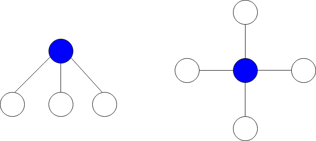
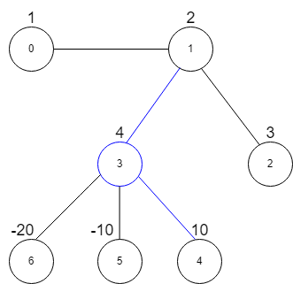

# 枚举+排序

> **[2497. 图中最大星和](https://leetcode.cn/problems/maximum-star-sum-of-a-graph/solutions/2015684/mei-ju-pai-xu-by-endlesscheng-pblv/) · Medium**

> **题目描述**
> 给你一个 `n` 个点的无向图，节点从 `0` 到 `n - 1` 编号。给你一个长度为 `n` 下标从 **0** 开始的整数数组 `vals` ，其中 `vals[i]` 表示第 `i` 个节点的值。
>
> 同时给你一个二维整数数组 `edges` ，其中 `edges[i] = [a_i, b_i]` 表示节点 `a_i` 和 `b_i` 之间有一条双向边。
>
> **星图** 是给定图中的一个子图，它包含一个中心节点和 `0` 个或更多个邻居。换言之，星图是给定图中一个边的子集，且这些边都有一个公共节点。
>
> 下图分别展示了有 `3` 个和 `4` 个邻居的星图，蓝色节点为中心节点。
>
> 
>
> **星和** 定义为星图中所有节点值的和。
>
> 给你一个整数 `k` ，请你返回 **至多** 包含 `k` 条边的星图中的 **最大星和** 。
>
> **示例 1：**
>
> 
>
> ```
> 输入：vals = [1,2,3,4,10,-10,-20], edges = [[0,1],[1,2],[1,3],[3,4],[3,5],[3,6]], k = 2
> 输出：16
> 解释：上图展示了输入示例。
> 最大星和对应的星图在上图中用蓝色标出。中心节点是 3 ，星图中还包含邻居 1 和 4 。
> 无法得到一个和大于 16 且边数不超过 2 的星图。
> ```
>
> **示例 2：**
>
> ```
> 输入：vals = [-5], edges = [], k = 0
> 输出：-5
> 解释：只有一个星图，就是节点 0 自己。
> 所以我们返回 -5 。
> ```
>
> **提示：**
>
> - `n == vals.length`
>
> - `1 <= n <= 10⁵`
>
> - `-10⁴ <= vals[i] <= 10⁴`
>
> - `0 <= edges.length <= min(n * (n - 1) / 2``, 10⁵)`
>
> - `edges[i].length == 2`
>
> - `0 <= a_i, b_i <= n - 1`
>
> - `a_i != b_i`
>
> - `0 <= k <= n - 1`

> **题解**
> [视频讲解](https://www.bilibili.com/video/BV1kR4y1r7Df/) 已出炉，欢迎点赞三连，在评论区分享你对这场双周赛的看法~
>
> ---
>
> 建图，枚举中心节点，选择至多 $k$ 个最大的值为正数的邻居。
>
> ```python
> class Solution:
>     def maxStarSum(self, vals: List[int], edges: List[List[int]], k: int) -> int:
>         g = [[] for _ in vals]
>         for x, y in edges:
>             if vals[y] > 0: g[x].append(vals[y])
>             if vals[x] > 0: g[y].append(vals[x])
>         return max(v + sum(nlargest(k, a)) for v, a in zip(vals, g))
> ```
>
>
> #### 复杂度分析
>
> - 时间复杂度：$O(n+m\log n)$，其中 $n$ 为 $\textit{vals}$ 的长度，$m$ 为 $\textit{edges}$ 的长度。用快速选择算法可以做到 $O(n+m)$。
> - 空间复杂度：$O(n+m)$。
