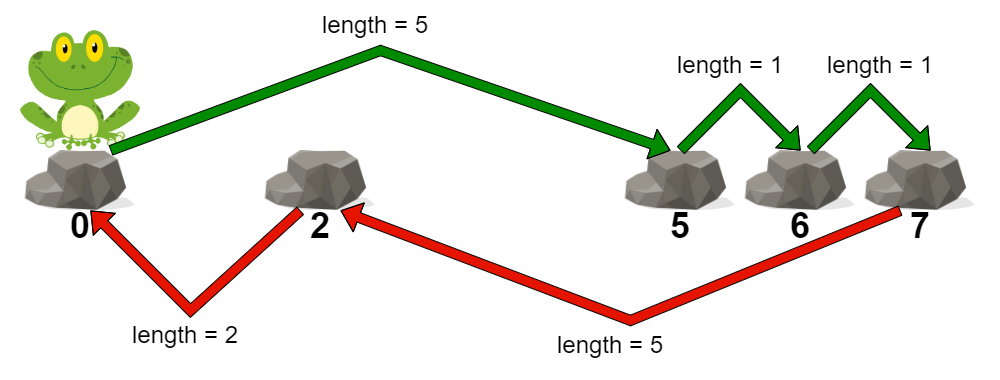
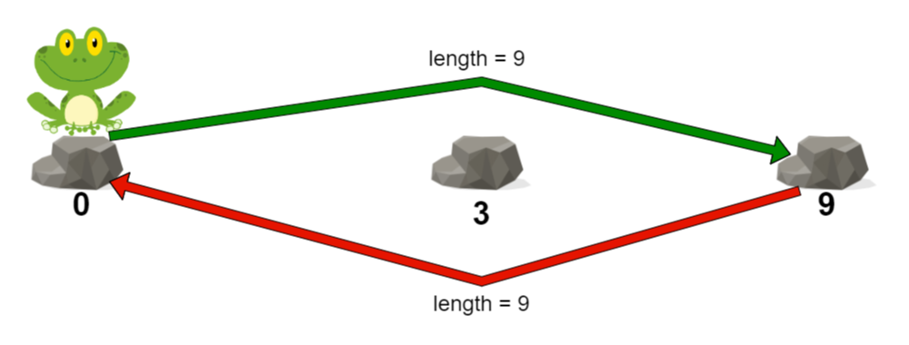

# 2498. 青蛙过河 II

Medium · 难度分 1759 · [力扣原题](https://leetcode.cn/problems/frog-jump-ii/)

所在刷题路径：灵神题单·贪心与思维

| 作者 | 题解 | 动画讲解 |
|---|---|---|
| 灵茶山艾府 | [📄 题解](灵茶山艾府.md) | [▶︎ 动画（GIF）](2498%20青蛙过河%20II%20·%20灵茶山艾府.gif) · [mp4 文件](2498%20青蛙过河%20II%20·%20灵茶山艾府.mp4) |
| yiduobo | [📄 题解](yiduobo.md) | [▶︎ 动画（GIF）](2498%20青蛙过河%20II%20·%20yiduobo.gif) · [mp4 文件](2498%20青蛙过河%20II%20·%20yiduobo.mp4) |

## 动画讲解

> 动图会循环播放；想暂停、拖进度条请下载上面表格里的 mp4 文件。

### 灵茶山艾府


### yiduobo


## 题目描述

给你一个下标从 **0** 开始的整数数组 `stones` ，数组中的元素 **严格递增** ，表示一条河中石头的位置。

一只青蛙一开始在第一块石头上，它想到达最后一块石头，然后回到第一块石头。同时每块石头 **至多** 到达 **一次。**

一次跳跃的 **长度** 是青蛙跳跃前和跳跃后所在两块石头之间的距离。

- 更正式的，如果青蛙从 `stones[i]` 跳到 `stones[j]` ，跳跃的长度为 `|stones[i] - stones[j]|` 。

一条路径的 **代价** 是这条路径里的 **最大跳跃长度** 。

请你返回这只青蛙的 **最小代价** 。

**示例 1：**



```

输入：stones = [0,2,5,6,7]
输出：5
解释：上图展示了一条最优路径。
这条路径的代价是 5 ，是这条路径中的最大跳跃长度。
无法得到一条代价小于 5 的路径，我们返回 5 。
```

**示例 2：**



```

输入：stones = [0,3,9]
输出：9
解释：
青蛙可以直接跳到最后一块石头，然后跳回第一块石头。
在这条路径中，每次跳跃长度都是 9 。所以路径代价是 max(9, 9) = 9 。
这是可行路径中的最小代价。
```

**提示：**

- `2 <= stones.length <= 10⁵`

- `0 <= stones[i] <= 10⁹`

- `stones[0] == 0`

- `stones` 中的元素严格递增。

---
[↑ 返回 2400-2499](../README.md) · [总索引](../../../索引.md) · [仓库首页](../../../README.md)
