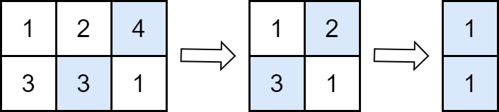
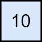

# 2500. 删除每行中的最大值

Easy · [力扣原题](https://leetcode.cn/problems/delete-greatest-value-in-each-row/)

| 作者 | 题解 | 动画讲解 |
|---|---|---|
| 灵茶山艾府 | [📄 题解](灵茶山艾府.md) | [▶︎ 动画（GIF）](2500%20删除每行中的最大值%20·%20灵茶山艾府.gif) · [mp4 文件](2500%20删除每行中的最大值%20·%20灵茶山艾府.mp4) |
| yiduobo | [📄 题解](yiduobo.md) | [▶︎ 动画（GIF）](2500%20删除每行中的最大值%20·%20yiduobo.gif) · [mp4 文件](2500%20删除每行中的最大值%20·%20yiduobo.mp4) |

## 动画讲解

> 动图会循环播放；想暂停、拖进度条请下载上面表格里的 mp4 文件。

### 灵茶山艾府


### yiduobo


## 题目描述

给你一个 `m x n` 大小的矩阵 `grid` ，由若干正整数组成。

执行下述操作，直到 `grid` 变为空矩阵：

- 从每一行删除值最大的元素。如果存在多个这样的值，删除其中任何一个。

- 将删除元素中的最大值与答案相加。

**注意** 每执行一次操作，矩阵中列的数据就会减 1 。

返回执行上述操作后的答案。

**示例 1：**



```

输入：grid = [[1,2,4],[3,3,1]]
输出：8
解释：上图展示在每一步中需要移除的值。
- 在第一步操作中，从第一行删除 4 ，从第二行删除 3（注意，有两个单元格中的值为 3 ，我们可以删除任一）。在答案上加 4 。
- 在第二步操作中，从第一行删除 2 ，从第二行删除 3 。在答案上加 3 。
- 在第三步操作中，从第一行删除 1 ，从第二行删除 1 。在答案上加 1 。
最终，答案 = 4 + 3 + 1 = 8 。
```

**示例 2：**



```

输入：grid = [[10]]
输出：10
解释：上图展示在每一步中需要移除的值。
- 在第一步操作中，从第一行删除 10 。在答案上加 10 。
最终，答案 = 10 。
```

**提示：**

- `m == grid.length`

- `n == grid[i].length`

- `1 <= m, n <= 50`

- `1 <= grid[i][j] <= 100`

---
[↑ 返回 2500-2599](../README.md) · [总索引](../../../索引.md) · [仓库首页](../../../README.md)
