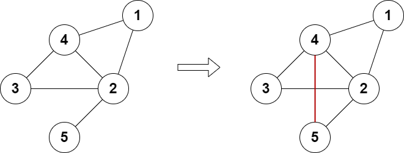

# 分类讨论（Python/Java/C++/Go）

> **[2508. 添加边使所有节点度数都为偶数](https://leetcode.cn/problems/add-edges-to-make-degrees-of-all-nodes-even/solutions/2024528/fen-lei-tao-lun-by-endlesscheng-z71j/) · Hard · 难度分 2060**

> **所属题单**
> - [图论算法 · 九、其他](../../../刷题路径/灵神原版题单/图论算法/九、其他.md)
> - [贪心算法 · 五、思维题](../../../刷题路径/灵神原版题单/贪心算法/五、思维题.md) · §5.8 分类讨论

> **题目描述**
> 给你一个有 `n` 个节点的 **无向** 图，节点编号为 `1` 到 `n` 。再给你整数 `n` 和一个二维整数数组 `edges` ，其中 `edges[i] = [a_i, b_i]` 表示节点 `a_i` 和 `b_i` 之间有一条边。图不一定连通。
>
> 你可以给图中添加 **至多** 两条额外的边（也可以一条边都不添加），使得图中没有重边也没有自环。
>
> 如果添加额外的边后，可以使得图中所有点的度数都是偶数，返回 `true` ，否则返回 `false` 。
>
> 点的度数是连接一个点的边的数目。
>
> **示例 1：**
>
> 
>
> ```
>
> 输入：n = 5, edges = [[1,2],[2,3],[3,4],[4,2],[1,4],[2,5]]
> 输出：true
> 解释：上图展示了添加一条边的合法方案。
> 最终图中每个节点都连接偶数条边。
> ```
>
> **示例 2：**
>
> 
>
> ```
>
> 输入：n = 4, edges = [[1,2],[3,4]]
> 输出：true
> 解释：上图展示了添加两条边的合法方案。
> ```
>
> **示例 3：**
>
> 
>
> ```
>
> 输入：n = 4, edges = [[1,2],[1,3],[1,4]]
> 输出：false
> 解释：无法添加至多 2 条边得到一个符合要求的图。
> ```
>
> **提示：**
>
> - `3 <= n <= 10⁵`
>
> - `2 <= edges.length <= 10⁵`
>
> - `edges[i].length == 2`
>
> - `1 <= a_i, b_i <= n`
>
> - `a_i != b_i`
>
> - 图中不会有重边

> **题解**
> [视频讲解](https://www.bilibili.com/video/BV1LW4y1T7if/) 已出炉，欢迎点赞三连，在评论区分享你对这场周赛的看法~
>
> ---
>
> 把度数为奇数的节点记到 $\textit{odd}$ 中，记 $m$ 为 $\textit{odd}$ 的长度，分类讨论：
>
> - 如果 $m=0$，那么已经符合要求。
> - 如果 $m=2$，记 $x=\textit{odd}[0],y=\textit{odd}[1]$：
>     - 如果 $x$ 和 $y$ 之间没有边，那么连边之后就符合要求了。
>     - 如果 $x$ 和 $y$ 之间有边，那么枚举 $[1,n]$ 的所有不为 $x$ 和 $y$ 的点 $i$，由于 $i$ 的度数一定是偶数，如果 $i$ 和 $x$ 以及 $i$ 和 $y$ 之间没有边，那么连边之后就符合要求了。
> - 如果 $m=4$，记 $a=\textit{odd}[0],b=\textit{odd}[1],c=\textit{odd}[2],d=\textit{odd}[3]$：
>     - 如果 $a$ 和 $b$ 以及 $c$ 和 $d$ 之间没有边，那么连边之后就符合要求了。
>     - 如果 $a$ 和 $c$ 以及 $b$ 和 $d$ 之间没有边，那么连边之后就符合要求了。
>     - 如果 $a$ 和 $d$ 以及 $b$ 和 $c$ 之间没有边，那么连边之后就符合要求了。
> - 其余情况无法满足要求。
>
> ```python
> class Solution:
>     def isPossible(self, n: int, edges: List[List[int]]) -> bool:
>         g = defaultdict(set)
>         for x, y in edges:
>             g[x].add(y)
>             g[y].add(x)
>         odd = [i for i, nb in g.items() if len(nb) % 2]
>         m = len(odd)
>         if m == 0: return True
>         if m == 2:
>             x, y = odd
>             return x not in g[y] or any(
>                 i != x and i != y and x not in g[i] and y not in g[i]
>                 for i in range(1, n + 1))
>         if m == 4:
>             a, b, c, d = odd
>             return b not in g[a] and d not in g[c] or \
>                    c not in g[a] and d not in g[b] or \
>                    d not in g[a] and c not in g[b]
>         return False
> ```
>
>
> #### 复杂度分析
>
> - 时间复杂度：$O(n+m)$，其中 $m$ 为 $\textit{edges}$ 的长度。
> - 空间复杂度：$O(n+m)$。
