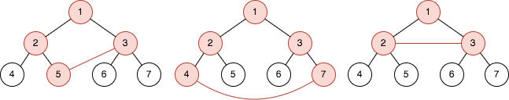
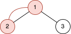

# 最近公共祖先 + 位运算优化时间复杂度（Python/Java/C++/Go）

> **[2509. 查询树中环的长度](https://leetcode.cn/problems/cycle-length-queries-in-a-tree/solutions/2024527/zui-jin-gong-gong-zu-xian-pythonjavacgo-v8ata/) · Hard · 难度分 1948**

> **所属题单**
> - [链表、二叉树与回溯 · 二、二叉树](../../../刷题路径/灵神原版题单/链表、二叉树与回溯/二、二叉树.md) · §2.16 其他
> - [位运算 · 八、思维题](../../../刷题路径/灵神原版题单/位运算/八、思维题.md)

> **题目描述**
> 给你一个整数 `n` ，表示你有一棵含有 `2^n - 1` 个节点的 **完全二叉树** 。根节点的编号是 `1` ，树中编号在`[1, 2^(n - 1) - 1]` 之间，编号为 `val` 的节点都有两个子节点，满足：
>
> - 左子节点的编号为 `2 * val`
>
> - 右子节点的编号为 `2 * val + 1`
>
> 给你一个长度为 `m` 的查询数组 `queries` ，它是一个二维整数数组，其中 `queries[i] = [a_i, b_i]` 。对于每个查询，求出以下问题的解：
>
> 1. 在节点编号为 `a_i` 和 `b_i` 之间添加一条边。
>
> 2. 求出图中环的长度。
>
> 3. 删除节点编号为 `a_i` 和 `b_i` 之间新添加的边。
>
> **注意：**
>
> - **环** 是开始和结束于同一节点的一条路径，路径中每条边都只会被访问一次。
>
> - 环的长度是环中边的数目。
>
> - 在树中添加额外的边后，两个点之间可能会有多条边。
>
> 请你返回一个长度为 `m` 的数组 `answer` ，其中 `answer[i]` 是第 `i` 个查询的结果<em>。</em>
>
> **示例 1：**
>
> 
>
> ```
>
> 输入：n = 3, queries = [[5,3],[4,7],[2,3]]
> 输出：[4,5,3]
> 解释：上图是一棵有 2³ - 1 个节点的树。红色节点表示添加额外边后形成环的节点。
> - 在节点 3 和节点 5 之间添加边后，环为 [5,2,1,3] ，所以第一个查询的结果是 4 。删掉添加的边后处理下一个查询。
> - 在节点 4 和节点 7 之间添加边后，环为 [4,2,1,3,7] ，所以第二个查询的结果是 5 。删掉添加的边后处理下一个查询。
> - 在节点 2 和节点 3 之间添加边后，环为 [2,1,3] ，所以第三个查询的结果是 3 。删掉添加的边。
> ```
>
> **示例 2：**
>
> 
>
> ```
>
> 输入：n = 2, queries = [[1,2]]
> 输出：[2]
> 解释：上图是一棵有 2² - 1 个节点的树。红色节点表示添加额外边后形成环的节点。
> - 在节点 1 和节点 2 之间添加边后，环为 [2,1] ，所以第一个查询的结果是 2 。删掉添加的边。
> ```
>
> **提示：**
>
> - `2 <= n <= 30`
>
> - `m == queries.length`
>
> - `1 <= m <= 10⁵`
>
> - `queries[i].length == 2`
>
> - `1 <= a_i, b_i <= 2^n - 1`
>
> - `a_i != b_i`

> **题解**
> [视频讲解](https://www.bilibili.com/video/BV1LW4y1T7if/) 已出炉，欢迎点赞三连，在评论区分享你对这场周赛的看法~
>
> ---
>
> # 方法一：暴力上跳到最近公共祖先
>
> 挨个回答每个询问。
>
> 环可以看成是从 $a$ 出发往上走，在某个位置「拐弯」，往下走到 $b$。
>
> 这个拐弯的地方就是 $a$ 和 $b$ 的**最近公共祖先**。
>
> 设 $\textit{LCA}$ 为 $a$ 和 $b$ 的最近公共祖先，那么环长等于 $\textit{LCA}$ 到 $a$ 的距离加 $\textit{LCA}$ 到 $b$ 的距离加一。
>
> 如何找 $\textit{LCA}$？
>
> 注意到在完全二叉树中，深度越深的点，其编号必定大于上一层的节点编号，根据这个性质，我们可以不断循环，每次循环比较 $a$ 和 $b$ 的大小：
>
> - 如果 $a>b$，则 $a$ 的深度大于等于 $b$ 的深度，那么把 $a$ 移动到其父节点，即 $a=a/2$；
> - 如果 $a<b$，则 $a$ 的深度小于等于 $b$ 的深度，那么把 $b$ 移动到其父节点，即 $b=b/2$；
> - 如果 $a=b$，则找到了 $\textit{LCA}$，退出循环。
>
> 循环次数加一即为环长。
>
> ```python
> class Solution:
>     def cycleLengthQueries(self, n: int, queries: List[List[int]]) -> List[int]:
>         for i, (a, b) in enumerate(queries):
>             res = 1
>             while a != b:
>                 if a > b: a //= 2
>                 else: b //= 2
>                 res += 1
>             queries[i] = res
>         return queries
> ```
>
>
> #### 复杂度分析
>
> - 时间复杂度：$O(nm)$，其中 $m$ 为 $\textit{queries}$ 的长度。回答一个询问的时间复杂度为 $O(n)$。
> - 空间复杂度：$O(1)$，仅用到若干额外变量。
>
> # 方法二：位运算优化
>
> 进一步挖掘完全二叉树的性质：节点编号的二进制的长度恰好等于节点深度。
>
> 以二进制下的 $a=110,\ b=11101$ 为例：
>
> 1. 算出两个节点的深度，分别为 $3$ 和 $5$，深度之差 $d=5-3=2$，那么把 $b$ 右移 $d$ 位（相当于上跳 $d$ 步），得到 $111$，这样 $b$ 就和 $a$ 在同一层了。
> 2. 如果此时 $a=b$，说明 $a$ 就是 $\textit{LCA}$，答案为 $d+1$。
> 3. 如果此时 $a\ne b$，计算 $a$ 异或 $b$ 的结果 $1$，它的二进制长度为 $L=1$，那么 $a$ 和 $b$ 需要各上跳 $L$ 步才能到达 $\textit{LCA}$，答案为 $d+2L+1$。
>
> ```python
> class Solution:
>     def cycleLengthQueries(self, n: int, queries: List[List[int]]) -> List[int]:
>         for i, (a, b) in enumerate(queries):
>             if a > b: a, b = b, a  # 保证 a <= b
>             d = b.bit_length() - a.bit_length()
>             queries[i] = d + (a ^ (b >> d)).bit_length() * 2 + 1
>         return queries
> ```
>
>
> #### 复杂度分析
>
> - 时间复杂度：$O(m)$，其中 $m$ 为 $\textit{queries}$ 的长度。回答一个询问的时间复杂度为 $O(1)$。
> - 空间复杂度：$O(1)$，仅用到若干额外变量。
