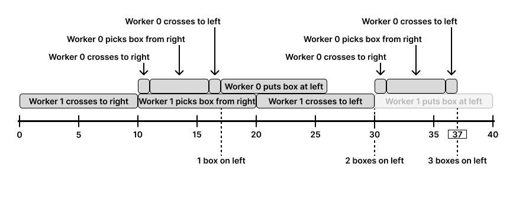

# 复杂模拟题如何思考？视频讲解！（Python/Java/C++/Go/JS）

> **[2532. 过桥的时间](https://leetcode.cn/problems/time-to-cross-a-bridge/solutions/2050900/by-endlesscheng-nzqo/) · Hard · 难度分 2589**

> **所属题单**
> - [常用数据结构 · 五、堆（优先队列）](../../../刷题路径/灵神原版题单/常用数据结构/五、堆（优先队列）.md) · §5.2 进阶
> - [常用数据结构 · 编程能力强化训练](../../../刷题路径/灵神原版题单/常用数据结构/编程能力强化训练.md) · Part C

> **题目描述**
> 共有 `k` 位工人计划将 `n` 个箱子从右侧的（旧）仓库移动到左侧的（新）仓库。给你两个整数 `n` 和 `k`，以及一个二维整数数组 `time` ，数组的大小为 `k x 4` ，其中 `time[i] = [right_i, pick_i, left_i, put_i]` 。
>
> 一条河将两座仓库分隔，只能通过一座桥通行。旧仓库位于河的右岸，新仓库在河的左岸。开始时，所有 `k` 位工人都在桥的左侧等待。为了移动这些箱子，第 `i` 位工人（下标从 **0** 开始）可以：
>
> - 从左岸（新仓库）跨过桥到右岸（旧仓库），用时 `right_i` 分钟。
>
> - 从旧仓库选择一个箱子，并返回到桥边，用时 `pick_i` 分钟。不同工人可以同时搬起所选的箱子。
>
> - 从右岸（旧仓库）跨过桥到左岸（新仓库），用时 `left_i` 分钟。
>
> - 将箱子放入新仓库，并返回到桥边，用时 `put_i` 分钟。不同工人可以同时放下所选的箱子。
>
> 如果满足下面任一条件，则认为工人 `i` 的 **效率低于** 工人 `j` ：
>
> - `left_i + right_i > left_j + right_j`
>
> - `left_i + right_i == left_j + right_j` 且 `i > j`
>
> 工人通过桥时需要遵循以下规则：
>
> - 同时只能有一名工人过桥。
>
> - 当桥梁未被使用时，优先让右侧 **效率最低** 的工人（已经拿起盒子的工人）过桥。如果不是，优先让左侧 **效率最低** 的工人通过。
>
> - 如果左侧已经派出足够的工人来拾取所有剩余的箱子，则 **不会** 再从左侧派出工人。
>
> 请你返回最后一个箱子 **到达桥左侧** 的时间。
>
> **示例 1：**
>
> **输入：**`n = 1, k = 3, time = [[1,1,2,1],[1,1,3,1],[1,1,4,1]]`
>
> **输出：**`6`
>
> **解释：**
>
> ```
>
> 从 0 到 1 分钟：工人 2 通过桥到达右侧。
> 从 1 到 2 分钟：工人 2 从右侧仓库拿起箱子。
> 从 2 到 6 分钟：工人 2 通过桥到达左侧。
> 从 6 到 7 分钟：工人 2 向左侧仓库放下箱子。
> 整个过程在 7 分钟后结束。我们返回 6 因为该问题要求的是最后一名工人到达桥梁左侧的时间。
> ```
>
> **示例 2：**
>
> **输入：**n = 3, k = 2, time = \[\[1,5,1,8],[10,10,10,10]]
>
> **输出：**37
>
> **解释：**
>
> ```
>
> 
> ```
>
> 最后一个盒子在37秒时到达左侧。请注意，我们并 **没有** 放下最后一个箱子，因为那样会花费更多时间，而且它们已经和工人们一起在左边。
>
> **提示：**
>
> - `1 <= n, k <= 10⁴`
>
> - `time.length == k`
>
> - `time[i].length == 4`
>
> - `1 <= left_i, pick_i, right_i, put_i <= 1000`

> **题解**
> 复杂模拟题，推荐观看 [视频讲解](https://www.bilibili.com/video/BV1KG4y1j73o/?t=16m25s)，详细介绍了本题的思考过程。
>
> ---
>
> 建立 $4$ 个堆，每个堆都记录工人下标 $i$ 和完成时间 $t$（到达桥的时间），这 $4$ 个堆**从左到右**分别表示:
>
> 1. $\textit{workL}$：新仓库正在放箱的工人；
> 2. $\textit{waitL}$：左边等待过桥的工人；
> 3. $\textit{waitR}$：右边等待过桥的工人；
> 4. $\textit{workR}$：旧仓库正在搬箱的工人。
>
> 记录当前时间 $\textit{cur}$，不断循环直到所有箱子被搬完，每次循环：
>
> 1. 把完成时间不超过 $\textit{cur}$ 的 $\textit{workL}$ 弹出，放入 $\textit{waitL}$ 中；
> 2. 把完成时间不超过 $\textit{cur}$ 的 $\textit{workR}$ 弹出，放入 $\textit{waitR}$ 中；
> 3. 如果 $\textit{waitR}$ 不为空，出堆，过桥，更新 $\textit{cur}$ 为过完桥的时间，然后把这个工人放入 $\textit{workL}$ 中（记录完成时间）；
> 4. 否则如果 $\textit{waitL}$ 不为空，出堆，过桥，更新 $\textit{cur}$ 为过完桥的时间，然后把这个工人放入 $\textit{workR}$ 中（记录完成时间），同时把 $n$ 减一；
> 5. 否则说明 $\textit{cur}$ 过小，找个最小的放箱/搬箱完成时间来更新 $\textit{cur}$。
>
> 循环结束后，不断弹出 $\textit{workR}$，过桥，最后一个工人过完桥的时间即为答案。
>
> 代码实现时，可以先把 $\textit{time}$ 从小到大**稳定排序**，这样下标越大的工人效率越低，只看下标就能比较工人的效率。
>
> ```python
> class Solution:
>     def findCrossingTime(self, n: int, k: int, time: List[List[int]]) -> int:
>         time.sort(key=lambda t: t[0] + t[2])  # 稳定排序
>         cur = 0
>         workL, waitL, waitR, workR = [], [[-i, 0] for i in range(k - 1, -1, -1)], [], []  # 下标越大效率越低
>         while n:
>             while workL and workL[0][0] <= cur:
>                 p = heappop(workL)
>                 p[0], p[1] = p[1], p[0]
>                 heappush(waitL, p)  # 左边完成放箱
>             while workR and workR[0][0] <= cur:
>                 p = heappop(workR)
>                 p[0], p[1] = p[1], p[0]
>                 heappush(waitR, p)  # 右边完成搬箱
>             if waitR:  # 右边过桥，注意加到 waitR 中的都是 <= cur 的（下同）
>                 p = heappop(waitR)
>                 cur += time[-p[0]][2]
>                 p[1] = p[0]
>                 p[0] = cur + time[-p[0]][3]
>                 heappush(workL, p)  # 放箱
>             elif waitL:  # 左边过桥
>                 p = heappop(waitL)
>                 cur += time[-p[0]][0]
>                 p[1] = p[0]
>                 p[0] = cur + time[-p[0]][1]
>                 heappush(workR, p)  # 搬箱
>                 n -= 1
>             elif len(workL) == 0: cur = workR[0][0]  # cur 过小，找个最小的放箱/搬箱完成时间来更新 cur
>             elif len(workR) == 0: cur = workL[0][0]
>             else: cur = min(workL[0][0], workR[0][0])
>         while workR:
>             t, i = heappop(workR)  # 右边完成搬箱
>             # 如果没有排队，直接过桥；否则由于无论谁先过桥，最终完成时间都一样，所以也可以直接计算
>             cur = max(t, cur) + time[-i][2]
>         return cur  # 最后一个过桥的时间
> ```
>
>
> #### 复杂度分析
>
> - 时间复杂度：$\mathcal{O}(n\log k)$。
> - 空间复杂度：$\mathcal{O}(k)$。
>
> ## 分类题单
>
> [如何科学刷题？](https://leetcode.cn/circle/discuss/RvFUtj/)
>
> 1. [滑动窗口与双指针（定长/不定长/单序列/双序列/三指针/分组循环）](https://leetcode.cn/circle/discuss/0viNMK/)
> 2. [二分算法（二分答案/最小化最大值/最大化最小值/第K小）](https://leetcode.cn/circle/discuss/SqopEo/)
> 3. [单调栈（基础/矩形面积/贡献法/最小字典序）](https://leetcode.cn/circle/discuss/9oZFK9/)
> 4. [网格图（DFS/BFS/综合应用）](https://leetcode.cn/circle/discuss/YiXPXW/)
> 5. [位运算（基础/性质/拆位/试填/恒等式/思维）](https://leetcode.cn/circle/discuss/dHn9Vk/)
> 6. [图论算法（DFS/BFS/拓扑排序/基环树/最短路/最小生成树/网络流）](https://leetcode.cn/circle/discuss/01LUak/)
> 7. [动态规划（入门/背包/划分/状态机/区间/状压/数位/数据结构优化/树形/博弈/概率期望）](https://leetcode.cn/circle/discuss/tXLS3i/)
> 8. [常用数据结构（前缀和/差分/栈/队列/堆/字典树/并查集/树状数组/线段树）](https://leetcode.cn/circle/discuss/mOr1u6/)
> 9. [数学算法（数论/组合/概率期望/博弈/计算几何/随机算法）](https://leetcode.cn/circle/discuss/IYT3ss/)
> 10. [贪心与思维（基本贪心策略/反悔/区间/字典序/数学/思维/脑筋急转弯/构造）](https://leetcode.cn/circle/discuss/g6KTKL/)
> 11. [链表、二叉树与回溯（前后指针/快慢指针/DFS/BFS/直径/LCA/一般树）](https://leetcode.cn/circle/discuss/K0n2gO/)
> 12. [字符串（KMP/Z函数/Manacher/字符串哈希/AC自动机/后缀数组/子序列自动机）](https://leetcode.cn/circle/discuss/SJFwQI/)
>
> [我的题解精选（已分类）](https://github.com/EndlessCheng/codeforces-go/blob/master/leetcode/SOLUTIONS.md)
>
> 欢迎关注 [B站@灵茶山艾府](https://space.bilibili.com/206214)
